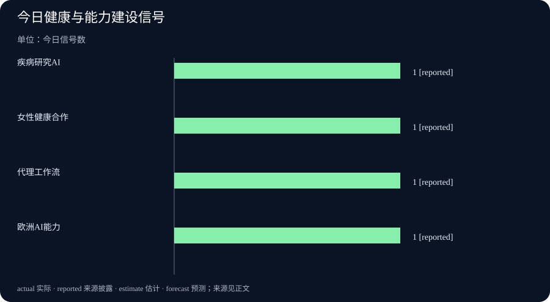

# Daily Intelligence｜健康 AI 进入产品与研究闭环

> 2026-10-13｜Asia/Shanghai｜早间版。检索锚点为 2026-10-13 06:57:13+08:00，回看 10 月 12 日首次公开的材料。Google、OpenAI 页面明确标注 10 月 12 日；涉及产品合作、研究介绍和活动回放，不能把公司叙述直接写成临床、收入或生产率结果。

## Today’s Thesis｜今天的判断

10 月 12 日的新增信息集中在 AI 进入健康、科研和国家技能体系：Google介绍用 AI 加速疾病研究，Google Health与 Flo Health 合作推进个性化女性健康，OpenAI Academy更新新闻机构工作流回放，OpenAI Forum讨论爱尔兰和欧洲的 AI 能力建设。共同主题是“把模型接入真实制度”，但可持续价值仍要经过数据质量、隐私、临床验证、组织采用和成本回报的连续检验。

## Executive Summary｜先看三条变化

- **AI 健康叙事从单点功能转向研究链**：Google称 AI 用于疾病检测、药物再利用和癌症识别，但页面是研究与平台介绍，不是临床试验结果。[Google Research](https://blog.google/innovation-and-ai/technology/health/ai-health-research/)
- **个性化健康合作扩大数据入口**：Google Health与 Flo Health宣布女性健康合作，涉及周期、孕期和更年期指导；个性化建议的准确性、隐私授权和实际健康改善仍待验证。[Google Health](https://blog.google/products-and-platforms/products/google-health/commitment-womens-health-flo-health-partnership/)
- **AI 能力建设被放进国家与组织议题**：OpenAI Forum关于爱尔兰和欧洲的回放讨论技能、基础设施和公共信任，活动观点不等于 GDP、就业或企业采用结果。[OpenAI Forum](https://forum.openai.com/public/videos/event-replay-building-ireland-and-europes-ai-advantage-innovation-competitiveness-and-skills)

## AI Daily｜AI 与产品

Google Research页面介绍 AI 如何用于疾病识别、药物再利用、酶设计和癌症检测。它的价值在于展示研究链条，而不是宣称某个模型已经替代医生或完成临床决策。页面没有把每项结果都对应到随机对照试验、监管批准或真实世界效果，因此读者应把它视为研发方向和平台能力的公开说明。[Google Research](https://blog.google/innovation-and-ai/technology/health/ai-health-research/)

Google Health与 Flo Health 的合作将周期、孕期和更年期信息连接到 Google Health Coach 和 Fitbit 设备。这样的产品会处理高度敏感的数据，问题不只是预测是否准确，还包括用户是否理解数据用途、能否撤回授权、模型是否会把相关性写成医学结论，以及出现错误时谁负责解释。[Google Health](https://blog.google/products-and-platforms/products/google-health/commitment-womens-health-flo-health-partnership/)

OpenAI Academy在 10 月 12 日更新新闻机构 ChatGPT Work 回放，继续强调代理、技能和插件如何推动多步骤任务。对编辑部来说，健康新闻尤其需要来源追踪、医学术语核对和人工审阅；代理能减少整理时间，却不能替代专业判断。[OpenAI Academy](https://academy.openai.com/public/clubs/news-organizations-b9osl/videos/webinar-intro-to-chatgpt-work-for-newsrooms-2026-08-26)

## Business Daily｜商业与产业

健康 AI 的商业模式正在从单一设备销售转向软件、订阅、研究合作和数据服务的组合。Google Health 的合作页面强调产品更新、教练和可穿戴设备，但没有披露新增用户、留存、支付转化或医疗结果。投资判断应把宣传覆盖面与可验证收入分开。

OpenAI Forum关于爱尔兰和欧洲 AI 优势的活动回放，讨论技能、基础设施、医疗与教育，以及公众信任。活动能帮助组织提出议题，却不等于已经完成算力投资、人才供给或企业部署。真正的产业指标包括培训后岗位转化、云与芯片投资、企业采用率、单位任务成本和合规事件。[OpenAI Forum](https://forum.openai.com/public/videos/event-replay-building-ireland-and-europes-ai-advantage-innovation-competitiveness-and-skills)

Google同时介绍 Fitbit Edge 与 Google Health 的新组合，页面标注 10 月 12 日并给出 10 月 27 日上市计划。上市日期和产品参数是商业计划，不等于实际销量、续费率或健康改善。[Google Fitbit](https://blog.google/products-and-platforms/devices/fitbit/google-fitbit-edge/)

健康产品还面临更高的合规成本。周期预测、症状记录与个性化建议需要数据治理、访问控制、模型更新和用户申诉流程。若数据合作扩大，却没有把用途、保留期限和撤回机制写清楚，用户增长可能同时带来更高的信任与监管风险。

## Macro Observation｜宏观观察

健康 AI 的宏观影响要通过公共卫生、人力资本与医疗支出传导。疾病研究工具如果缩短候选药物筛选时间，可能影响研发成本；但从研究平台到临床可用产品仍有验证、试验、监管和支付环节。不能用“发现速度”直接推导为医疗生产率。

欧洲 AI 能力建设的讨论把技能和基础设施放在一起，说明人才培训不能脱离算力、数据和公共采购。培训人数是投入指标，岗位转化、工资、企业采用和生产率才是结果指标。国家战略若没有明确的执行时间表与独立评估，仍属于方向性材料。

Google Health与 Flo Health 的合作也反映出健康数据的宏观分配问题。个性化服务可能改善部分用户的管理体验，但没有数据的人群、数字设备覆盖不足的人群和不愿共享敏感信息的人群，可能被排除在收益之外。评估时应同时看覆盖率、误差分布和不平等影响。

## Signal Dashboard｜信号仪表盘

| 信号 | 今日事实 | 边界 |
|---|---|---|
| 疾病研究 AI | Google介绍疾病检测、药物与酶设计方向 | 研究介绍，不是临床结论 |
| 女性健康产品 | Google Health与 Flo Health宣布合作 | 未披露健康结果与隐私治理细节 |
| 代理工作流 | OpenAI Academy更新新闻机构回放 | 活动材料，不是生产率评估 |
| 欧洲 AI 能力 | OpenAI Forum讨论技能、基础设施与信任 | 观点交流，不等于宏观结果 |

## Deep Insight｜深度观察

### 健康 AI 的价值单位不是建议，而是可验证的结果

健康产品最容易把“更个性化”误写成“更有效”。当应用收集周期、睡眠、活动和症状数据时，模型可以生成更加贴近个人的提醒；但提醒是否改变了行为，是否减少了延误，是否让用户更快获得正确的医疗帮助，必须通过长期指标验证。一个看似准确的预测，也可能因为数据缺失、测量偏差或用户误读而产生相反效果。

Google关于疾病研究的页面强调 AI 可以帮助识别遗传疾病、重新利用药物和改善癌症检测。对于研究人员，这些能力可能节省筛选时间；对于患者，真正重要的是后续实验是否确认机制、临床试验是否复现、监管机构是否批准，以及医生是否能够解释不确定性。研究平台的速度和临床决策的可靠性不是同一个指标。

女性健康合作还凸显了隐私和公平。周期、孕期和更年期数据具有长期敏感性，用户需要知道哪些数据由应用保存、哪些数据用于模型改进、哪些数据可以被合作方访问。模型还要接受不同年龄、疾病、药物和生活方式的误差测试。平均准确率很高，也可能掩盖少数群体持续收到错误提示的问题。

把 AI 放入新闻机构和国家技能讨论，则提供了组织层面的对照。新闻编辑部需要一个可追溯的研究和发布系统，国家层面需要技能、基础设施和公共信任。两者都不能只购买一个模型接口就结束。组织必须重写审批、培训、审计、事故响应和责任分配流程，才能把模型能力转为可持续服务。

从经营角度看，健康 AI 的部署还会产生一组容易被忽略的二阶成本。医疗机构需要把模型接入既有信息系统，处理格式转换、权限分层、备份和审计；医生需要花时间理解模型的置信度与适用范围；患者需要知道何时应当忽略建议并寻求人工帮助。若这些成本没有计入项目预算，早期试点可能看起来很便宜，扩展后却把负担转移给临床人员和用户。

数据偏差也会改变产品的商业边界。某类设备用户的数据更完整，并不代表没有设备的人不需要服务；某一地区的医学术语覆盖率较高，也不代表跨地区使用安全。企业要按年龄、地区、语言、设备和疾病状态拆分误差，而不是只公布总体平均值。对于敏感健康数据，还应明确谁可以导出、谁可以删除、模型更新是否会改变旧建议，以及用户如何申诉错误。

欧洲 AI 能力建设同样要回答“谁获得收益、谁承担风险”。技能计划若只面向已经具备数字基础的人，可能扩大而不是缩小差距；算力和数据中心投资若缺少能源、水资源和网络规划，也会出现新的基础设施瓶颈。公共信任不能靠口号建立，需要透明的采购、独立评估和可解释的事故处理。只有当培训、基础设施、企业采用和居民体验形成闭环，能力建设才可能转化为长期生产率。

这也是为什么今天的四个来源不应被拼成“AI 已经改变健康和经济”的大标题。它们各自提供了研究方向、产品合作、工作流教育和能力建设议题，证据层级不同。日报应保留这些边界，等待临床结果、隐私审计、付费数据、培训转岗和公共项目评估把方向变成结果。

## Tomorrow Watch｜明日值得追踪

- Google健康研究案例是否提供同行评审、数据集、临床试验或真实世界效果指标。
- Google Health与 Flo Health 是否公布数据治理、授权撤回、误差测试和地区可用性细节。
- 欧洲 AI 技能讨论是否转化为具体课程、算力投入、公共采购和岗位转化数据。
- 新闻机构代理工作流是否公开来源审计、人工接管率和单位任务成本。
- 健康 AI 产品是否对不同人群披露误差分布，而不只展示平均表现。

## One Chart｜一张图

本期图表只统计 10 月 12 日四个官方页面明确披露的方向信号，每类计数为 1，不代表市场规模、医疗效果或投资回报。

## Quote of the Day｜今日引用

> “Applying technology to understand and treat disease”

— Google Research，健康 AI 研究说明。[出处](https://blog.google/innovation-and-ai/technology/health/ai-health-research/)

中文：用技术理解并治疗疾病。这是页面标题，代表研究方向，不是对临床疗效的证明。

## Action Items｜今天值得思考什么

1. **健康建议如何验证？** 把预测准确率、临床复核、用户行为和长期健康结果分开记录。

2. **数据能否撤回？** 在产品上线前明确敏感数据用途、保留期限、合作方访问和授权撤回路径。

3. **培训带来什么结果？** 追踪 AI 技能培训后的岗位转化、工资、企业采用和未受益者支持。

4. **代理是否可审计？** 为新闻工作流保留来源、插件、版本、人工批准和撤回日志。

5. **谁被排除在外？** 按设备、收入、年龄和地区检查健康 AI 的覆盖率与错误分布，避免平均数掩盖差异。

## 信息边界

本报告以 2026-10-13 06:57:13+08:00 为编写锚点，优先使用 10 月 12 日公开的 Google、OpenAI 官方页面。产品合作、研究介绍和活动回放属于不同证据层级；未将公司叙述写成临床疗效、收入增长、生产率或就业结果。页面日期明确，但部分来源未提供小时，故不声称已证实处于严格小时级窗口。
