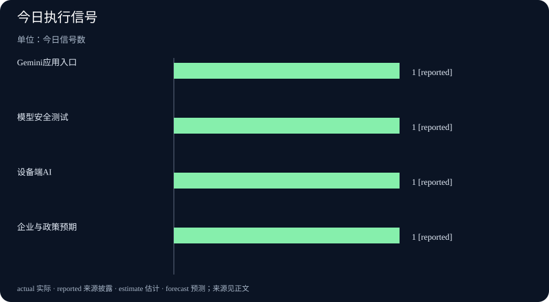

# Daily Intelligence｜代理能力进入产品与安全双轨

> 2026-10-14｜Asia/Shanghai｜早间版。检索锚点为 2026-10-14 07:02:45+08:00，回看 10 月 13 日首次公开材料。Google、科技部地方信息和中国政府网页面给出明确日期或发布时间；公司产品页、活动页和政策消息分别属于不同证据层级，不把发布、合作或演示直接写成已实现结果。

## Today’s Thesis｜今天的判断

10 月 13 日的新增信号把代理能力推进到三个相互牵制的轨道：Google把 Gemini 4 Argon 接入普通用户和开发者工作流，同时发布安全说明；Google Play把设备端 AI 创作和发现入口推向更多用户；中国政府网披露何立峰会见苹果董事长，强调跨国企业预期与合作。能力扩张越快，越需要把安全测试、权限控制、商业兑现和公共监督放在同一张表上。

## Executive Summary｜先看三条变化

- **Gemini 4 Argon 进入应用和开发者入口**：Google宣布模型在 Gemini 应用和开发者平台开放，强调长任务、编码和跨应用操作；可用性不等于所有任务都可靠。[Google 产品公告](https://blog.google/innovation-and-ai/products/gemini-app/gemini-4-argon-availability/)
- **安全说明与产品发布同步出现**：Google披露 Argon 的 Fairwind 计划、内部扫描和医院软件漏洞发现案例；安全叙述是风险控制说明，不是独立审计结论。[Google 安全说明](https://blog.google/innovation-and-ai/technology/safety-security/gemini-4-model-safety-security/)
- **跨国企业合作预期被放到宏观语境**：中国政府网披露何立峰会见苹果董事长，双方谈到中美关系稳定和苹果在华长期发展；会见不等于新增投资或销售结果。[中国政府网转载](https://www.ln.gov.cn/web/ywdt/rdgz/2026101308535834564/index.shtml)

## AI Daily｜AI 与产品

Google宣布 Gemini 4 Argon 在 Gemini 应用中可供订阅用户使用，并把聊天、编码和任务模式放到同一入口。页面称模型可以跨应用处理订餐、预约、设计和业务建设等任务。这种产品变化的关键不只是模型分数，而是权限、外部动作确认、失败恢复和用户能否随时停止。[Google Gemini 应用公告](https://blog.google/innovation-and-ai/products/gemini-app/gemini-4-argon-availability/)

同日发布的安全说明把 Argon 放入更长的风险控制链。Google称先通过 Fairwind 计划让网络防御人员使用，并由内部安全团队扫描关键系统；页面举例称发现医院软件关键漏洞，帮助保护患者记录。这个案例说明模型能提供安全线索，但不能替代补丁验证、供应商响应和独立复测。[Google安全说明](https://blog.google/innovation-and-ai/technology/safety-security/gemini-4-model-safety-security/)

Google Play更新则把 AI 入口继续下沉到设备：用户可以在设备上创建和运行个人 Android 应用，平台也增加 Ask Play、Game Finder 等发现工具。入口扩大可能提高尝试率，但会同步增加恶意应用、隐私泄露和内容质量控制压力。[Google Play更新](https://blog.google/products-and-platforms/platforms/google-play/google-play-updates-october-2026/)

## Business Daily｜商业与产业

Gemini 4 Argon 的开发者公告强调长周期软件工程、企业知识工作和网络防御，并允许通过付费 API 和 Google AI Studio 试用。对企业而言，真正的采购问题是任务总成本：上下文准备、调用次数、人工复核、错误回滚和数据隔离都要计入。模型开放并不自动带来正的单位经济性。[开发者公告](https://blog.google/innovation-and-ai/technology/developers-tools/build-with-gemini-4-argon/)

Google Ads 的 10 月 Demand Gen 更新也把“数据质量”放在转化和 ROI 之前。页面引用内部分析称，使用 Tag Gateway 的广告主平均转化提升超过 20%，并给出个案数据。内部分析和个案可以作为线索，却不能直接代表所有行业、预算规模或增量因果效果。[Google Ads](https://blog.google/products/ads-commerce/demand-gen-drop-october-2026/)

中国政府网消息显示，何立峰会见苹果公司执行董事长蒂姆·库克时，强调构建基于尊重、公平、对等的中美建设性战略稳定关系，为跨国企业提供稳定预期。苹果方面表达在华长期发展的信心。企业信心和政策表态需要通过供应链、投资、产品发布与销售数据检验。[中国政府网](https://www.ln.gov.cn/web/ywdt/rdgz/2026101308535834564/index.shtml)

## Macro Observation｜宏观观察

AI 模型的应用扩张与宏观环境之间存在多条传导链。开发者使用更强模型，可能降低软件开发的边际成本，但也可能增加算力、数据中心、电力和安全投入。企业若只看 API 单价，会低估合规、迁移和人工接管成本；若只看收入增长，也会忽略持续服务的基础设施负担。

跨国企业的政策预期则影响投资和供应链决策。会见消息能够降低部分不确定性，但不能直接推导出新增资本开支、出口增长或就业改善。宏观判断要继续观察企业公告、海关数据、产能安排、产品定价和本地生态投入。

广告数据更新提醒我们，AI 产品的商业叙事越来越依赖测量系统。转化提升如果来自更好的归因、样本选择或预算变化，就不能全部归因于模型或工具。投资者和经营者应要求实验组、对照组、时间窗口和增量口径，否则“提升”只是相关性描述。

## Signal Dashboard｜信号仪表盘

| 信号 | 今日事实 | 边界 |
|---|---|---|
| 模型进入应用 | Gemini 4 Argon 接入聊天、编码和任务模式 | 可用性不等于可靠完成率 |
| 安全控制同步发布 | Google披露 Fairwind 与内部扫描案例 | 公司说明不等于独立审计 |
| 设备端 AI | Google Play增加个人应用创建和发现工具 | 仍需观察隐私与滥用风险 |
| 商业与政策预期 | 中国政府网披露中美企业沟通 | 会见不等于新增投资和销量 |

## Deep Insight｜深度观察

### 代理能力的商业化，关键在于能否把失败成本显性化

模型进入应用之后，用户看到的往往是“任务完成”按钮，却看不到任务链中隐藏的依赖。订餐、预约、编码或安全扫描都需要多个外部系统，任何一个接口失效、权限过期、价格变化或网页内容被篡改，都可能让最终结果偏离用户意图。一个真正可用的代理系统必须在动作前展示范围、在动作中保留日志、在动作后提供撤销或补救路径。

Google对 Argon 的安全说明提供了一个积极但仍需谨慎的例子：模型发现医院软件漏洞，可能帮助安全团队更早定位问题。但漏洞发现只是第一步，医院还要确认是否真实存在、是否能被利用、补丁会不会影响临床系统，以及数十万条记录是否真的受到保护。若案例只披露“发现了漏洞”，却没有补丁上线、复测和误报数据，外界仍不能估算实际风险降低了多少。

设备端 AI 也会扩大责任范围。用户可以更容易创建个人应用和使用 AI 发现内容，这降低了开发门槛，却把安全、版权、儿童保护和隐私治理带到更多终端。平台需要告诉用户应用读取了什么数据、模型生成内容是否经过筛选、异常应用如何下架，以及用户是否可以恢复被错误修改的设置。只增加一个 AI 入口，不等于建立了完整的信任机制。

商业测量同样需要显性化失败成本。Google Ads 页面以转化提升说明数据质量价值，但广告主必须知道增量来自真正的新增客户，还是来自归因窗口改变、重复曝光和预算重分配。企业若把相关性直接当成因果性，短期报表会很好看，长期获客成本却可能上升。AI 工具的商业价值应由可重复实验和利润贡献衡量，而不是由界面更新数量衡量。

中美企业沟通说明，技术产品还受宏观与制度环境约束。苹果在华长期发展的表态有助于稳定预期，但供应链、研发、零售和服务投入仍需在后续公告中逐项确认。政策沟通提供方向，企业行动提供结果；两者之间的间隔正是日报需要持续追踪的地方。

如果把这些信号放到企业决策中，第一步不是立即更换模型，而是画出一张任务和责任地图。哪些步骤由模型完成，哪些步骤需要员工批准，哪些外部动作不可逆，哪些数据不得离开本地系统，都应在采购和上线前写清。对开发者来说，还要记录版本、提示词、工具调用和异常样本，保证模型升级后能解释结果为何改变。

安全测试也不能只在发布日完成。新模型接入金融、法律、医疗和网络防御后，风险会随工具权限、数据更新和用户规模变化。企业应建立持续红队测试、漏洞报告、回滚和事故通报机制，并把模型表现与系统整体表现区分开。模型在受控测试中成功，不代表在开放网络和复杂组织里同样稳定。

宏观层面，企业预期的改善需要多项数据互相印证。政策会见之后，可以观察订单、资本开支、供应商计划和就业；广告工具更新之后，可以观察增量转化、退订率和利润；设备端 AI 上线之后，可以观察恶意应用、隐私投诉和使用留存。将这些结果放回时间轴，才能区分一次性的发布效应与真正的结构变化。

## Tomorrow Watch｜明日值得追踪

- Gemini 4 Argon 的实际任务成功率、外部动作确认和用户可撤销机制。
- Fairwind 与医院软件漏洞案例是否提供补丁、复测、误报和独立验证细节。
- Google Play 设备端 AI 应用的权限、内容治理和儿童安全措施。
- Google Ads 转化提升是否有公开实验设计、对照组和增量利润数据。
- 苹果在华供应链、投资、产品与服务安排是否出现具体后续文件。

## One Chart｜一张图

本期图表只统计 10 月 13 日官方页面明确披露的四类执行信号，每类计数为 1，不代表市场份额、风险概率或财务回报。

## Quote of the Day｜今日引用

> “Gemini 4 Argon is designed for those long-horizon workflows that require deep reasoning and structural precision.”

— Google Developers，Gemini 4 Argon 开发者公告。[出处](https://blog.google/innovation-and-ai/technology/developers-tools/build-with-gemini-4-argon/)

中文：Gemini 4 Argon 面向需要深度推理和结构精度的长周期工作流。这是产品定位，不是对所有长任务可靠性的独立证明。

## Action Items｜今天值得思考什么

1. **代理如何停下来？** 在外部动作前展示权限、成本和影响范围，并保留人工确认与撤销入口。

2. **安全案例如何复测？** 为漏洞发现记录补丁、复测、误报和独立验证，避免把线索写成风险已消除。

3. **转化真的增量吗？** 要求实验组、对照组、归因窗口和利润贡献，区分相关性与因果性。

4. **设备端谁来负责？** 检查 AI 应用的数据访问、版权、儿童保护、下架和设置恢复机制。

5. **政策预期兑现了吗？** 跟踪苹果在华供应链、投资、产品与服务的后续公告，而不是停留在会见表态。

## 信息边界

本报告以 2026-10-14 07:02:45+08:00 为编写锚点，优先使用 10 月 13 日公开的 Google、中国政府网和科技平台官方页面。产品发布、安全说明、广告分析和政策会见属于不同证据层级；未将公司叙述写成独立审计、增量收入、漏洞风险已消除或宏观结果。部分页面未披露小时，故不声称已证实处于严格小时级窗口。
