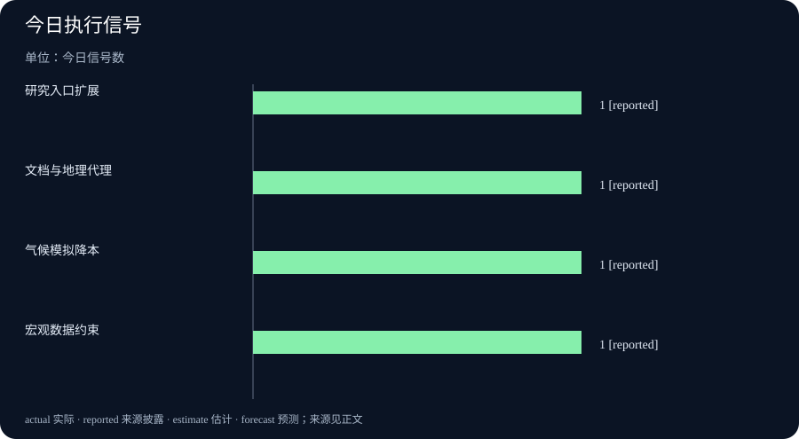

# Daily Intelligence｜研究能力转向可验证的工作流

> 2026-10-15｜Asia/Shanghai｜早间版。检索锚点为 2026-10-15 09:00:51+08:00，优先回看 10 月 14 日首次公开的一手页面。研究公告、经济数据和政策日程属于不同证据层级；页面日期不等于精确小时，数据所属期间也不等于发布日期。

## Today’s Thesis｜今天的判断

10 月 14 日的新增信号显示，AI 竞争正在从“模型是否更强”转向“能否进入专业工作流并留下可复核证据”。Google Research 把医疗、危机韧性和地球观测放到同一研究入口，Google 的 Deep Review 与 Earth AI 强调文档分析和地理代理，AI2则把极端天气模拟成本压低到更易使用的区间。与此同时，美国 CPI 和联储 Beige Book 继续提醒市场：宏观判断必须区分发布日期、统计期间和未来政策含义。

## Executive Summary｜先看三条变化

- **研究入口开始按问题组织**：Google Research@ 2026 同日推出医疗、危机韧性、Earth AI 与 Deep Review 等方向，说明产品边界正在从单一聊天转向领域工作流；研究展示不等于生产部署。[Google Research](https://blog.google/innovation-and-ai/technology/research/research-capabilities-intelligence-2026/)
- **AI 输出更强调可审阅链路**：Deep Review 面向技术文档，Earth AI 面向地理空间问题；用户得到的是检索、分析和代理组合，仍需要数据覆盖、引用质量与人工复核。[Google Research Blog](https://research.google/blog/?m=1)
- **宏观数据为 AI 投资提供约束**：美国 9 月 CPI 于 10 月 14 日发布，联储 Beige Book 同日覆盖此前数周经济活动；两者都不能直接证明下一期利率或企业利润路径。[BLS 发布日程](https://www.bls.gov/schedule/2026/)，[芝加哥联储日程](https://www.chicagofed.org/research/data/data-release-calendar)

## AI Daily｜AI 与产品

Google Research@ 2026 的公告把 AI 能力放进医疗、危机韧性和科学发现语境，并提到 AMIE、Earth AI 与 Project Suncatcher 等项目。页面强调“把研究带给专家”，这表明目标用户从普通问答者扩展到拥有领域流程和数据责任的组织。公告仍是研究方叙述，不能据此推导临床效果、灾害预警准确率或卫星项目已完成部署。[Google Research](https://blog.google/innovation-and-ai/technology/research/research-capabilities-intelligence-2026/)

Google Research 的最新列表同日列出 Deep Review、Earth AI 和“10 ways we're amplifying human ingenuity”。Deep Review 解决的是技术文档的长链分析，Earth AI 处理地理空间问题，二者共同指向“输入资料—形成中间证据—交付可审阅结果”的工作流。与聊天回答相比，这类系统的关键指标应包括引用覆盖、错误定位、数据新鲜度和人工修改成本，而不是只看一次回答的流畅度。[Google Research Blog](https://research.google/blog/?m=1)

AI2 发布 HiRO-ACEv2，称其能以 3 公里分辨率模拟极端降雨、风和气压事件，成本约为 X-SHiELD 的 1/300。这个数字来自研究机构的自述，实际价值仍取决于验证集、区域偏差、推理硬件和下游预警流程。较低计算成本可能扩大气候研究覆盖，但不能直接等同于更准确的天气预报。[AI2 Research](https://allenai.org/research)

## Business Daily｜商业与产业

研究型 AI 的商业化路径越来越依赖组织能否接住结果。医疗、政府和气候应用需要数据许可、责任边界、审计日志和人工审批；模型服务价格只是总成本的一部分。企业在评估 Deep Review 或 Earth AI 时，应同时计算数据整理、领域专家复核、失败重跑和版本迁移成本。

AI2 的成本说法也提示基础设施的另一面：若模拟更便宜，研究机构可能运行更多情景，带来数据存储、可视化和团队协作需求。需求增长是否会转化为采购、订阅或公共项目预算，需要看后续用户、许可方式和复现实验，而不是把单项技术指标写成收入预测。

美国 CPI 的发布日期对企业预算有直接参考价值，但该数据描述的是 9 月价格变化，不能直接替代 10 月通胀、工资或服务价格的实时判断。AI 供应商如果把算力、电力和云服务成本放进长期定价，就需要把宏观数据的滞后性纳入合同和容量规划。[BLS CPI 日程](https://www.bls.gov/schedule/2026/)

## Macro Observation｜宏观观察

联储 Beige Book 记录的是截至发布前各地区的经济活动和企业反馈，属于定性材料；CPI 是统计指标，二者回答的问题不同。把两者并列，可以帮助判断价格压力是否与企业招聘、消费和投资叙述一致，但不能据此预言联储下一次决定。真正有用的做法是持续记录发布时间、参考期间、修订可能性和市场反应。

AI 产业的宏观传导链也需要拆开：更低的模拟成本可能提高科研产出，更强的文档代理可能降低部分知识工作成本，但数据中心资本开支、能源使用、合规投入和专业人员需求可能同步上升。只有当企业披露生产率、毛利、资本开支和员工结构变化，才能判断技术效率是否转化为经营结果。

## Signal Dashboard｜信号仪表盘

| 信号 | 今日事实 | 边界 |
|---|---|---|
| 研究入口扩展 | Google Research@ 2026 同时覆盖医疗、危机韧性和科学发现 | 研究展示不等于生产部署 |
| 文档与地理代理 | Deep Review、Earth AI 被列为新研究方向 | 引用质量和数据覆盖仍待验证 |
| 气候模拟降本 | AI2 宣称 HiRO-ACEv2 以约 1/300 成本做高分辨率模拟 | 机构自述，需外部复现 |
| 宏观约束 | CPI 与 Beige Book 在 10 月 14 日进入观察窗口 | 发布日期、统计期间和政策含义不同 |

## Deep Insight｜深度观察

### 可验证工作流比单项模型能力更接近真实生产力

当 AI 进入专业场景，用户需要的不只是一个结论，而是一条可以回看的证据链。技术文档分析要说明使用了哪些版本、检索了哪些段落、哪些判断来自原文、哪些是模型推断；地理空间代理要说明数据的时间、分辨率、缺失区域和模型假设。没有这些中间层，专家无法快速发现错误，也无法在事故后重建决策过程。

Google Research@ 的研究组合具有代表性：医疗、危机韧性和地球观测看起来跨越多个行业，但共同需求是把复杂资料压缩成专家可审阅的步骤。模型越能调用工具，权限和日志越重要。一个系统如果能生成地图、提出干预建议或修改技术文件，就必须把写入权限、引用来源和人工审批放在任务界面内，而不是藏在后台策略中。

AI2 的 HiRO-ACEv2 把“成本”放到科学模型讨论中。成本下降有可能让研究者运行更多情景，进而提高极端事件的覆盖；也可能因为近似方法引入偏差，造成大量便宜但不可靠的结果。因此，成本指标要和基准误差、区域泛化、极端尾部表现以及复现实验一起阅读。便宜本身没有方向，只有在质量约束下才会形成生产力。

宏观数据则提供了组织采用 AI 的外部边界。CPI 描述过去一个月的价格变化，Beige Book 汇总更早时段的地区反馈；企业不能把某一次发布当天的市场反应当成长期成本趋势。对 AI 预算而言，最稳妥的做法是把算力、人工复核、数据治理和回滚成本分开记账，再用多期数据检验是否真的改善单位产出。

这也改变了采购的提问方式。与其问“哪个模型最强”，不如问“哪个工作流能够在错误出现时被定位、暂停和修复”。供应商需要提供版本锁定、引用导出、权限预览、审计日志和人工接管机制；客户需要准备代表性数据、失败样本和独立评测。只有双方都能复查过程，研究能力才可能稳定转化为业务能力。

未来几天应重点观察这些公告是否出现真实使用证据：研究项目是否开放数据或代码，客户是否披露部署后的误差与节省，气候模拟是否有独立基准，宏观数据是否改变企业的资本开支和招聘计划。这样才能把“新能力”与“新结果”分开。

还要留意研究系统与组织流程的耦合。医疗团队需要把模型建议接入临床审核，灾害管理部门需要把地理代理接入预警和资源调度，科研团队需要把文档代理接入同行评议和数据管理。每一条连接都可能成为新的故障点：输入资料过期、权限配置错误、责任人不在岗，都会让看似准确的输出失去行动价值。因此，评估不能只在模型层进行，也要在完整流程中进行。

对于投资者和经营者，发布日的叙事往往最容易掩盖时间差。Google Research的项目可能需要多年研究，AI2的模拟成本数字可能来自特定硬件和特定基准，CPI和Beige Book也分别反映不同的参考窗口。把这些材料放在同一时间轴上，可以避免将研究突破、成本下降和宏观改善误读为已经同步发生。日报后续应追踪公开版本、用户反馈、独立复现和预算变化。

## Tomorrow Watch｜明日值得追踪

- Google Deep Review 与 Earth AI 是否给出数据来源、引用覆盖和外部验证细节。
- AI2 HiRO-ACEv2 是否公开基准误差、区域泛化和复现实验材料。
- CPI 与 Beige Book 的发布日期和参考期间是否在企业成本、招聘与投资计划中留下可观测变化。
- 医疗、气候和政府用户是否披露人工审批、事故复盘和回滚机制。
- 研究型 AI 的低成本是否转化为持续预算，而不是一次性演示或活动热度。

## One Chart｜一张图

本期图表只统计 10 月 14 日官方或研究机构页面明确出现的四类信号，每类计数为 1，不代表准确率、市场份额或财务回报。

## Quote of the Day｜今日引用

> “This is the golden age of research and scientific discovery.”

— Yossi Matias，Google Research@ 2026 公告。[出处](https://blog.google/innovation-and-ai/technology/research/research-capabilities-intelligence-2026/)

中文：这是研究与科学发现的黄金时代。这是研究负责人对方向的判断，不是对具体项目结果或社会影响的独立证明。

## Action Items｜今天值得思考什么

1. **证据链完整吗？** 为每个 AI 结论保存原文段落、数据版本、工具调用和人工修改记录。

2. **低成本换来什么？** 同时记录模拟误差、区域泛化、复现实验和总拥有成本，不把单一成本数字写成生产力。

3. **宏观数据说的是什么？** 分开标注发布日期、参考期间、修订可能性和政策含义，避免把滞后数据当成实时信号。

4. **谁能暂停系统？** 在医疗、气候和政府工作流中预先定义权限、人工审批、回滚和事故通报路径。

5. **研究如何变成结果？** 追踪客户部署、预算、误差和长期留存，区分活动公告与已实现的业务改善。

## 信息边界

本报告以 2026-10-15 09:00:51+08:00 为编写锚点，优先使用 10 月 14 日公开的 Google Research、AI2、BLS 和联储相关官方页面。页面未提供统一的小时级发布时间，故不声称所有材料严格落在 24 小时窗口；CPI 的参考期为 2026 年 9 月，Beige Book 覆盖发布前若干周，均作为背景与约束，不冒充 10 月 14 日新发生的经济事实。
