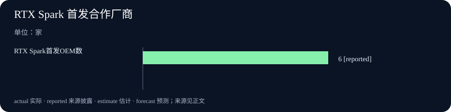

# Daily Intelligence｜AI走进本地设备与组织用工

> 2026-10-17｜Asia/Shanghai｜补编于 2026-10-18 07:06+08:00。报道截点严格限定在 2026-10-17 当日及此前已公开材料。优先核验的 AI 一手页面包括 Anthropic 10 月 16 日两篇研究（页面仅标日期、小时未披露）和 NVIDIA 10 月 17 日 RTX Spark 现场发布回顾；宏观一手数据于 10 月 16 日美国东部时间 08:30 与 09:15 按官方日程发布，换算为北京时间分别为 20:30 与 21:15，落在 10 月 17 日 07:00 锚点前 10 小时内。没有把更早消息伪装成当日新事件。

## Today’s Thesis｜今天的判断

10 月 17 日值得观察的不是又一项模型能力宣称，而是 AI 进入两类真实约束：一类是组织怎样重排工作与新人入口，另一类是个人设备能否承担本地推理。Anthropic披露的内部雇佣结构和自动代理工时，提示生产流程可能被重组，但单一供应商的自我研究不足以代表全行业；NVIDIA庆祝 RTX Spark 笔记本上市，则把本地 AI 的讨论推进到实际商品、价格与软件兼容层面。美国工业生产与进出口价格数据提供了产业和成本背景，但它们是 9 月的统计，不是 10 月 17 日的即时景气或 AI 投资回报。

## Executive Summary｜先看三条变化

- **新人岗位占比出现公司内变化**：Anthropic 研究称，初级技术岗位占其技术招聘比例由早期 2025 年的 27% 降至后续观察期的 9%；公司同时指出技术招聘绝对人数仍在增加。这是单家公司内部趋势，不能直接推断行业裁员或岗位总量萎缩。[Anthropic](https://www.anthropic.com/research/employment-at-anthropic)
- **可自动评估的 AI 科研任务显示效率潜力**：Anthropic称 Claude 在八类量子电路设计任务中提出了资源更少的方案，部分指标优于既有发表电路；这是研究团队所设基准与自动评分器上的结果，仍需独立复核和实机验证。[Anthropic Research](https://www.anthropic.com/research/designing-efficient-quantum-circuits)
- **本地 AI 进入零售产品阶段**：NVIDIA 10 月 17 日称 RTX Spark 笔记本已在全球多地举行零售发布活动，起价 2,399 美元，主打 Blackwell RTX、统一内存与本地 AI；宣称的峰值算力与体验并非等同于通用模型速度或买家实际收益。[NVIDIA](https://blogs.nvidia.com/blog/local-ai-rtx-spark-windows-laptops-celebration/)

## AI Daily｜AI 与产品

Anthropic 10 月 16 日发布《How employment is changing at Anthropic》，研究其内部雇佣、代理使用、产出和日历数据。公司报告称，初级员工在技术部门中的占比从早期 2025 年的 21% 降至 14%，初级技术岗位在新技术招聘中的比例从 27% 降至 9%。与此同时，Anthropic表示技术岗位仍在绝对人数上增长，只是销售、财务、招聘等职能的扩张更快；因此比例下降不能简单写成“技术岗位减少”。该页还称，交互式代理工时在 2026 年 8 月达到员工工时的六倍，但这是按公司内部定义统计的代理使用量，并非六倍的人类劳动产出。[Anthropic就业研究](https://www.anthropic.com/research/employment-at-anthropic)

报告把变化与 AI 工具普及相联系，也列出规模扩张、组织职能变化等可能因素。三分之一左右的机器学习经理和五分之一的软件工程经理在公司调查中表示因 AI 减少招聘；这属于内部调查回答，不代表已经确认的因果效应。对行业判断更有价值的信号是，企业可能先改变任务组合和初级岗位培训路径，再决定是否调整岗位总数。管理者也报告会议时间增加，说明自动化产出的文本和任务需要更多协调、审阅与决策注意力。

另一篇 Anthropic 研究《Designing more efficient quantum circuits with Claude》为模型提供八个电路任务的自然语言规格和自动评估器，让 Claude 自主迭代设计。研究称多项电路在门数、量子比特或其他资源指标上优于此前发表的基准，某些差异达到数量级。成果在可计算评价任务上具有意义，因为电路可被模拟与计数，不只是让评审者主观评价语言流畅度；但“优于已发表电路”仍取决于任务定义、基准完整性、硬件连接限制与文献检索质量，不能推成量子计算机已经可实用，也不能替代同行独立重现。[Anthropic量子研究](https://www.anthropic.com/research/designing-efficient-quantum-circuits)

NVIDIA 10 月 17 日回顾 RTX Spark 笔记本零售上市活动，称来自 ASUS、Dell、HP、Lenovo、Microsoft、MSI 的设备起价 2,399 美元，并宣称最高 1 petaflop AI 算力、最高 128GB 统一内存。这里的核心产业变化，是 AI 运行位置从云端数据中心进一步延伸到个人设备：本地推理可能降低部分网络往返、帮助离线工作并让数据保留在设备端；但能耗、散热、电池续航、内存可用量、模型许可和持续更新仍决定实际价值。官方文章描述的是产品能力和上市信息，不是独立基准或长期用户表现。[NVIDIA上市回顾](https://blogs.nvidia.com/blog/local-ai-rtx-spark-windows-laptops-celebration/)

这些信号指向同一管理问题：AI 的进步要落到可验证的工作单元。量子电路任务有明确的自动评分器；雇佣报告有公司内部样本，但解释链更复杂；个人计算设备需要独立性能、功耗与软件兼容测量。若把不同证据等级混为一谈，演示成绩可能被直接换算成生产率或就业趋势。

## Business Daily｜商业与产业

Anthropic的内部报告把 AI 采购的回报问题延伸到人才管道。若代理替人完成部分编码、调试、合同处理或销售准备，企业可能改变岗位设计和招聘结构；初级员工少了可承担的任务，也可能失去在真实项目中积累经验的入口。另一方面，企业增长阶段、非技术职能扩张和专业分工变化都能降低技术人员占比。因此管理层应追踪绝对招聘人数、初级岗位申请与录取、任务转移、导师投入和交付质量，而不是只看一个比例。

供应商自己的数据有两面价值：它能提供高频内部观察，却也有样本偏差和商业激励。Anthropic是 AI 工具的创造者和高强度使用者，工作方式可能比一般企业更早变化；但这不能证明传统行业会以同样速度、同样方式采用代理。后续最好对照公开岗位、工资、职级晋升、员工留任和多家公司面板数据。若“员工产出上升”只依据代码提交次数、销售触达数或合同处理量，还要检查质量、返工、安全事件和客户留存。

RTX Spark 笔记本的上市把本地 AI 商业化从路线图推进为可购买硬件。起售价和多个 OEM 合作关系有助于形成产品供给，但购买决策还需纳入 GPU 配置、可售地区、内存占用、实际可运行模型、续航、软件兼容和售后更新。高规格设备可能吸引开发者、创作者和重视本地数据处理的机构；这并不代表一般消费者会愿为峰值计算能力支付溢价。检验商业成功应看实际出货、复购、应用使用和本地推理工作负载，而非发布会活动数量。

对软件公司，本地硬件还可能改变成本结构：部分推理从按调用付费的云端转移到一次性设备成本，但模型更新、分发、权限管理和终端安全会增加新的支出。混合部署会成为可选架构：低敏感度或高算力任务仍放云端，受隐私和延迟约束的任务在设备或边缘运行。是否节省成本，需要比较总拥有成本、利用率和人工运维，而不是只比较一台设备与云 API 的标价。

## Macro Observation｜宏观观察

美国联邦储备委员会于 10 月 16 日东部时间 09:15 发布 G.17。数据显示 9 月工业生产月增 0.7%，8 月此前估值为 0.1%；第三季度年化增长 2.8%。9 月制造业产出增 0.3%，采矿增 0.2%，公用事业增 3.5%。这是工业部门对 9 月的初步统计，不是 10 月 17 日的实时生产速度；后续修订也可能改变月度比较。[Federal Reserve G.17](https://www.federalreserve.gov/releases/g17/20261016/g17.pdf)

美国劳工统计局于 10 月 16 日东部时间 08:30 发布 9 月进出口价格指数。进口价格月增 1.1%，出口价格月增 2.2%；进口价格同比增 8.1%，出口价格同比增 11.6%。报告指出非燃料与燃料进口价格均推动进口价格上涨。同比变化部分反映基期和过去一年累计传导，不能用来断言单月所有企业采购价格都上涨 8.1%。[U.S. BLS](https://www.bls.gov/news.release/archives/ximpim_10162026.htm)

两份官方统计提供的是不同截面：工业产出表现改善，贸易价格仍显著上升。价格与产量方向同时上行，可以给企业的资本支出和运营预算带来不同约束；但不能据此判断 AI 数据中心设备价格或芯片成本的具体变化，因为发布资料没有直接测量这些项目。评估算力投资时，需要进一步看服务器、半导体、电力合同、运输和进口构成的专门数据。

## Signal Dashboard｜信号仪表盘

| 信号 | 最新一手披露 | 统计或能力边界 |
|---|---|---|
| 初级技术招聘比例 | Anthropic称其内部比例由 27% 降至 9% | 供应商自身招聘结构，不代表行业总岗位 |
| 量子电路设计 | Claude 在八项研究任务上改进部分资源指标 | 自动基准结果，须独立重现和硬件评估 |
| 本地 AI 硬件 | RTX Spark 笔记本上市，官方起价 2,399 美元 | 峰值算力不等于通用推理表现或销量 |
| 美国工业生产 | 9 月月增 0.7%，Fed 10 月 16 日发布 | 9 月参考期，初值可能修订 |
| 美国进出口价格 | 9 月进口月增 1.1%，出口月增 2.2% | 9 月价格指数，不直接代表 AI 设备成本 |

## Deep Insight｜深度观察

### 自动化能力会先改变任务与入口，再改变岗位总量

Anthropic的报告提供了一个值得跟踪的组织切片：初级技术招聘占比下降，同时公司称技术岗位绝对数量继续增长。两者并不矛盾，可能意味着团队扩张时更偏向资深岗位，也可能反映销售、财务或其他职能扩张更快。要判断 AI 的劳动力效应，至少应分开观察人员总量、招聘结构、任务分工和生产质量。

初级工作往往包含明确但重复的任务，也提供学习机会。代码代理可以生成初稿、找错误或执行测试时，团队可能减少初级员工处理的部分工作；如果组织没有重新设计导师制和培训任务，未来资深人才供给可能受到影响。相反，代理也可能让新人更快完成原型并获得反馈。现有一家公司内部数据并不能回答哪种机制占主导，必须追踪晋升速度、员工流动、缺陷率和不同年龄段的实际任务分配。

报告还把注意力指出为新的限制：代理运行时间增加，可能提高文本、代码变更和待审批事项的数量，管理者要花更多精力审读、排序和授权。自动化减少的是部分执行摩擦，未必减少协调成本。若企业只奖励产出件数而不设审阅带宽和暂停条件，系统会把工作堆积转移给人类监督者，造成新的瓶颈。更好的评估单位应是从任务启动到可接受成果的总时间，并计入返工、审查、风险和维护。

量子电路研究展示了另一种更可检验的自动化路径。明确的规格、机器可判定的约束与自动评分器让模型能反复修改候选方案。它并不证明所有科学工作都能如此自动化，而是提示“任务可形式化程度”会影响 AI 工具的可靠性。当输出能够被形式验证、仿真或独立实验检查时，研究团队更容易分辨真实进步与流畅的错误。对于无法简化成单一评分的科学与商业决策，则需保留多指标、反例和专家判断。

本地 AI 硬件把上述问题带到企业设备治理。模型在本地运行可以减少部分数据跨域流动，但设备仍有账号、软件更新、模型权重、日志和外接代理权限等风险。若组织让代理在本地设备访问文件或执行操作，就要定义哪些动作可自动完成、哪些需要确认、如何撤销权限以及断网后的安全状态。设备“支持 AI”不等于工作流已受控。

因此，10 月 17 日的核心观察可以转成三项可执行指标：其一，用质量调整后的完成时间衡量代理是否真正减少工作；其二，记录初级岗位进入、导师投入与晋升的连续变化；其三，把本地设备的实测吞吐、能耗、兼容与安全成本纳入部署决策。未来若多家公司都出现类似岗位结构变化，同时独立生产率数据改善，才有理由把企业案例上升为劳动市场判断。

## Tomorrow Watch｜明日值得追踪

- RTX Spark 的实测模型速度、功耗、续航和兼容性是否有独立测量，而非只引用峰值算力。
- Anthropic未来是否公开可复核的岗位总量、员工流动、质量和非技术部门样本，帮助分辨结构变化的原因。
- 量子电路研究能否由外部团队复现，并在明确硬件拓扑约束下保持资源优势。
- 9 月工业生产与贸易价格后续修订是否改变初值；不要把修订后的系列误当作 10 月 17 日已知信息。
- 企业本地与云端推理的总拥有成本、数据治理和任务质量是否出现可比较的公开指标。

## One Chart｜一张图

图表把本期可核验信号按主题计数：AI 与产品三条、美国宏观数据两条。计数表示本期纳入的一手材料数量，不代表行业发生频率、市场份额或统计估计。

## Quote of the Day｜今日引用

> “Industrial production increased 0.7 percent in September after edging up 0.1 percent in August.”

— 美国联邦储备委员会，G.17 工业生产统计，2026-10-16 09:15 EDT。[原始发布](https://www.federalreserve.gov/releases/g17/20261016/g17.pdf)

中文：9 月工业生产增长 0.7%，此前 8 月小幅增长 0.1%。这是官方月度统计中的初步估计，描述的是 9 月参考期，不等于 10 月 17 日的经济增速。

## Action Items｜今天值得思考什么

1. **岗位入口如何变化？** 建立初级岗位申请、招聘、晋升和离职的季度面板，避免把一家公司的占比变化直接推成行业就业结论。

2. **代理产出算不算完成？** 将代码、合同或销售任务的数量与返工、缺陷、审批时间和客户结果共同记录。

3. **本地设备真的更合算吗？** 比较模型能力、设备折旧、利用率、电力、软件、支持和安全成本，再决定本地与云端的任务分工。

4. **研究结果可以复现吗？** 对量子电路基准核对任务规格、文献基线、硬件限制和外部复现记录。

5. **宏观数字对应哪段时间？** 记录发布日期、统计参考月、初值或修订状态，避免把 9 月生产与价格说成 10 月即时事实。

## 信息边界

本期报道截止于 2026-10-17，实际补编时间为 2026-10-18 07:06+08:00。Anthropic两篇研究页面标注 2026-10-16，但页面未披露小时，故保留发布日期并将精确小时列为未知；不能声称已证实落在严格 24 小时窗口。NVIDIA文章标注 2026-10-17，亦未披露小时。Fed G.17 发布时刻为 10 月 16 日 09:15 EDT，BLS 进出口价格发布时刻为 10 月 16 日 08:30 EDT，二者按官方日程换算均在本期 10 月 17 日 07:00+08:00 锚点前约 10 小时。Anthropic与NVIDIA为企业一手披露，其研究结论及产品宣传需要外部检验；宏观数字对应 2026 年 9 月，部分为初值，后续可能修订。未使用 10 月 18 日及之后材料。
