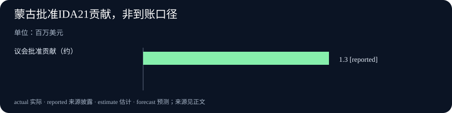

# Daily Intelligence｜搜索入口开放，代理接口与财政缓冲各有边界

> 2026-10-18｜Asia/Shanghai｜实际补编日期：2026-10-19。历史报道截点为 2026-10-18 08:00+08:00，优先观察窗口为此前 24 小时。OpenAI SDK 的官方发布时刻已核验处于窗口内；DeepSeek、IMFC 与世界银行页面标注 10 月 17 日，但小时未披露，不能声称三者均已证实落在严格 24 小时窗口。本稿未使用截点之后的消息。

## Today’s Thesis｜今天的判断

本期的变化集中在三个相互关联、却不能直接画等号的层面：DeepSeek把自研搜索能力开放给开发者，并更新现有模型；OpenAI在 Python SDK 中补上新的事件类型与服务档位参数；IMFC和世界银行则分别呈现了财政风险约束与一项具体的发展融资承诺。它们共同提示，代理系统的落地条件越来越取决于检索入口、软件接口和制度资源。但搜索接口开放不等于答案可靠，SDK增加字段不等于服务全面开放，批准贡献也不等于资金已经到账。比较这些变化，首先要把“可以调用”“实际可用”和“已经产生结果”分开。

## Executive Summary｜先看三条变化

- **搜索成为可单独接入的能力**：DeepSeek 10 月 17 日官方日志宣布开放自研搜索 API，并将 V4.1 Flash 升级为 V4.1-Flash-1017。官方称调用方式与价格保持不变；性能改进属于厂商评测，仍需实际任务检验。[DeepSeek 更新日志](https://api-docs.deepseek.com/updates/)
- **代理接口增加可表达的信息**：OpenAI Python SDK v3.35.0 新增 typed Live sideband events 与 Agents ultrafast service tier 支持，并修复实时连接的字节接收问题。该发布证明客户端代码发生变化，不能据此确认相关服务对所有用户可用、具有特定价格或达到特定延迟。[官方发布记录](https://github.com/openai/openai-python/releases/tag/v3.35.0)
- **增长机会仍受融资条件约束**：IMFC 10 月 17 日声明同时讨论技术投资机会、财政缓冲削弱和债务风险；世界银行当天宣布蒙古成为 IDA 捐助方，议会批准约 130 万美元贡献。前者是政策判断，后者是具体批准事项，均需继续追踪实施。[IMFC 主席声明](https://www.mof.go.jp/english/policy/international_policy/imf/imfc/261017ChairsStatement.pdf)、[世界银行公告](https://www.worldbank.org/en/news/press-release/2026/10/17/mongolia-becomes-a-donor-to-the-international-development-association-of-the-world)

## AI Daily｜AI 与产品

DeepSeek 的 10 月 17 日更新包含两个不同动作：开放自研搜索 API，以及更新既有 V4.1 Flash 模型至 V4.1-Flash-1017。官方表示网页端、App 和 API 已同步更新，开发者仍使用原有调用名称，计费方式未改。关于更短的任务运行时间、输出长度和更高的基准成绩，应明确归属为厂商报告；不同测试框架、工具配置与评分规则会影响结果，不能把某个分数直接换算为企业节省的工时。[DeepSeek](https://api-docs.deepseek.com/updates/)

搜索能力对代理的重要性，在于让系统获取模型训练之后的信息，并为回答提供可检查的材料入口。不过检索与核验是不同步骤：系统即使找到了权威域名，也可能取到旧版文件、只包含安排的会议页面，或把二手报道日期误认为原始披露日期。对实际工作流，应该保存查询、抓取版本、来源日期和引用片段，再要求生成的判断回到证据上。这个流程价值不能仅用搜索命中数量衡量。

另一项可核实变化来自 OpenAI 官方代码仓库。Python SDK v3.35.0 的发布时间为 2026-10-17 23:13:52 UTC，换算为北京时间 10 月 18 日 07:13:52，落在本期 08:00 截点前。发布说明列出 typed Live sideband events、Agents ultrafast service tier，以及针对 websockets 13 的字节接收修复。这是具体的客户端接口与兼容性更新；发布说明没有给出该档位的普遍可用范围、价格或性能承诺。[OpenAI Python SDK](https://github.com/openai/openai-python/releases/tag/v3.35.0)

对应用开发者，类型定义能让程序更明确地处理事件，兼容性修复能减少连接层面的意外，但业务可靠性仍要在完整链路上验证。需要观察断线重连、重复事件、取消请求、失败重试和权限撤销如何影响最终状态。SDK 版本升级可以成为检查这些环节的契机，却不能替代端到端验证，更不能仅凭一个名字推断服务速度。

## Business Daily｜商业与产业

搜索入口开放可能改变开发者采购与组合工具的方式。过去必须随模型一起使用的检索能力，如果能够独立接入，就为不同模型、索引和工作流之间的组合提供了选择。潜在价值是更明确地比较检索质量、来源覆盖、延迟与价格；实际约束包括授权范围、内容更新速度、抓取失败处理和供应商依赖。开放接口本身并没有证明任何一种组合更便宜或更准确。

企业可以把评价单位从“模型一次回答得怎样”延伸到“完成一项可审阅决策需要什么”。例如调查供应商资质，应记录找到证据的比例、证据是否最新、关键结论是否有原文支持，以及人工复核耗时。只统计生成字数、调用次数或单次响应时间，容易漏掉错误引用与返工成本。持续核验也需要预算，尤其当底层网页会更新、接口会变更时。

世界银行 10 月 17 日公告提供了一项规模明确的融资变化：蒙古议会批准向 IDA 第 21 次增资贡献 48 亿图格里克，约合 130 万美元，世界银行据此宣布蒙古成为 IDA 捐助方。蒙古在 2020 年已从 IDA 毕业，不能把毕业误写成这次的新事件。公告披露的是批准与新的捐助方身份，未证明全部款项已经到账。[世界银行](https://www.worldbank.org/en/news/press-release/2026/10/17/mongolia-becomes-a-donor-to-the-international-development-association-of-the-world)

这项变化的观察意义，是发展融资关系可能随一国收入、政策选择和国际参与方式而变化。单一国家的贡献不足以代表全球资金缺口得到缓解，也不能由此推断贫困已经减少。后续应关注承诺的执行、资金使用与受援项目结果。对于技术投资，同样需要把承诺额度、实际支出和可衡量收益依次连接起来。

## Macro Observation｜宏观观察

IMFC 10 月 17 日主席声明指出，全球经济在多轮冲击中保持韧性，但政策缓冲已被削弱；供应链中断、贸易紧张和较高债务及再融资需求仍带来风险。声明也认为先进智能技术正在支持投资和贸易，并可能提高生产率，同时强调其影响存在不确定性。这是政策机构对形势与风险的判断，不能读成已经测得的技术生产率增幅。[IMFC 主席声明](https://www.mof.go.jp/english/policy/international_policy/imf/imfc/261017ChairsStatement.pdf)

在同日官方发布会上，IMF 领导层还把对 AI 的乐观与对增长驱动过于集中的担忧并列提出。对企业而言，这一提醒可以转化成情景分析：若技术相关需求、融资成本或能源约束变化，收入和资本支出计划是否仍能承受。情景分析是对风险的准备，不是对衰退或投资泡沫破裂的预测。[IMF 官方发布会记录](https://mediacenter.imf.org/news/imf-imfc-press-briefing/s/6c812df6-f0e8-4a3b-b663-22c9e888b440)

政策缓冲与发展融资还存在不同的时间尺度。财政调整需要考虑债务与公共服务，技术投资需要长期基础设施和人才，优惠融资又依赖持续的资源承诺。因此不能把一份会议声明与一笔批准贡献简单相加，得出全球风险已下降的结论。它们更适合组成一个观察清单：哪些风险已有应对措施，哪些仅停留在承诺，哪些结果尚无数据。

## Signal Dashboard｜信号仪表盘

| 信号 | 本期一手披露 | 下一步需要验证什么 |
|---|---|---|
| 检索入口 | DeepSeek 10 月 17 日宣布开放搜索 API | 实际来源覆盖、日期准确性与引用可核验性 |
| 模型更新 | V4.1-Flash-1017 更新，官方称调用方式与价格不变 | 同一任务、同一工具设置下的质量与总成本 |
| 软件接口 | OpenAI SDK v3.35.0 增加事件类型及服务档位支持 | 账号可用性、实际行为与异常处理，不推断普遍开放 |
| 财政约束 | IMFC 提醒政策缓冲削弱及债务风险 | 各国具体政策、融资条件与实施结果 |
| 发展融资 | 蒙古议会批准约 130 万美元 IDA21 贡献 | 付款进度与资金使用，不能把批准写成到账 |

## Deep Insight｜深度观察

### 从找到资料到采取行动，中间需要可核验的接口

本期材料最值得连接的部分，是“入口增加”与“责任增加”同时发生。搜索接口让代理更容易取得外部材料，SDK 更新让程序能够表达更多事件和服务选项，融资与政策文件则为组织提供新的承诺或风险判断。但每增加一个入口，工作流也多了一个需要解释和记录的状态。把入口开放理解成任务完成，会让错误在多个系统之间累积。

以一份每日简报为例，搜索可能返回今天发布的报道，但它引用的原文可能几天前已经公开；官方页面可能标注会议日期，却没有说明网页何时上线；软件版本可能写着新增某个字段，却没有承诺所有账号都能使用相应服务。如果生成过程只看标题中的日期和关键词，这些不同层次就会被压成一句“今天发布了”。可靠流程需要让证据保留各自的时间语义：首次披露、事件发生、统计参考期、实际获取和修订时间都可以不同。

接口治理也有类似问题。一个程序接受新的参数，说明开发者能够在请求中表达这个选项；服务器是否允许使用、是否按预期处理、失败后怎样反馈，需要另外验证。若业务只检查请求能否发出，就可能把客户端支持误认为服务可用。更清晰的做法是分别记录版本变更、账号能力、请求结果和最终业务状态，出现问题时才能定位是接口兼容、访问资格还是执行质量。

这种拆分并不意味着每条新闻都要变成技术审计。它的编辑价值是让结论的强度与证据匹配：官方确认发布的软件版本可以写成已发布；厂商报告的性能要保留归属；未来的生产率改善应写成可能性；经议会批准的贡献应写成批准金额。读者因此能分辨哪些变化已经发生，哪些仍要等待后续观察，而不必从模糊措辞中猜测。

经济层面的缓冲也是一种状态管理。机构可能同时承诺推动技术投资和重建财政空间，这不是天然矛盾，而是资源配置需要排序。若只强调增长机会，容易忽略融资与能源等限制；若只强调风险，又会失去对有效投资的识别。更有用的分析，是为同一项计划列出实施前提、可观察进度、退出条件与受影响人群，再用后续事实检查判断。

蒙古成为 IDA 捐助方提供了一个具体但范围有限的例子。批准金额可以核对，身份变化可以核对，资金是否按计划支付和产生效果则需要后续资料。这个例子不能说明全球发展问题已有答案，却展示了如何用一个可追踪承诺连接制度叙事与执行证据。技术项目也可以采用同样方式：把宏大的能力宣称收敛为有责任主体、有时点、有验收条件的事项。

因此，本期可以提出一个跨技术与商业的判断：更好的自动化并不只取决于系统接入多少工具，还取决于它是否能保存证据、承认未知，并在状态变化时及时更正结论。衡量这一点，可以看错误来源能否被复现、结论能否回到原文、承诺能否区分于成果，以及失败能否留下可恢复的记录。这些指标比每天重复相似的技术口号更接近实际价值。

## Tomorrow Watch｜明日值得追踪

- DeepSeek 搜索接入后，是否出现可重复的来源准确性和时间过滤测量；不要把厂商的检索质量宣称当作已完成独立验证。
- OpenAI SDK 新字段对应服务的可用范围、文档和错误行为是否有进一步官方说明；届时再更新判断。
- IMFC 提及的财政缓冲与债务风险，是否转化为具体预算或融资安排，而非只追踪会议措辞。
- 蒙古的 IDA21 批准贡献是否进入支付和实施阶段；后续数字应与本期批准口径分开。
- 对同一技术事件的二次报道是否提供新事实；仅换标题或新增评论，不足以成为下一期的新主线。

## One Chart｜一张图

本期图表只展示世界银行 10 月 17 日公告中的一个透明金额：蒙古议会批准的 IDA21 贡献约 130 万美元，原币金额为 48 亿图格里克。图中金额是批准口径，未证实全额到账；这不是 IDA 总筹资额，也不表示对全球发展融资需求的覆盖比例。单点呈现用于保留规模感，不加入无法核实的对比或推算。

## Quote of the Day｜今日引用

> “There is no room for complacency.”

— IMFC 主席 Mohammed Aljadaan，2026 年 10 月 17 日官方发布会。[IMF 原始记录](https://mediacenter.imf.org/news/imf-imfc-press-briefing/s/6c812df6-f0e8-4a3b-b663-22c9e888b440)

中文：没有自满的余地。这里是对经济韧性与风险并存的政策提醒，不是对某项危机必然发生的预测。

## Action Items｜今天值得思考什么

1. **来源日期对应什么？** 给关键材料分别记录首次披露、事件发生和统计参考期；小时未知时保留未知，不用搜索结果日期代替原始日期。

2. **检索结果能支撑结论吗？** 抽查核心判断能否回到原文，并记录失效链接、旧版本和人工复核时间。

3. **SDK 支持等于服务可用吗？** 升级前核对版本与接口变化，再在受控环境验证账号资格、错误反馈和实际业务结果。

4. **批准金额是否已执行？** 对贡献与投资分别维护批准、承诺、支付和验收状态，避免重复累计不同阶段的同一笔金额。

5. **增长计划有缓冲吗？** 检查融资、能源、供应商和需求发生变化时的应对条件，用可观察指标更新计划。

## 信息边界

本期实际补编于 2026-10-19，历史报道截点为 2026-10-18 08:00+08:00，优先观察窗口为 2026-10-17 08:00 至 2026-10-18 08:00+08:00。OpenAI 官方 GitHub 发布页的 relative-time 元数据显示 v3.35.0 于 2026-10-17T23:13:52Z 发布，即北京时间 10 月 18 日 07:13:52，已确认在窗口内。该版本晚于当日原 07:00 定时点，本补编稿没有声称其在 07:00 已知。DeepSeek、IMFC 和世界银行原始资料均标注 2026-10-17，小时未披露，不能证实严格小时窗口。IMFC 发布会日程提供事件时刻，但日程时刻不自动等于网页首次公开时间。未使用 Meta 变更时刻不明的条款来补足来源数，也未将 10 月 17 日已报道的 Anthropic、NVIDIA、Fed 与 BLS 事件换标题重复计为新主线。SDK 更新只证明客户端变化；模型性能保留厂商归属；政策与批准金额不冒充已实现结果。未使用本期截点之后的消息。
