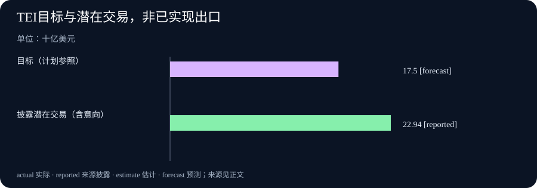

# Daily Intelligence｜公益股权与贸易签署，下一步是兑现

> 2026-10-19｜Asia/Shanghai｜研究锚点为 2026-10-19 03:04:28+08:00，优先核验窗口为此前 24 小时。本文使用 10 月 18 日公开的一手材料；Ollama 与印尼商务部公告可核对精确时刻，另两项只披露日期，小时未披露。日期级近期材料不等于已证实落在严格 24 小时内。

## Today’s Thesis｜今天的判断

今天的新增信号落在四种不同的兑现路径上：AI 企业把一部分未来股权价值承诺给公益，本地推理软件继续修补运行接口，贸易协定完成签署，出口展会披露潜在交易。它们都推进了事情，却分别距离资金分配、稳定运行、条约生效和实际收款还有不同步骤。读懂这些差别，有助于把资源投入到下一项可验证的进展，而不是把宣布时的数字直接当成最终成果。以下联系是本报基于四项披露的分析，不是来源给出的统一结论。

## Executive Summary｜先看三条变化

- **AI 公益开始涉及资本结构**：Anthropic 的新安排把未来公司价值与公益资源联系起来；下一步要看批准条件、治理和可支配资源怎样落实。[官方公告](https://www.anthropic.com/news/public-benefit-fund)
- **本地推理工具在补接口**：Ollama 新预发布处理模型服务层与计算后端的兼容问题；该日志没有提供模型质量或推理速度提升的实测证据。[官方版本](https://github.com/ollama/ollama/releases/tag/v0.40.7-rc0)
- **贸易通道和订单意向各进一步**：EFTA 与越南完成协定签署，印尼展会公布潜在交易规模。前者仍待生效，后者仍需跟进为合同与交付，不能合并理解为当日出口已经增加。[EFTA 协议页](https://www.efta.int/trade-relations/free-trade-network/viet-nam)、[印尼商务部](https://www.kemendag.go.id/berita/siaran-pers/mendag-busan-resmi-tutup-tei-ke-41-potensi-transaksi-capai-usd-2294-miliar)

## AI Daily｜AI 与产品

Anthropic 于 10 月 18 日宣布 Public Benefit Fund，拟投入公司 5% 的股份，须经股东批准。公司估值超过指定基线每上升 50%，董事会可酌情追加 2% 股份；基金以全资 LLC 形式设立，具体治理和估值节点尚待后续说明。它讨论了非营利捐赠、特定人群分配及劳动力影响等可能方向，不能写成上述款项或援助已经发放。[Anthropic：Investing in the public benefit](https://www.anthropic.com/news/public-benefit-fund)

这项披露的新意在于公益资源的来源和增量机制。对观察者而言，首先需要区分公司股份、可出售资产与当期现金支出；其次要分清承诺的受益对象、决策者与评估方法。股权能让公益参与未来价值增长，也使资源实际可用的时间与公司价值、流动性和批准程序相连。这些是对安排的经济解释，尚不能用来估计基金未来能支持多少就业培训或社会保障。

Ollama 官方 GitHub 发布的版本标识为 `v0.40.7-rc0`，属于预发布。变更包括允许非思考模型使用 Responses effort、让 llama-server 推断 draft speculative type，以及在 MLX 中加入 PPLX Decider v1.2 支持。官方 DOM 的发布时间为 2026-10-18T00:28:57Z，即北京时间 08:28:57，处于本次窗口。[Ollama 版本说明](https://github.com/ollama/ollama/releases/tag/v0.40.7-rc0)

这些修改可以改变应用和运行时之间的连接方式，却没有改变模型能力已被验证的证据。工程团队若依赖相关接口，可挑选与自身部署一致的用例做对照检查，例如参数能否被正确接受、草稿模型设置是否与预期一致，以及不同后端能否返回一致的结构。是否升级应取决于这些具体问题和回退能力；仅凭版本号变动，没有依据宣称准确率提高、延迟下降或成本已经节省。

## Business Daily｜商业与产业

印尼商务部于 10 月 18 日 21:16 WIB 发布 TEI 闭幕公告，换算为北京时间 22:16。政府称五天展会记录潜在交易 229.4 亿美元，超过 175 亿美元目标约 31.1%，并包括 426 份谅解备忘录；公告提出继续跟踪，将机会推进为贸易合同。这一数字是政府自报的潜在交易口径，不能作为已交付出口、已确认收入或已收到货款。[印尼商务部闭幕公告](https://www.kemendag.go.id/berita/siaran-pers/mendag-busan-resmi-tutup-tei-ke-41-potensi-transaksi-capai-usd-2294-miliar)

对于参加展会的企业，最有用的后续报表应该接续这条销售链：识别出的机会中，有多少进入正式报价、通过客户资质审核、签约、付定金、发货并完成回款。这样才能解释规模较大的意向池究竟意味着未来业务，还是包含较多尚未确定的机会。展会提供接触客户的场合，最终转化还依赖价格、产品标准、融资、交期和履约。

公益股权安排也给 AI 企业的商业观察增加了一个维度。利润增长与公益承诺之间建立了关系后，读者需要进一步了解股份由谁持有、谁决定分配、如何处理利益冲突，以及怎样披露实际支出。这些问题涉及资源使用和责任归属，不能仅凭公司采用某种法律形式就判定效果。若后续只有股份比例、没有支出和受益情况，就很难评价方案对劳动市场问题的实际贡献。

## Macro Observation｜宏观观察

EFTA [官方新闻列表](https://www.efta.int/media-resources/news)将越南自由贸易协定签署公告列为 10 月 18 日，协议页确认当天在河内签署，并明确生效仍为 Pending。范围涵盖货物和服务贸易、原产地、投资、知识产权及政府采购等。页面没有披露发布小时，因此本期按日期级近期材料处理。[EFTA 官方协议资料](https://www.efta.int/trade-relations/free-trade-network/viet-nam)

从宏观观察角度，签署说明谈判达到了一个制度节点；是否随后改变贸易成本，要等生效、适用安排和企业使用情况逐步明确。企业准备进入相关市场时，可以先核对商品分类、原产地证明和服务准入的适用条款，但在优惠尚未生效时，不能把可能降低的关税直接计入已兑现利润。

协定和展会提供的证据层次不同：前者讨论市场之间的规则，后者记录企业之间的商业机会。规则更便利也不保证每个项目成交，意向较多也不保证跨境成本已经降低。若未来要判断贸易是否受益，需要把这些制度和活动信号，同后续实际交易、企业参与、履约与统计数据连接起来。本期没有窗口内的新 GDP 或通胀数值，不能据此给整体经济景气定向，也没有将旧统计冒充当日新增。

## Signal Dashboard｜信号仪表盘

| 新增信号 | 当前可确认的状态 | 接下来验证什么 |
|---|---|---|
| Anthropic 公益安排 | 股权承诺包含批准条件 | 治理、可支配资源与实际分配 |
| Ollama 运行接口 | 预发布列出兼容性修改 | 自身工作负载是否通过对照检查 |
| EFTA—越南 FTA | 已签署，待生效 | 生效安排及企业实际使用 |
| 印尼 TEI | 公布潜在交易口径 | 意向转合同、交付和回款 |

表格用于说明本期证据所处阶段，不是投资评级，也不表示四项信号具有可加总的经济规模。

## Deep Insight｜深度观察

### 怎样把宣布后的等待变成可跟踪的过程

这些新披露最值得放在一起思考的地方，是后续进展需要用不同单位衡量。公益安排涉及权利和资产，软件版本涉及接口行为，贸易协定涉及法律适用，展会涉及销售机会。用同一种“落实进度”百分比覆盖全部过程，会隐藏各自真正重要的环节。下文是分析框架，目的是提出可验证的问题，并不代表四个主体已经提供了这些后续结果。

对公益资源，首先应观察资金何时变得可支配。股权比例告诉人们潜在价值如何分配，却不能直接回答今年能支出多少钱、受益者何时获得支持。把公益承诺换算成社会效果，中间至少需要用途、支出和受益结果。更细的追踪可以区分一次性拨款、长期承诺、管理费用和项目效果：一项项目即使按时花完预算，也可能没有改善参与者的处境；另一项长期研究可能短期支出不高，却形成后续政策所需证据。评价时应把目标与时间尺度写清楚。

对软件，重要的单位是可复现的任务，而不是发布次数。某一接口以前无法正确表达调用方意图，修改后能正常传递参数，这是具体的工程进展。它是否值得立刻部署，要看该问题在团队自己的任务中出现多频繁，以及升级同时引入了哪些维护成本。可用一组固定请求记录成功率、错误类型、响应结构和资源消耗；若没有跑这些检查，就不宜把兼容性修改转述为生产率改善。这里还要区分运行时和模型：使模型更容易接入，并不自动改变它回答问题的质量。

对贸易协定，关键是规则真正可以被企业使用。市场准入条款只有转化成适用的手续和可执行的安排，才可能影响决策。即使协定生效，企业也可能因为证明成本、产品认证或客户需求而暂不采用优惠。一个有用的观察方法是跟踪典型产品的合规路径：原材料怎样取得资格、需要哪些凭证、由谁签发、在哪里申报，以及优惠与办理成本相比是否有吸引力。这样的具体案例比笼统估计“市场扩大”更容易被验证。

对展会，合适的单位是机会的转化和履约。大额意向能够提示值得继续跟进的客户群，但销售机会在不同阶段有不同确定性。若把询价、谅解备忘录和正式合同都记成同一种交易，就无法发现哪一环节的障碍最大。出口商可以按来源、产品和客户类型建立分组，观察下一阶段进入率、耗时和失败原因。随后再看付款条件、交付质量和回款周期，才能决定下一次展会应增加投入，还是先改善融资与履约支持。

这些观察方法还揭示了一个共同的资源配置问题：后续工作往往跨越不同岗位和机构。承诺写入公告以后，法律、财务、开发、销售和运营人员仍需完成各自部分。若只奖励宣布时的数字，执行者可能缺乏持续记录的动力。为每个阶段指定责任主体、下一项证据和合理观察期限，可以让等待具有信息价值：一项安排推进缓慢时，能够判断是程序尚未结束、资源尚未到位，还是需求与最初判断有差异。

因此，本期不把这些消息推成 AI 公益已见成效、本地模型性能普遍提高或贸易景气已经转强。更有用的判断是，它们分别提供了可以开启后续观察的起点。未来若基金公布实际分配、工具在真实任务中通过验证、协定生效并被使用、展会意向形成交付，才有条件把今天的阶段性信号升级为结果判断；若没有出现这些证据，也应允许原来的预期被下调。

## Tomorrow Watch｜明日值得追踪

- Anthropic 是否披露股东批准、基金治理及实际分配安排，使股权承诺能够对应到可支配资源。
- Ollama 预发布是否转为稳定版本，以及相关接口在不同后端是否出现回归或使用限制。
- EFTA—越南协定的生效程序与适用文件如何明确，企业何时能够实际申请相关待遇。
- 印尼商务部和出口商如何跟进本次潜在交易，是否继续披露合同、交付与回款口径。
- 上述后续信息是否真正新增；仅重述同一公告的媒体报道不再作为下一期新事件。

## One Chart｜一张图

下图比较 TEI 的目标与主办方披露的潜在交易，单位为十亿美元。目标为 17.50，潜在交易为 22.94，两者相差 5.44。前者是计划参照，后者包括尚需跟进的商业意向；这张图不是出口、收入或回款对比，不能把柱形差额解释为已经新增的经济产出。统计覆盖本届展会 10 月 14—18 日，披露于 10 月 18 日。[图表数据来源](https://www.kemendag.go.id/berita/siaran-pers/mendag-busan-resmi-tutup-tei-ke-41-potensi-transaksi-capai-usd-2294-miliar)

## Quote of the Day｜今日引用

> “Well done is better than well said.”

— Benjamin Franklin（本杰明·富兰克林）编印，《穷理查年鉴》1737年版，五月格言。[国家档案馆原文](https://founders.archives.gov/documents/Franklin/01-02-02-0028)

中文：做得好，胜过说得好。

这句格言把评价放在完成的行动上。本期把它用于提醒自己：股权承诺、软件发布、协定签署和交易意向，仍应分别接受后续结果的检验。

## Action Items｜今天值得思考什么

1. **公益资源何时可用？** 跟踪批准、治理和实际分配，先确认股份承诺能够转成哪些可执行项目，再评价社会效果。

2. **升级解决哪一个问题？** 选择与自己接口和后端一致的固定任务，对照记录错误、返回结构和资源消耗，再决定是否采用预发布。

3. **贸易优惠可以申请了吗？** 对照生效状态、产品资格、原产地凭证和办理成本，计算企业真正可使用的条件。

4. **意向怎样变成现金？** 把询价、MoU、合同、定金、交付和回款逐项记录，检查机会在哪一步流失。

5. **下一条证据是什么？** 为每个判断写下能支持或推翻它的具体观察，避免把连续重刊误当成持续进展。

## 信息边界

研究锚点固定为 2026-10-19T03:04:28+08:00，优先窗口为 2026-10-18T03:04:28+08:00 至锚点。四条主线均来自 10 月 18 日官方披露，未复用 10 月 17 日日报的核心事件。精确时刻证据与日期级证据分列如下：

| 来源 | 首次公开日期或时间证据 | 时效确认与事件边界 |
|---|---|---|
| Anthropic 公益基金公告 | 页面标注 2026-10-18，小时未披露 | 日期级近期材料；不能证实严格小时窗口，批准与分配仍有条件 |
| Ollama v0.40.7-rc0 | 官方 GitHub DOM：2026-10-18T00:28:57Z，即 08:28:57+08:00 | 严格处于窗口；预发布变更不代表模型性能提升 |
| EFTA—越南协定 | 官方新闻列表标注 2026-10-18，小时未披露；协议页确认签署日 | 日期级近期材料；新闻单页抓取失败，实质状态由实际打开的协议页核验，仍待生效 |
| 印尼商务部 TEI 公告 | 2026-10-18 21:16 WIB，即 22:16+08:00 | 严格处于窗口；数据参考期为展会五天，潜在交易不等于出口或收款 |

本文区分公告时间、事件发生时间和数据覆盖期间。企业披露及政府活动统计未在本期获得独立审计；涉及将来批准、应用、实施和转化的内容均保留条件。除直接陈述来源外，文中的联系、评估方法和观察问题属于本报分析，不是来源证明的因果关系或已经实现的效果。

修订说明（2026-10-19T07:01:59+08:00）：本次将今日引用改为有原著出处的经典名人语录，并复审全文；新闻研究锚点仍为 2026-10-19T03:04:28+08:00，本次未刷新新闻检索截点。
