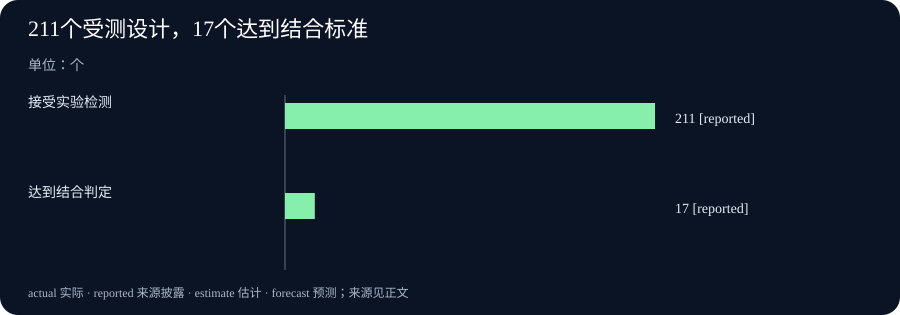

# Daily Intelligence｜AI走进实验室，共享服务开始处理拥挤

> 2026-10-21｜北京时间｜新闻查阅截止：2026-10-21 07:05:08+08:00，优先观察此前24小时首次公开的材料。本期AI研究、llm-d、德国统计及世界银行原文标注10月20日；Netflix原页当前显示10月21日。主要来源均未核实发布小时，不能声称全部已证实处于严格24小时窗口。公开日期、数字所属时期与条件见文末。

## Today’s Thesis｜今天的判断

今天的变化，可以从“怎样把新能力交给更多人使用”来理解。Anthropic公布人工智能（AI）设计小蛋白的实验检测结果，让一部分计算设计获得了实验室证据；llm-d发布1.0，把多位用户争用计算资源、系统升级和连续任务的安排做成更明确的功能。Netflix则更新广告数据与测量工具，帮助广告客户追踪观看之后的行为。同时，德国生产环节的价格上涨，世界银行提出扩大数字接入的战略。它们让一个具体问题浮现出来：有了候选结果和新工具，下一步还要安排稀缺的实验、计算资源、可比较的数据，以及人们负担得起的接入条件。把这些变化联系起来，是本报的分析，不是五个来源共同作出的结论。

## Executive Summary｜先看三条变化

- **AI设计已经接受实验检测，但还没有成为药物**：Anthropic称，合作团队检测了211个设计，其中17个达到研究方的结合判定标准。结合，是指小蛋白能附着在特定目标上；这不等于已经证明可以治疗。研究方尚未确认细胞环境中的中和作用，也明确没有制成抗毒药。[Anthropic研究原文](https://www.anthropic.com/research/claude-scorpion-toxin-binder-design)
- **共享AI服务，需要处理请求之间的竞争**：llm-d 1.0增加按优先级和公平性分配请求、保持服务运行，以及复用多轮任务信息的能力。它是管理模型运行的软件，不是一个更聪明的新模型。新的多租户策略需要采用者选择开启，不能假设升级就会自动取得所有收益。[llm-d维护者说明](https://llm-d.ai/blog/llm-d-v1.0-state-of-the-art-inference-ready-for-day-2)
- **广告测量、生产价格和数字接入，各自有新信息**：Netflix更新转化数据与测试工具；德国公布9月工业生产者价格同比上涨6.7%；世界银行发布数字战略，并宣布共享、按使用付费的AI算力倡议。三者分别涉及企业工具、已经记录的价格与未来实施安排，不能合并成已经实现的生产率或收入。[Netflix公告](https://about.netflix.com/en/news/netflix-ads-suite-has-better-buying-better-planning-better-results)、[德国统计局](https://www.destatis.de/EN/Press/2026/10/PE26_373_61241.html)、[世界银行](https://www.worldbank.org/en/news/press-release/2026/10/20/world-bank-group-launches-first-digital-strategy-to-expand-access-and-create-jobs)

## AI Daily｜AI与产品

Anthropic于10月20日披露一项研究：内部研究模型参与设计小蛋白，希望它们可以附着在蝎子神经毒素上。神经毒素是会干扰神经正常工作的毒素，这些设计旨在为未来治疗研究提供候选材料。这类小蛋白在文中称为结合蛋白。研究过程有人员监督和后续引导，不能写成公开可用的Claude版本已经能为任何人独立完成药物研发。这次的新信息，是这一具体研究的实验结果，不是8月相关蛋白设计文章重新出现。[研究原文](https://www.anthropic.com/research/claude-scorpion-toxin-binder-design)

合作实验团队检测了211个设计，其中17个符合研究方的结合判定标准。这个结果比单纯在计算机里提出候选更进一步：有一部分设计已经接受了实际检测。研究方还称，将公开全部211个设计及数据。不过，本期只报道汇总结果，不把设计数量当作药物数量，也不把达到结合标准写成已经治好疾病。

限制同样具体。研究团队尚未确认这些结合蛋白在细胞环境中能否中和毒液，也就是阻止毒液发挥有害作用；原文明确没有制成抗毒药。一个分子能够附着在目标上，与它能否发挥治疗作用，是不同问题；是否安全、能否制成可负担的药物，也仍需后续证据。因此，本期图表展示的只是这一组实验中达到判定标准的数量，不是AI药物研发的普遍成功率。本报没有独立重复这些实验。

另一条新增主线来自llm-d维护者。10月20日发布的1.0版本，关注如何让许多用户持续使用大型模型。模型根据输入生成回答的计算过程，通常叫推理；llm-d负责安排这些计算请求如何交给设备处理。多人共享一组设备时，有人希望即时得到回答，也有人让AI连续执行许多任务，请求可能突然增加。新版本试图把这些不同需求纳入同一套调度安排。[维护者版本长文](https://llm-d.ai/blog/llm-d-v1.0-state-of-the-art-inference-ready-for-day-2)、[官方Release](https://github.com/llm-d/llm-d/releases/tag/v1.0.0)

其中一项变化是多租户流量控制。“租户”在这里是共享同一服务的不同客户或任务群，不是租房者。系统可以按优先级安排请求，并在同一优先级内兼顾不同用户；请求多于设备承受能力时，也可限制继续接纳的请求。但维护者明确说明，默认安排仍接近先到先服务。采用者需要选择开启新的策略，并决定不同任务的优先级，不能把新增功能误读为升级之后所有请求都会自然得到公平处理。

另一些变化涉及升级和连续任务。热备路由器是准备接替工作的备用调度组件；协调滚动更新，则是让相关部分按安排逐步换用新版本。维护者还把路由配置接口提升至稳定的v1，并增加会话及轮次状态支持。会话是连续的多轮交互，保留相关状态有助于少做重复计算。这些是软件能力和维护者对用途的说明，不是本报测得的所有部署都不中断、一定更便宜的保证。

两条AI新闻对应不同环节。实验研究让部分计算设计获得了新的检测证据；共享服务软件则处理许多人同时使用模型时的资源安排。它们不能互相证明效果：运行平台更成熟，不说明研究候选已经成为药物；实验中出现符合标准的设计，也不说明共享服务的费用已经下降。

## Business Daily｜商业与产业

Netflix在原页当前显示10月21日的公告中，介绍广告工具Ads Suite的新安排。页面没有披露发布小时和时区，不能确证严格处于本期24小时窗口。公司增强了Conversion API，并建立Netflix Pixel。前者是广告客户向平台传递行为数据的接口，后者是帮助记录相关行为的工具。公告称，广告客户可用标准方式提供20多种转化事件。“转化”在广告行业里，指观看广告后希望发生的行动，例如注册或试用；它不是说每位看到广告的人都完成了购买。[Netflix公司公告](https://about.netflix.com/en/news/netflix-ads-suite-has-better-buying-better-planning-better-results)

按公告，客户可以测试Netflix自身提供的转化增量、归因和A/B测试，并根据自己的转化数据建立广告受众。归因，是按一定规则判断一次注册或其他行为应算到哪个广告渠道；增量，则试图回答如果没有这次广告，原本是否也会发生这些行为。A/B测试是把可比较的方案或人群分组，观察结果差别的方法。能记录一次行为，与证明广告额外带来一次行为，并不是同一个结论。

开放状态需要分开读。Yahoo DSP内已经提供单平台归因；DSP是帮助广告客户程序化购买广告的服务。The Trade Desk的部分测量能力仍是“即将推出”，借助它启用第三方或客户自有受众，则从下月开始。广告套餐进入15个新国家是明年计划，部分国家预计2027年3月进入，不能写成现在已经完成扩张。

Netflix还在宣传稿中提供了一个未具名客户的效果案例，但没有完整披露样本和实验设计，本期不把其中比例用作所有广告客户的效果，也不用于正式图表。这是一条广告工具新闻。工具更新本身不能证明某个季度的收入已经因此增长。

另一项商业条件来自世界银行集团。它在10月20日发布首份数字战略，把公共与私营部门的工具放入同一个框架，帮助发展中国家扩大数字接入。四项重点包括可靠联网、负担得起的设备和数据服务、数字服务与技能，以及使用AI所需的准备。它关注的不只是有没有模型，还包括人们能否接入、能否负担、会不会使用。[世界银行战略公告](https://www.worldbank.org/en/news/press-release/2026/10/20/world-bank-group-launches-first-digital-strategy-to-expand-access-and-create-jobs)

同日宣布的AI Infrastructure and Readiness Initiative，提出共享、按使用付费的GPU算力，为新兴市场政府提供独立建设国家数据中心之外的选择。GPU是许多AI系统使用的专门计算设备。按需购买计算服务，与自行建设整座数据中心，是两种不同的资源安排；公告并没有证明前一种在每个国家都更省钱。倡议初步聚焦非洲和拉丁美洲，知识合作伙伴包括Cassava Technologies和NVIDIA。

战略和倡议已经宣布，具体实施仍待观察。原文没有给出确定的GPU总规模、总投资、上线日期和完整国家名单，不能自行补齐这些数字。对希望使用数字服务的企业和政府，下一步应看实际可用服务、收费安排、电力和网络条件，以及人员技能。发布战略不等于设备已经运行，也不等于相应就业已经创造出来。

## Macro Observation｜宏观观察

德国联邦统计局10月20日公布：9月工业生产者价格比上年同月上涨6.7%，比8月上涨1.9%。工业生产者价格，简称PPI，记录的是生产环节的价格。本次统计涉及德国国内生产并在德国销售的工业品，包含采矿、制造、电力和水务等活动。它不能直接当作家庭购物账单的涨幅。[德国统计局原文](https://www.destatis.de/EN/Press/2026/10/PE26_373_61241.html)

同份发布显示，能源价格同比上涨14.9%；剔除能源的工业生产者价格同比上涨3.2%，环比上涨0.1%。同比是和上年同月比较，环比是和紧邻的上月比较。这组数字说明，读整体涨幅时需要同时看能源和其他商品，但不能把6.7%减去3.2%所得的3.5个百分点，直接说成能源对总指数的正式贡献，因为两个指数包含的商品篮子不同。

这条统计给企业提供的是已经记录的价格环境，不是对某家企业盈利的结论。企业采购哪些投入、销售什么产品、能否调整售价，以及库存何时购入，都会影响它实际面对的费用。生产环节的涨价也不必然按同样幅度传给消费者。仅凭9月这份价格资料，不能决定未来利率路径，或断言企业已把所有成本转嫁出去。

世界银行的数字战略，则提供另一种经济观察：希望使用AI的人，不只需要算力，还需要网络、设备、技能和负担能力。共享设备可以改变资源取得方式，但是否适用，需要继续看服务是否稳定、价格怎样计算，以及当地是否具备使用条件。这是从新战略提出的问题，不能写成已经测得的经济回报。

德国统计与世界银行战略所处的时间和状态不同。前者是10月新发布的9月价格，后者是10月宣布的未来安排；它们都不是10月20日当天的全部经济状态。本期也没有把世界银行引用的2025年联网情况，或未来青年人口和就业预测，改写为当天刚测得的数据。

## Signal Dashboard｜信号仪表盘

| 消息 | 本次新增信息 | 接下来要分清什么 |
|---|---|---|
| AI结合蛋白研究 | 211个设计接受检测，17个达到研究方结合标准 | 结合不等于中和作用，更不等于已制成药物 |
| llm-d 1.0 | 新增多用户调度、持续运行与会话支持 | 新策略需要选择开启，维护者说明不代替自己的运行测试 |
| Netflix广告工具 | 更新转化数据传递、归因与测试安排 | 记录行为和证明额外效果不同，部分功能仍待推出 |
| 德国9月PPI | 同比上涨6.7%，剔除能源同比上涨3.2% | 生产者价格不是居民生活成本，两个篮子的差额不是能源贡献 |
| 世界银行数字战略 | 提出数字接入重点与共享算力倡议 | 已宣布的安排，不等于上线、资金到账或就业结果 |

## Deep Insight｜深度观察

### 候选更多了，实验、设备和可比较的数据怎样跟上

本期最具体的变化，是AI相关工作开始面对不同种类的“下一步”。提出一个结合蛋白设计之后，要安排实验检测；模型已经可以运行之后，要安排许多人的请求；广告能够触达人群之后，要判断观看与行动之间到底有什么关系。世界银行的战略又把问题延伸到使用者：网络、设备和费用是否允许他们进入这些流程。这些环节需要的资源不同，不能只靠再增加一批候选或再发布一项功能来解决。以下是基于本期材料的分析。

先看实验研究。211个被检测的设计中，17个达到结合标准，足以说明结果已经超出纯计算候选的层面。但这组数字回答的是“这一批送去检测的设计，有多少符合这次标准”，不是“今后所有AI设计有多少能变成药”。这211个受检设计不能视作所有可能设计的随机样本；判定标准也只是研究过程中的一个环节。如果把8.1%写成药物研发成功率，就同时改变了分母、评价目标和观察阶段。真正值得继续看的，是下一项实验能否回答目前尚未解决的问题，而不是把同一个检测比例反复当成新成果。

共享服务面对的是另一种有限资源。许多用户请求同一组设备时，安排谁先被处理，必然涉及取舍。例如，假设即时问答和大量后台任务同时涌入，单纯按照到达顺序，可能无法满足不同任务的等待要求。这个例子用来解释调度问题，不是本期披露的已发生故障。llm-d把优先级、公平性和超负荷时的接纳控制纳入新版本，让采用者有更明确的工具。但工具不会替企业决定哪些用户应被优先服务。默认策略仍近似先到先服务，也提醒读者：功能存在，与组织已经正确配置它，是两件事。

这意味着，减少重复计算与决定服务顺序，需要分别评价。会话支持可以帮助连续任务复用已有信息，热备和协调升级则面向持续运行；这些机制各自解决不同问题。即使某一种配置减少了重复工作，也还要看它是否增加管理负担、是否让某一类任务等得更久，以及维护人员能否看清异常。不能用一句“更高效”，把所有指标替换掉。与昨日一段计算内核更快的测试相比，今天的新消息更接近怎样持续管理多人共享的服务，观察对象已经改变。

Netflix的广告测量，则把有限资源换成了可比较的数据。一个人看过广告后注册，平台可以记录这次行为；但如果他原本就准备注册，这条记录不能单独证明广告带来了额外效果。归因规则帮助企业把结果分配给广告渠道，增量测试才进一步追问没有这次广告时会怎样。两者都有用途，也可能给出不同结论。新的接口和Pixel可以让行为数据更容易传递，但效果判断仍取决于记录是否完整、比较条件是否合适，以及测试覆盖哪些人群。产品名称中出现“更好结果”，不等于每位广告客户的投入都已经获得回报。

成本和接入把这些技术问题带回实际选择。德国PPI记录的价格变化，说明企业需要重新看自己购买和出售的商品，而不是只看一个总百分比。世界银行提出共享、按使用付费的算力，则让一些使用者可以考虑先购买计算服务，而非独自建设整套设施。这样的选择可能改变费用发生的时间和方式，但并不能仅凭组织方式，就确认总费用一定降低。还要把服务价格、网络、电力、人员和持续使用所需的投入放在一起比较。这是建议采用的评估办法，不是倡议已经公布的节约结果。

因此，今天值得保留的判断不是“所有事情仍待验证”，而是不同进展已经来到不同位置。实验检测已经给出一组有限结果；共享服务已经发布具体软件功能；广告工具已经扩展一部分测量安排；价格统计已经记录了9月变化；数字战略则提出未来实施方向。后续阅读应沿着各自的问题走：实验还缺哪类结果，服务在拥挤时怎样运行，广告比较能否支持额外效果，使用者是否负担得起接入。问题越具体，下一份证据才越容易改变我们的判断。

## Tomorrow Watch｜明日值得追踪

- Anthropic是否继续公布后续实验，回答目前尚未确认的中和作用、安全性等问题；不要把结合数量当作治疗结果。
- llm-d采用者怎样设置优先级和公平策略，实际拥挤、升级及多轮任务中是否达到自己的服务要求。
- Netflix已经开放的测量工具如何说明比较条件，The Trade Desk相关安排是否按公告所述推进。
- 德国生产价格后续如何变化，企业采购结构和售价调整是否与总指数呈现不同情况。
- 世界银行共享算力倡议何时披露实际服务、价格、参与范围和上线安排，而不是仅重复战略目标。

## One Chart｜一张图

下图题为“211个受测设计，17个达到结合标准”，展示Anthropic本次披露的两个源数字：接受实验检测的设计为211个，其中达到研究方结合判定标准的为17个。17个是211个中的一部分，两条柱不能相加，也不是两个独立样本。数字来自研究方披露，不是本报独立实验。

图中的 `reported` 表示“来源披露的数字”。17÷211约为8.1%，只能描述这211个已送检设计中达到本次标准的比例。其余194个由211减17得到，是算术差额，图中不把它标为直接披露的数据。这个比例不是药物成功率、临床有效率，也不能代表全部AI生成候选；未达到本次标准，也不能据此称为临床治疗失败。[实验结果来源](https://www.anthropic.com/research/claude-scorpion-toxin-binder-design)

## Quote of the Day｜今日引用

> “Nothing great was ever achieved without enthusiasm.”

— Ralph Waldo Emerson（拉尔夫·沃尔多·爱默生），《圆》，收入《随笔第一集》（1841年）；中文为本报译文。[原著全文](https://www.gutenberg.org/files/2944/2944-h/2944-h.htm)

中文：没有热忱，便成就不了伟大的事业。

这句话出现在《圆》结尾，讨论人如何超出熟悉的思维与行动范围，开辟新的可能。它是哲学随笔中的表达，不是技术效果或商业回报的保证。联系今天的材料，可以把热忱理解为开始探索的动力；实验、服务安排和持续记录，则帮助探索继续向前。这一联系属于本报的编辑感想，也不把热忱说成成功的充分条件。

## Action Items｜今天值得思考什么

1. **实验回答了哪个问题？** 区分计算候选、实验结合、中和作用与治疗效果；引用比例前，先确认分母是哪一组被检测的设计。

2. **设备拥挤时，谁先被服务？** 为共享AI服务写清不同任务的优先级、可以接受的等待，以及超负荷时如何处理；不要假设新策略已默认开启。

3. **记录到的行动，是广告额外带来的吗？** 分开检查行为记录、渠道归因与增量比较，核对哪些工具已经开放、哪些仍是下月计划。

4. **总涨幅对应自己的采购吗？** 阅读生产价格时，先看统计范围、同比或环比，以及自己购买的商品；不要直接把总指数当作企业费用或家庭账单。

5. **共享服务真的能够使用吗？** 追踪计算服务的价格、上线范围、网络和技能条件，再比较自行建设与按需购买的全部投入。

## 信息边界

本期研究截止时间固定为2026-10-21T07:05:08+08:00，优先观察窗口为2026-10-20T07:05:08+08:00至截止时间。AI研究、llm-d、德国统计和世界银行的主要原文标注10月20日；Netflix原页当前显示10月21日，但小时和时区未披露。主要来源均未取得足以核实发布小时的证据。因此，只能确认这些原文日期较近，不能说全部严格落在24小时内。

| 来源 | 已核验的公开时间 | 事实所处的时期或阶段 | 需要保留的限制 |
|---|---|---|---|
| Anthropic研究 | 原文标注2026-10-20，小时未披露 | 本次研究及实验结果的新披露 | 内部研究模型、人员监督；尚未确认中和作用，未制成抗毒药 |
| llm-d 1.0维护者说明 | 正文标注2026-10-20，小时未确证 | 正式大版本及功能说明，官方Release交叉确认 | 没有可可靠换算为北京时间的发布时刻；新策略需选择开启 |
| Netflix广告工具 | 原页当前显示2026-10-21，小时和时区未披露，不能确证严格24小时 | 当前工具、可测试安排与未来开放计划并存 | 部分功能尚待推出，次月及2027年计划没有当作已实现 |
| 德国生产价格 | 第373号新闻稿日期为2026-10-20，小时未披露 | 2026年9月工业品生产者价格 | 不是消费者价格；整体与剔除能源的商品篮子不同 |
| 世界银行数字战略 | 原文标注2026-10-20，小时未披露 | 战略与倡议已宣布，实施仍待推进 | 未披露确定的算力总规模、总投资、上线日和完整国家名单 |

本期与前两期的核心事件和来源逐项对照，没有把微软代理权限、Mamba-2内核提速、Anthropic公益股份、Ollama测试版或既有贸易消息换标题再作新事件。Netflix这条消息来自广告工具公告，不能用来说明其财报收入。文中的观察办法、假设例子和跨事件联系，均属于本报分析。它们不替代原始研究，也不构成已经证明的共同因果关系。
