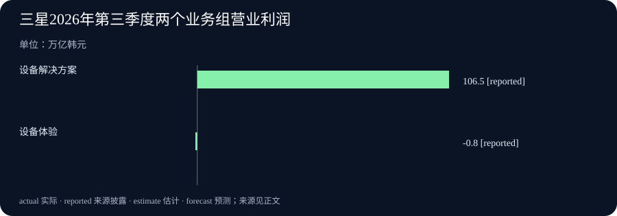

# Daily Intelligence · 2026-10-30

研究截止：2026 年 10 月 30 日 07:04:29，Asia/Shanghai。观察窗口从 10 月 29 日 07:04:29 起。美国 GDP 原文提供精确发布时间；其余三条主线只披露 10 月 29 日日期，小时未披露，不能确认严格落在 24 小时内。

## Today's Thesis

人工智能（AI）开始让人更方便地修改文件、追查使用费用，但“容易操作”和“值得投入”仍要分别检验。今天的三星季报与美国增长初值提供两个参照：同一家公司内部可以盈亏并存，同一个增长数字也需要看清计算方式。

## Executive Summary

Gemini 增加对话内的文件预览和编辑，用户可以直接改文字，也可以选中内容要求模型修改。Claude 则推出用量和费用分析测试接口，帮助组织看清不同模型和团队的消耗。这两项新增能力分别处理成果修改与费用归属，不等于模型回答本身更准确。

三星第三季度总收入与营业利润创纪录，但面向终端设备和体验的业务组仍录得营业亏损。美国第三季度实际国内生产总值初值的年化增速为 3.4%，对应实际季度增速约 0.8%。阅读这两份披露，都需要先问“统计的是什么”，再判断好坏。

相较最近两期，本期不再复用语音转写、法律模板、小模型或互动世界消息，也不把微软季报和加拿大加息换标题重报。今天的四个新增事实分别是文件编辑入口、组织费用分析接口、三星完整季度结果与美国新的季度增长估计。

## AI Daily

### 1. Gemini 把文件预览和修改放进对话

Google 10 月 29 日宣布，Gemini 应用可在对话中生成、预览和编辑文件。用户可以展开到全屏手动输入，也可以选中文字，要求 Gemini 修改或解释内容。便携式文档格式（PDF）的预览和编辑支持网页及手机端；文档、表格、幻灯片、Markdown、纯文本和代码等其他格式目前支持网页端。官方称，这些功能面向 Gemini 应用可用地区的所有用户与语言提供。[Google 官方公告](https://blog.google/innovation-and-ai/products/gemini-app/edit-files-directly/)

这次变化主要在于修改过程。过去拿到生成结果后，用户常要将它移到另一个地方继续改；现在可以围绕同一个文件提出局部要求。编辑的判断是，这有助于让用户指明究竟哪一处需要处理，但不能据此宣称排版、公式或事实错误已经消失。

例如，假设读者把学习笔记整理成文档，可以先核对某一段，再要求模型重写该段。这是说明用法的假设，不是本期测试得出的学习效果。修改完成后，仍要重新检查受影响的内容，尤其是原本正确的数字和引用是否被意外改变。网页与手机支持范围也要分别理解，不能把手机端的 PDF 能力扩大成所有文件格式都能编辑。

### 2. Claude 提供新的组织用量与费用分析测试接口

Anthropic 的官方更新日志在 10 月 29 日列出 Usage and Cost Analytics API 测试版。API 是让软件之间交换信息的接口。这个接口报告组织的历史使用量和费用，可以按模型、工作区、发起请求的用户或服务账户等条件筛选和分组，适用于 Claude Console 和 Claude Enterprise 组织。原有相关接口仍受支持。[官方更新日志](https://platform.claude.com/docs/en/release-notes/overview)

使用量报告包括请求次数和 token 数。token 是模型处理文字等内容时采用的计算单位，不能直接当作字数。费用报告则提供美元金额。配套说明还区分折扣后的费用与按标价计算的费用，并说明前者尚未扣除抵用额度。这样的区别会影响内部核账，不能把报表上的任一金额都直接称作最终需要付款的账单。[官方分析接口说明](https://platform.claude.com/docs/en/manage-claude/usage-cost-analytics-api)

这项更新帮助回答“费用记在哪个模型或团队名下”，但没有直接回答“这笔费用是否产生了价值”。要进一步判断，还需将费用与已完成的工作、人工检查和返工联系起来。文档说明数据通常在四小时内刷新，也可能需要最长二十四小时，所以它适合事后分析，不能被描述成即时阻止超支的控制开关。当前仍是测试版，组织接入还需满足相应管理权限条件。

## Business Daily

### 1. 三星总利润创纪录，终端业务仍有亏损

三星电子 10 月 29 日公布截至 9 月 30 日的第三季度完整结果：合并收入约 195.3 万亿韩元，比上一季度增加 14%；营业利润约 107.4 万亿韩元。营业利润描述主营经营在相关成本费用后的结果，与净利润及收到的现金不同。半导体所在的设备解决方案业务组收入为 147.1 万亿韩元，营业利润为 106.5 万亿韩元。[三星完整季报公告](https://news.samsung.com/global/samsung-electronics-announces-third-quarter-2026-results)

另一边，设备体验业务组收入环比增加 8%，营业亏损为 0.8 万亿韩元。收入增长与亏损可以同时出现，因为卖得更多并不必然覆盖新增成本。公司称，存储业务受益于 AI 相关需求与产品组合调整；与此同时，部分终端业务面对成本压力。这里是公司对自身经营的解释，不能据此推断所有芯片、手机或家电企业都有相同处境。

这份正式季度结果与较早的业绩指引不同，新增的业务细分让读者能看清总量内部的差别。公司的下一季度和下一年销售、需求及投资表述属于计划或预期，本期不把它们算成已实现收入。图表仅比较已披露的营业利润和亏损，保留业务边界。

### 2. 美国第三季度增长初值加快，年化并非季度实增

美国经济分析局在 10 月 29 日 08:30 美国东部夏令时间公布初值，换算为上海时间当晚 20:30，处于本期窗口内。第三季度实际国内生产总值，即扣除价格变化影响后的 GDP，按季节调整后的年化增速为 3.4%，第二季度为 2.2%。实际从第二季度到第三季度的增幅约为 0.8%。[美国经济分析局原始发布](https://www.bea.gov/news/2026/gdp-advance-estimate-3rd-quarter-2026)

年化的做法，是假设一个季度的增长速度连续保持四个季度，再换算成年增长速度。它便于比较增长快慢，但不能把 3.4% 写成美国经济在三个月内实际扩大了 3.4%。该局说，投资、消费和政府支出增加，出口下降抵消部分增长，进口增加。第三季度增速比第二季度加快，主要与投资加快和政府支出转增有关。

这是第一次估计，之后仍可能修订。公告给出的下一次估计日期为 11 月 25 日。总量增长也不说明每个家庭的收入、每家公司的销售或就业情况都同样改善。要回答这些问题，需要各自对应的数据。

## Macro Observation

三星的结果与美国增长初值并不描述同一个对象：一个是跨国公司的经营报告，一个是美国境内生产活动的统计。把它们放在一起，是为了检查解释是否超过证据，而不是拼成一条“AI 已经推动全部经济增长”的因果结论。

投资增加可以支撑当期生产需求，但不同参与者得到的收益未必相同。三星的细分结果显示，即使整体利润很高，也有营业亏损的业务组。美国 GDP 初值显示增长加快，却没有据此计算某个软件产品带来的收益。这些差别提醒读者，产业需求、公司利润和家庭感受需要分别寻找证据。

对于使用 AI 的组织，今天更实际的变化是可以更容易地修改成果、整理费用。前者改善操作入口，后者改善记录方式。它们可能帮助管理投入，但是否减少总成本，还需观察人工复核、错误处理和后续使用的结果。

## Signal Dashboard

| 变化 | 目前能够确认 | 仍需要检验 |
| --- | --- | --- |
| Gemini 文件编辑 | 可在对话内预览和局部修改，手机与网页支持范围不同 | 修改后事实、格式和公式是否仍正确 |
| Claude 费用分析 | 测试接口可按模型和团队等条件分析历史消耗 | 费用能否与合格工作成果对应 |
| 三星经营 | 半导体业务组盈利，设备体验业务组亏损 | 成本与需求变化如何影响后续季度 |
| 美国增长 | 第三季度实际 GDP 年化增长初值 3.4% | 后续修订及收入、就业等其他指标 |

这些信号分别来自产品公告、接口说明、企业经营披露和统计初值，不能直接相加成一个“AI 景气指数”。

## Deep Insight

### 当修改变容易，判断过程需要留下什么

文件生成之后，往往还会被改很多次。增加一个局部编辑入口，能够让人更清楚地指出自己不满意的地方；增加一份费用报告，能够让管理者知道某段时间用了多少资源。这两种便利都很具体，但它们也带来同一个问题：当操作越来越容易，我们是否仍知道每一次改动和每一笔投入的理由？

假设一个团队要整理产品说明。有人修改措辞，有人核对数字，另一个人检查排版。最终文件读起来更顺，不一定说明数字更准确。若模型在重写段落时改变了条件，表面上的改善甚至可能遮住事实错误。因此，局部编辑的好处需要配合清楚的检查范围：这次要改表达，还是要更新事实？负责确认的人是谁？这些是假设性工作例子，不代表某家企业已经出现了这类问题。

费用也有类似的区别。统计哪个模型使用最多，可以帮助发现投入集中在哪里，却不能独自判断投入是否浪费。处理复杂材料的任务可能本来就更费资源；一个便宜的回答如果需要大量返工，也可能增加总成本。更合适的比较，是让费用对应到一个已完成、可检查的工作单位，再把必要的人工时间一起算进去。

这种比较不必一开始就追求复杂评分。团队可以选一类重复任务，记录输入材料、需要达到的结果、实际修改和最终确认时间。遇到错误时，区分不影响意思的措辞问题与会改变行动的事实问题。这样做可以避免把所有错误混成一个比例，也能看出新入口究竟帮助了哪个环节。这里提出的是编辑分析的方法，不是两家公司已经证明有效的管理方案。

组织内部的责任同样需要清楚。费用被记在某个工作区名下，并不意味着那里的每个人都有权限查看全部原始材料；能够分享文件，也不等于所有接收者都应该看见其中内容。扩大使用时，除了看功能，还应核对现有权限和工作分工是否适合新的协作方式。公开公告没有替每个组织完成这些判断。

经营与宏观数字为这种谨慎提供了有用参照。三星的总利润与部分业务亏损能够同时成立，因为它们覆盖的范围不同。美国的年化增速与季度实增也能同时正确，因为计算方法不同。讨论 AI 成效时同样如此：某一步更快、单次调用更便宜、团队整体更省时，分别是不同结论。只有把范围和计算方法写清楚，才能知道究竟改善了什么。

今天值得保留的判断是，工具正在提供更细的操作和观察入口。下一阶段的关键证据，将是人们能否利用这些入口，把修改理由、合格结果与全部投入联系起来。把“看得见费用”进一步变成“理解费用为何产生”，把“能改文件”进一步变成“知道改得是否正确”，才更接近持续可用的工作方式。

## Tomorrow Watch

产品方面，继续观察 Gemini 各种格式在不同设备上的支持说明，以及编辑后导出结果的实际表现。Claude 费用分析仍在测试，后续正式说明、数据刷新和旧接口迁移安排都值得跟踪。测试版发布并不自动意味着组织应立刻迁移全部系统。

经营方面，继续看三星不同业务的后续成本与需求披露，避免只拿总利润推测终端产品的情况。美国增长初值则需与后续修订和其他经济指标互相参照。这些是待追踪的问题，不是说它们一定在明天公布。

## One Chart

### 三星两个业务组的营业利润与亏损

图中设备解决方案业务组营业利润为 106.5 万亿韩元，设备体验业务组营业亏损为 0.8 万亿韩元，以负 0.8 表示。两项均为截至 2026 年 9 月 30 日季度的已披露经营结果。图中的 reported 表示“来源披露的数字”，不是目标或预测。[图表来源：三星季度公告](https://news.samsung.com/global/samsung-electronics-announces-third-quarter-2026-results)

这张图强调同一家公司内部的方向差异，不是全部业务的加总表，也不是收入、净利润或现金流比较。不能把两柱相加直接当成集团营业利润；集团还包含其他业务与合并处理。负值柱较短，也不意味着相关业务的成本压力可以忽略。

## Quote of the Day

> Whoso would be a man must be a nonconformist.

中文：凡想成为独立自主的人，都必须不盲从。

人物：Ralph Waldo Emerson（拉尔夫·沃尔多·爱默生）

出处：1841 年《随笔集》第一版，第二篇《自立》（Self-Reliance），印刷页码第 41 页。[原著对应页](https://en.wikisource.org/wiki/Page:Essays_(1841).djvu/53)；[该版作者、年份与目录](https://en.wikisource.org/wiki/Index:Essays_(1841).djvu)。

上下文：爱默生批评人们为了习俗与外在认可放弃自身判断。这里的“不盲从”强调独立思考，不是为了反对而反对，也不表示可以无视事实。

编辑解读：工具可以帮助修改文字和整理记录，最终仍需要人依据材料作判断。这是本期阅读联系，不是说爱默生当时在讨论 AI。

## Action Items

1. **这次究竟要改什么？** 修改文件前写清楚是调整表达、格式还是事实，完成后核对被影响的数字、引用与条件。

2. **费用对应什么成果？** 将一类任务的模型费用、人工复核和返工放在一起，按合格完成的工作比较投入。

3. **报表能否代表即时状态？** 使用费用分析前确认刷新延迟和金额定义，不把历史报告当成即时限额开关。

4. **总体增长掩盖了什么？** 阅读三星季报时同时看不同业务的盈利与亏损，分清收入、营业利润和现金。

5. **这个增速如何计算？** 记录美国 GDP 数据时同时标明初值、季度、年化口径与约 0.8% 的季度实增，等待后续修订。

### 信息边界

固定研究截止时间为 2026-10-30T07:04:29+08:00，窗口起点为 2026-10-29T07:04:29+08:00。美国 GDP 原文于 10 月 29 日 08:30 EDT，即上海 20:30 发布；Gemini、Claude 更新和三星公告仅提供 10 月 29 日日期，发布小时未披露，不声称严格小时窗口已核实。统计期间、未来预期与编辑推断分别注明。经典引文不受新闻窗口限制。
