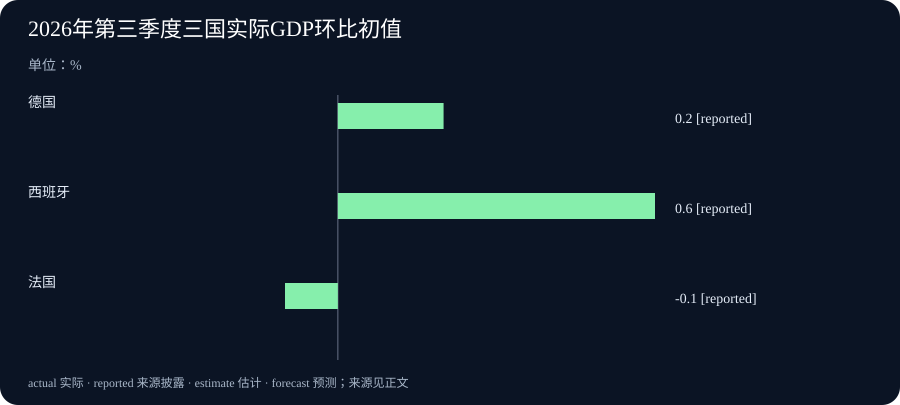

# Daily Intelligence · 2026-10-31

研究截止：2026 年 10 月 31 日 07:00:48，Asia/Shanghai。观察窗口从 10 月 30 日 07:00:48 起。四条主线的一手页面均标注 10 月 30 日，但未披露发布小时及明确时区，因此不能确认每条都严格落在 24 小时内。

## Today's Thesis

AI 计算开始在卫星和望远镜旁接受实际检验，值得追踪的是设备完成了什么、还有什么条件未被验证。欧洲的新数据则提醒我们：已经估计出的经济增长与专家对未来的预测，属于不同层次的证据，不能互相替代。

## Executive Summary

Google 披露原型卫星上的 AI 芯片已运行模型并传回回答，后续还要测试在轨温度和辐射影响。英伟达介绍的射电望远镜流程，则让 AI 接入仪器控制和实时数据处理。前者是原型试验，后者展示研究流程，两者都不能直接等同于长期可靠的通用服务。

欧洲统计局的初步快速估计显示，第三季度欧元区经济继续增长，但较第二季度放慢。欧洲央行同日公布的专业预测者调查，则上调了部分未来通胀预期。调查在月初收集，不代表专家已依据月底刚公布的增长数据调整判断。

本期新增事实来自 10 月 30 日的在轨模型试验披露、望远镜 AI 处理流程、欧洲第三季度增长初值和新一轮预测调查。它们不同于前两期的语音转写、法律模板、文件编辑及费用分析，也不重复三星、微软的季度业绩或美国增长数据。

## AI Daily

### 1. Google 原型卫星传回了模型回答

Google 10 月 30 日介绍 Project Suncatcher 的新试验结果。公司说，10 月 1 日发射的原型卫星已完成部分启用检查，本周取得首次模型回答回传。地面向卫星上的 Gemma 4 模型发送要求，模型生成一首关于太空的短诗，再传回地面。运行它的 TPU 是 Google 用于 AI 计算的专用芯片。[Google 官方研究披露](https://blog.google/innovation-and-ai/models-and-research/google-research/project-suncatcher-satellite-response/)

这次新闻的增量是模型实际运行与回答回传，而不是重新报道此前的卫星发射。Google 还表示进行了短诗及设备状态提示测试，下一步会研究芯片在轨承受温度变化和辐射的表现。两颗互联卫星的后续里程碑安排在 2027 年，仍是计划。

一首诗能证明的事情有限：在这次试验条件下，计算、指令传输和结果回传完成了一个流程。它不能独自证明设备已经可以长期处理大量业务，也没有回答轨道计算是否更便宜、是否能稳定服务客户。编辑判断是，这类原型的价值，在于让后续问题变得可以实测，而不只是纸面设想。评价时应继续看持续运行时间、故障、通信条件和维修方式。

### 2. 望远镜旁的 AI 开始参与处理实时观测

英伟达同日介绍，Breakthrough Listen 项目和搜寻地外智慧的 SETI 研究所，将能按指令执行多步任务的 AI 系统接入艾伦望远镜阵列。研究人员可以用自然语言发起请求，让系统参与仪器控制、数据校正和模型处理。其 Holoscan 平台及相关软件让观测数据直接进入 GPU，即适合并行计算的图形处理器内存，边接收边处理。[英伟达官方技术应用披露](https://blogs.nvidia.com/blog/ai-joins-the-search-for-extraterrestrial-signals/)

原文报告，这套流程已实时检测到蟹状星云中的脉冲星。脉冲星是快速旋转、会发出周期性信号的恒星残骸；检测到它说明流程完成了一项天文观测任务，不能写成发现了外星文明。下一步评估其他开放模型及更远期的离线观测用途，也不等于这些方案已经投入使用。

这一披露值得关注的地方，是把模型与连续到达的真实仪器数据连在一起。现场处理可以减少先存下全部数据、之后再分析的需要，但同时要求系统处理丢失的数据、仪器状态和计算资源。厂商对流程效率的描述仍需保留测试条件。本期不把宣传中的时间节省泛化成所有科研任务的加速比例，也没有把一次检测当成独立验证过的长期可靠率。

## Business Daily

### 1. 欧元区继续增长，季度速度有所放慢

欧洲统计局 10 月 30 日公布第三季度国内生产总值（GDP）初步快速估计。GDP 衡量境内生产活动，实际增长口径排除了价格变化影响，并对季节性波动作调整。欧元区比第二季度增长 0.4%，欧盟增长 0.5%；第二季度的对应增幅为 0.6% 和 0.7%。这描述的是继续扩大、速度放慢，而不是经济规模下降。[欧洲统计局原始发布](https://ec.europa.eu/eurostat/web/products-euro-indicators/w/2-30102026-ap)

各国也不一致。德国第三季度环比增长 0.2%，西班牙增长 0.6%，法国下降 0.1%。本次估计依赖尚不完整的数据，之后可能修订。原文正文将下一次第三季度估计日期列为 11 月 13 日；本期采用这一具体说明，不把页面顶部另一个更远的“下次发布”标签当成这轮修订日期。

对读者而言，初值提供及时的方向，却还不足以解释每个行业和家庭的处境。总量增长不保证所有公司的订单增加，也不能仅凭一个季度就断言新的长期趋势已经形成。阅读时需要保留地区、季度和初步估计这三个限定。

### 2. 专业预测者提高部分通胀预期

欧洲央行同日发布第四季度专业预测者调查。受访者对欧元区 2026 年、2027 年和 2028 年总体通胀率的预期分别为 3.0%、2.6% 和 2.0%；前两年比上一轮分别上调 0.3 和 0.4 个百分点。这里的通胀采用调和消费者价格指数，即按统一方法编制、便于跨国比较的消费价格指标。[欧洲央行调查原文](https://www.ecb.europa.eu/press/pr/date/2026/html/ecb.pr261030~e92c3c838c.en.html)

受访者主要将调整与能源价格及其间接影响联系起来，长期通胀预期仍为 2.0%。这些都是专业人士的预测，不是已经公布的实际物价结果，也不是欧洲央行决策机构或工作人员自己的预测。调查在 10 月 2—7 日开展，收到 52 份回答。

这一时间差尤其重要。发布日期是月底，回答却在月初形成，因此不能声称受访者已经读过同日公布的第三季度增长初值，再作出这次判断。它更适合用来观察预测如何变化，以及后续实际数据是否支持这些看法，而不适合直接推导下一次利率决定。

## Macro Observation

欧洲两份材料可以同时读，但要先分清它们回答的问题。增长初值尝试估计已经结束季度的生产活动；专业预测者调查记录受访者对未来的看法。前者仍可能修订，后者可能判断失准，这些限制各有原因。

本期看到的是增长继续、速度放慢，与部分未来通胀预期上调并存。它们不自动构成一条因果链，更不能据此断言 AI 投资正在推动欧洲增长或价格。两份原文没有提供足以计算这种贡献的证据。若读者关心企业经营，仍需进一步查看所在行业的订单、成本和收款情况。

与昨天美国数据的比较也应谨慎。昨天介绍过的美国增长数字采用年化口径，而今天欧洲这里的 0.4% 是一个季度相对上季度的增幅。比较之前需要统一计算方式；不能把两个原始百分比直接排在一起，就判断哪一方快了几倍。

## Signal Dashboard

| 信号 | 已披露的证据 | 尚未回答的问题 |
| --- | --- | --- |
| 在轨 AI | 原型卫星上的模型产生回答并传回地面 | 长期温度、辐射、通信和成本条件 |
| 观测现场处理 | AI 接入望远镜流程，完成脉冲星实时检测 | 持续运行中的错误、异常和人工确认 |
| 欧洲季度增长 | 欧元区环比增长初值 0.4%，各国方向不同 | 后续修订、行业及家庭层面的情况 |
| 通胀预测 | 月初受访者上调部分未来通胀预期 | 实际物价是否按预期发展 |

表中的实验结果、统计估计和预测不能合并成同一种“确定性”。每条信息的适用范围，需要跟着来源一起保留。

## Deep Insight

### 把计算放到现场后，验证也必须跟着过去

日常使用 AI 时，人们容易把注意力集中在模型本身：回答是否流畅，处理材料是否准确，价格是否合适。当模型进入卫星或望远镜流程，评价对象会扩大。除了模型，还包括传感器、通信、供电、温度、运行软件和负责确认结果的人。模型答对一次，只说明这条链路在某些条件下完成过工作。

Google 的试验给出了一个清楚的起点：地面发送要求，在轨设备运行模型，结果再返回。这让研究者可以继续问更具体的问题，例如设备经历不同温度时能否稳定运行，通信中断后怎样恢复，以及辐射影响是否会随时间积累。公开披露提出了下一阶段的测试方向，却没有给出所有答案。因此，最有意义的后续证据可能不是另一首更漂亮的诗，而是更长时间、更清楚条件下的运行记录。

望远镜旁的计算则面对另一类约束。数据持续到达，研究人员不能无限等待。模型和处理程序需要及时区分值得保留的信号与错误，仪器本身也需要保持合适状态。在这里，“让 AI 参与控制”不只是增加一个聊天入口。它意味着研究者要能知道系统做过哪些调整、为什么改变处理方式，以及何时应当停止自动处理并让人检查。

假设一个观测系统把干扰当成目标信号，即使很快生成了整齐的图，也还没有完成科学发现。反过来，系统明确标出异常，并保留足够的原始记录供人复查，可能比给出一个过于肯定的结论更有价值。这是假设，用来说明核验需要，不是在指称今天的两项试验已经发生这类错误。

因此，评价现场 AI 可以从三件事开始：它接收了什么材料，执行了什么动作，结果如何得到确认。再往后看，才是不同条件下能否重复完成，以及失败时是否可恢复。这样的顺序能够帮助读者区分一次演示、一个可重复实验和一项持续服务，也避免用最引人注意的输出代替整套系统的运行证据。

经济信息同样需要保留产生过程。一个增长初值是统计机构在资料尚未收齐时作出的估计，未来会补充数据；一份预测调查则是特定日期收集到的专家看法。若省略这些过程，两组数字都容易变成看似同样确定的事实。特别是月底公布的调查，不能因为页面日期新，就被解释为已经吸收了月底全部消息。

这不是要求读者等到所有事情完全确定才采取行动，而是为判断设置适当的分量。实验可以证明下一阶段值得测试，初值可以帮助及时观察方向，预测可以暴露哪些风险受到关注。每种材料都有用途。把它们放在合适的位置，才有可能在新证据出现时真正更新判断，而不是一开始就把结论说满。

## Tomorrow Watch

AI 研究方面，继续看在轨芯片的持续运行测试，以及观测流程如何报告错误和异常。未来增加模型或连接更多设备，要看正式披露的执行结果，不能把计划图当成已经建成的系统。

欧洲经济方面，观察下一轮增长估计是否修订初值，后续价格数据是否支持月初受访者的通胀判断。本栏是问题清单，不预告这些材料一定在明天发布，也不根据本期内容预测具体市场价格。

## One Chart

### 三个欧洲经济体的季度增长方向

图中德国为 0.2%，西班牙为 0.6%，法国为负 0.1%，均来自欧洲统计局同一份第三季度初步快速估计，比较的是实际 GDP 相对第二季度的变化，使用同一张表的季节调整口径。图中的 reported 表示“来源披露的数字”，本图为统计初值，不是未来预测。[原始表格与口径说明](https://ec.europa.eu/eurostat/web/products-euro-indicators/w/2-30102026-ap)

图表展示方向差别，不比较各国经济总量，也不能用三个增速的简单平均值代替欧元区增长。负值表示这个季度比上季度减少，并不直接说明全年的结果。随着更完整资料纳入，初值仍可能改变。

## Quote of the Day

> (I am large, I contain multitudes.)

中文：（我广阔博大，我包容万象。）

人物：Walt Whitman（沃尔特·惠特曼）

出处：《草叶集》中的《自我之歌》（Song of Myself）第 51 节，1891—1892 年版。美国诗人学会收录原句及作者，[对应诗节](https://poets.org/poem/song-myself-51/print)；[Project Gutenberg 原著全文](https://www.gutenberg.org/files/1322/1322-h/1322-h.htm)。

上下文：诗人在回应自身的矛盾时，表达自我可以包含多样的经验与声音。这是一种诗歌中的自我理解，不是允许事实互相矛盾而无需解释。

编辑解读：面对不同来源，容纳多种问题有助于继续观察，但判断仍须接受证据约束。这是本期的阅读联系，不是声称惠特曼在讨论 AI 或今天的经济数据。

## Action Items

1. **试验究竟完成了哪一步？** 阅读技术公告时分别记录已执行动作、成功结果和未测条件，不把一次回传当成长时间可靠率。

2. **失败后还能查回原因吗？** 评估现场 AI 时，查看是否保留输入、关键动作与异常记录，以及谁负责确认结果。

3. **新公布的材料有多新？** 同时记录公布日期、事件发生时间和调查收集期间，避免把旧回答当成吸收了全部新消息的判断。

4. **这些百分比可以直接比吗？** 比较经济增速前确认季度、地区、实际或名义口径，以及是否经过年化换算。

5. **什么证据会改变看法？** 为实验、统计初值和预测分别列出下一项核验材料，等它出现后再更新判断。

### 信息边界

固定研究截止时间为 2026-10-31T07:00:48+08:00，窗口起点为 2026-10-30T07:00:48+08:00。四条主线页面均标注 10 月 30 日，发布小时及明确时区未披露，不声称严格 24 小时已获确认。卫星发射日期属于背景，本周回答回传为本次新披露；望远镜成果的确切发生日未披露。欧洲增长是第三季度初值，专业预测者调查收集于 10 月 2—7 日。经典诗句不受新闻窗口限制。
