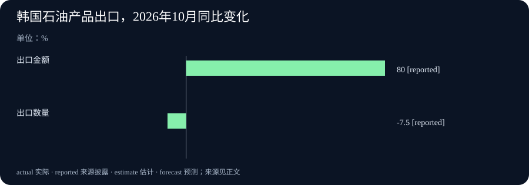

# Daily Intelligence · 2026-11-02

信息边界：新闻研究截止于北京时间 2026 年 11 月 2 日 06:57:46，优先窗口为此前 24 小时，即 11 月 1 日 06:57:46 起。本期四条主线均有 11 月 1 日的一手日期证据；部分页面没有可独立核实的发布时间及其时区，不能声称全部已证实落在严格 24 小时内。软件发布、会议决定与统计所属月份分别说明。

## Today's Thesis

人工智能（AI）软件在减少搭建流程和运行模型的障碍，贸易与能源消息则提醒我们：工具能用、货物卖出多少、未来准备生产多少，需要用不同证据判断。今天值得追踪的变化是具体功能与执行安排，效果仍要回到实际使用、数量和履约情况。

## Executive Summary

FastGPT 的新版本让用户用自然语言准备工作流程，但生成的版本仍要经过人工检查和发布。llama.cpp 的预发布版本补上两种紧凑模型格式的初始计算支持，这属于运行软件的变化，不能据此断言模型回答更好。

韩国产业通商部门公布 10 月出口数据。总金额大增，其中石油产品却出现“金额上升、数量下降”。石油输出国组织（OPEC）官网另行公布七个参与合作国家的 12 月产量安排。前者记录已经发生的贸易，后者规定未来生产要求，两者不能合起来当作能源供给已经改善的证明。

相对于最近两期报道，本期没有把 10 月 31 日的在轨 AI 实验，或 11 月 1 日的 Apple 中国功能时间表再次当作新消息。新增事实是两份 11 月 1 日的软件版本记录、韩国新公布的完整 10 月贸易结果，以及七国对 12 月生产要求的新决定。

## AI Daily

**FastGPT：先生成流程候选，再由人决定采用。** FastGPT 是搭建 AI 应用的软件；这里的“工作流”，指把检索资料、判断条件和输出答案等步骤连接起来。11 月 1 日的 v4.17.3 版本记录新增商业版工作流辅助生成。用户先确认文字方案，软件再连续搭建、检查和修正，交付一个可供选择的版本。中断后可以依据保存的对话与任务状态继续。增量在于流程准备方式，而不是推出一款新模型。[官方版本记录](https://github.com/labring/FastGPT/releases/tag/v4.17.3)

官方使用说明把边界写得很清楚：功能面向商业版及云服务，要求应用编辑权限，管理员还须启用相关能力和沙盒。沙盒是相对隔离的程序运行环境。生成结果尚未自动进入当前流程画布；用户手动采用后，还要检查配置、调试，再保存和发布。读者可把它理解为先拿到一份可编辑草稿，不能把“草稿已生成”当成“应用已投入使用”。说明页用于解释功能条件，不当作另一个当天新闻事件。[官方使用说明](https://doc.fastgpt.io/zh-CN/guide/build/workflow/assisted-generation)

**llama.cpp：为两种紧凑模型格式补上初始支持。** llama.cpp 是在本地设备运行语言模型的软件。11 月 1 日的 b12031 条目明确标为预发布，新增 OpenCL 对 IQ3_S、IQ3_XXS 的初始支持。OpenCL 是让程序调用图形处理器等计算设备的接口；这两种格式用较紧凑的数值表示模型参数，也就是模型计算使用的数字。程序需要实现相应计算，才能通过这条运行路径使用这些文件。[官方预发布记录](https://github.com/ggml-org/llama.cpp/releases/tag/b12031)

对应开发说明涉及 Adreno 图形处理器的计算优化，但没有提供足以推出“所有设备都会更快”的统一测试结果。适用设备、模型文件与运行设置仍需逐项试用。该改动在 10 月 28 日已进入开发讨论，本期新增披露是它进入 11 月 1 日的预发布版本；不能把讨论首次出现与版本公开混成同一时间。[开发者原始说明](https://github.com/ggml-org/llama.cpp/pull/31338)

两份版本页都显示 11 月 1 日的 released 日期。页面可见的小时缺少本期独立核实的时区依据，因此本期仅按日期采用，不把 Git 标签或代码提交时间冒充发布时间。

## Business Daily

**韩国 10 月出口大增，先区分金额与数量。** 韩国产业通商部门 11 月 1 日公布的数据显示，10 月出口约 1,152.8 亿美元，比去年同月增长 93.7%；进口约 727.8 亿美元，增长 36.0%，贸易顺差约 425.0 亿美元。顺差是出口与进口的差额，不是企业合计利润，也不是政府收入。数据所属期为 10 月，公开日期为 11 月 1 日。[韩国官方贸易公告](https://www.motir.go.kr/kor/article/ATCL3f49a5a8c/172360/view)

芯片出口约 564.4 亿美元，同比增长 259.4%。主管部门把相关需求与全球 AI 基础设施投资联系起来，这是官方对贸易结果的解释，不能据此把所有芯片销售都算成 AI 收入。公告还提及中秋假期从去年 10 月移到今年 9 月，影响部分品类的工作天数；比较单月同比时，需要同时留意这一条件。

一个更直观的反例来自石油产品：出口金额增长 80.0%，出口数量却下降 7.5%。金额增速很高，仍不代表运出的货物更多。对普通读者而言，遇到“出口创纪录”之类标题，下一步应先问它说的是美元金额、实物数量还是扣除价格变化后的结果。本期图表保留这两个方向相反的数字，没有把二者相减算成价格涨幅。

**七国确定 12 月生产要求，实际供给仍需观察。** OPEC 官网 11 月 1 日公告称，沙特阿拉伯、俄罗斯、伊拉克、科威特、哈萨克斯坦、阿尔及利亚和阿曼当天举行线上会议，决定在 12 月维持 2026 年 9 月的要求产量，并计划 11 月 29 日再次开会。这里的范围是这七个参与国家，不能扩展成所有产油国。[OPEC 官方公告](https://www.opec.org/pr-detail/620-1-november-2026.html)

本次新信息是对 12 月的正式安排。“要求产量”是参与方应遵循的生产水平，未来仍要看实际执行；它不等于已经生产或出口的数量。公告没有为运输、库存和炼厂需求提供完整答案，本期也不根据一份安排预测油价涨跌。页面与会议日期均为 11 月 1 日，小时未披露；会议日期本身不证明网页上传的精确时刻。

## Macro Observation

韩国贸易与七国生产安排可以放在同一条能源链上理解，但证据处于不同位置。出口金额回答的是卖出货物的货币价值；出口数量回答的是实际运出了多少；生产要求回答的是未来准备按什么水平组织生产。仅凭其中一个数字，很难知道消费者最终会面对怎样的价格与供应。

本期最有用的观察是金额与数量可能背离。企业卖货金额增加，既可能来自更多货物，也可能受到单价和产品构成影响。韩国的石油产品数据已经给出数量下降这一限制，所以不能进一步写成全球实体需求同步大增。反过来，七国给出生产安排，也不能立即证明未来供应短缺已经消除。跨地区、跨环节的因果关系，需要更多同口径数据支持。

## Signal Dashboard

- **流程搭建：功能已进入版本，使用仍有门槛。** FastGPT 提供可选择的工作流版本；人工采用、调试与发布依旧分别发生。观察点是实际减少多少返工，现有公告没有给出可比较的效果数字。
- **设备运行：新增支持，效果尚未统一测量。** llama.cpp 的两种模型格式支持处于预发布阶段。版本数量不能代替设备测试，也不能代替回答质量评估。
- **货物贸易：金额大增，实物方向不一。** 韩国总体出口与石油产品数量属于不同层级，不能用一项总额掩盖某类货物的下降。
- **能源安排：要求已经公布，未来执行未发生。** 七国决定覆盖 12 月，后续会议与实际生产资料才会补充结果。

## Deep Insight

今天四条消息共同提示一个阅读方法：判断进展之前，先确认它位于“准备、执行、结果”的哪一步。这个区分能保留新功能的价值，也能防止把尚未完成的事情写成现实。它不是一个行业都朝同一方向发展的证据，而是一种适用于不同新闻的核对方式。

在 AI 应用中，文字需求变成流程草稿，确实缩短了用户从想法走到可编辑对象的距离。但草稿里的步骤是否符合业务规则、连接的资料是否正确、输出能否被他人依赖，仍是不同问题。假设一个流程先查产品说明，再回答售后问题：图上的步骤连得通，并不能证明它引用的是现行保修条款。这个例子只是解释为什么还要检查资料与实际结果，不是对任何企业使用效果的报道。

本地运行软件的变化又属于另一层。模型文件采用较紧凑的数字保存参数，运行程序还要知道怎样计算这些数字。新增支持能够减少格式与设备之间的一道障碍，却没有自动回答准确率、速度、耗电和稳定性四个问题。用户若要比较效果，至少应保持设备、模型和测试任务一致，再观察自己需要的指标。把不同版本在不同设备上的零散感受相加，不能得出普遍收益。

贸易统计同样存在从动作到结果的距离。货物卖出了更高金额，并不必然意味着更多实物到达海外。即使数量确实增加，也不能只看销售额便判断利润，因为采购、运输和融资等成本尚未放进比较。此处的重点不是否认出口增长，而是确定这个数字能支持多大范围的判断。把一个大数字放回对应对象、单位和时期，读者反而更容易看出它真正重要的部分。

生产协议则把时间方向倒过来：它先描述未来应怎样做，实际结果要等执行后才有。要求不变，并不能证明实际生产、装船与交付完全不变；某一环节保持稳定，也不保证其他环节不会变化。对需要采购能源的企业，更实用的问题是交付日期、合同条件与可用库存，而不是仅凭会议措辞作一次方向押注。这是编辑分析，不构成对价格的预测。

因此，今天的判断应保持在证据所到的位置：流程准备多了一种方式，本地运行多了一项初始支持，韩国公布了一组已发生的贸易结果，七国明确了一段未来执行安排。它们分别提供可测试、可比较或可追踪的起点。真正有价值的后续报道，应补上下一环节的事实，而不是把原公告重新命名为“落地”。

## Tomorrow Watch

接下来关注 FastGPT 的使用者能否在有代表性的任务中减少修改次数，以及 llama.cpp 是否补充设备与模型条件清楚的测试。它们是待观察问题，本期没有预告厂商必定在明天披露结果。

贸易部分继续区分出口金额与数量，等待同口径后续资料，避免把一次单月变化直接延长成全年趋势。能源部分追踪七国实际生产与后续正式公告；11 月 29 日是已公布的下一次会议安排，不是已经作出的下一轮决定。

上期提及的 Apple 中国首批功能计划从 11 月 4 日开始开发者测试，仍属于此前公布的时间表。若后续出现实际开放及设备范围的新事实，再据实更新，不把今天的重复提醒算作新增新闻。

## One Chart

**韩国石油产品出口：金额上升，数量下降**

图中两项都是 2026 年 10 月相对 2025 年 10 月的变化，单位为百分比：出口金额增长 80.0%，出口数量下降 7.5%。图中 reported 表示“来源披露的数字”，两项均是对已发生贸易的统计，属于不同测量对象。

金额通常同时受数量、价格和商品构成影响。因此，这张图能说明金额与数量方向相反，不能单独测出价格究竟上涨多少，也不能把相差的百分点直接称为价格涨幅。来源为 11 月 1 日的[韩国官方贸易公告](https://www.motir.go.kr/kor/article/ATCL3f49a5a8c/172360/view)，统计所属期与公告日期已经分开标明。

## Quote of the Day

原文节录：“my country is the world, and my religion is to do good.”

中文译文：“世界是我的祖国，行善是我的信仰。”

Thomas Paine（托马斯·潘恩），《人权论》第二部，1792 年。此句保留原文在分号后的小写形式。可在[《潘恩文集》第二卷所收原文](https://www.gutenberg.org/files/3742/3742-h/3742-h.htm)中定位；[威斯康星大学麦迪逊分校的历史文献材料](https://csac.history.wisc.edu/wp-content/uploads/sites/281/2025/06/CSAC-FoF-P-NEW-2.pdf)也将该段列为《人权论》第二部、1792 年。

上下文是潘恩批评贵族政治及不公平税负，并说明自己从人道立场独立判断。编辑解读：这句话提供的是超越狭窄立场、关心人的价值视角，不是作者在谈现代 AI 或今天的贸易政策。

## Action Items

1. **流程生成后，谁负责检查？** 若准备试用辅助搭建，先写明资料范围、输出要求和发布负责人，再用一个可重复的小任务观察修改过程。

2. **新支持适合自己的设备吗？** 核对模型格式与运行条件，保留原有可用版本，比较相同任务的实际表现，分别记录速度和答案质量。

3. **出口增长说的是钱还是货？** 阅读统计时先标出单位、品类和比较时期；金额与数量同时可得时，放在一起判断，避免只看最大增幅。

4. **生产决定何时变成供给？** 需要关注能源的读者可分别记录要求产量、实际生产和交付资料，不把未来安排填进已实现结果。

5. **下一条证据会改变什么判断？** 为今天的主要判断各写一个可检验条件，例如流程返工是否减少、数量是否回升；后续用新事实回答，避免重复追逐旧标题。
