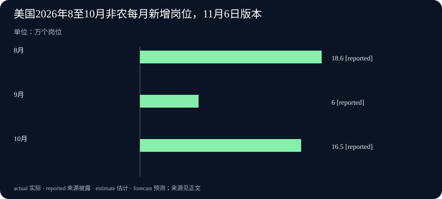

# Daily Intelligence · 2026-11-07

信息边界：新闻研究截止于北京时间 2026 年 11 月 7 日 07:00:11，优先窗口从 11 月 6 日 07:00:11 开始。美国就业报告和加拿大统计局当天公报的发布时间为美国东部时间 11 月 6 日 08:30，换算为北京时间 21:30。两条 AI 主线按明确标注的 11 月 6 日新披露纳入，小时未披露，不能据此声称已严格核实全部来源处于 24 小时内。Google 页面原发于 10 月 21 日，本期只将其明确注明日期的正式可用进展视为新增。

## Today's Thesis

人工智能（AI）走进真实业务，需要确认服务是否交付，也要检查它与其他系统连接后是否安全。今天的两项新进展分别推进这两件事。美、加就业资料同时提醒读者，总量可以掩盖内部差别：岗位增加、就业人数大致持平，以及不同群体的求职困难，都需要按各自口径解释。

## Executive Summary

OpenAI 宣布与 Hacktron 合作，联合测试自身系统，重点放在与第三方服务交互的地方。这次新增是合作对象、测试重点及模型访问安排，前一期的 GPT-6 Cyber 发布仍是背景，不能再当成另一轮新模型发布。

Google Cloud 在既有公告中明确补充：A5X 实例于 11 月 6 日正式可用。实例指用户租用的一组云端计算资源。这是从先前公布方案进入服务交付的新进展，尚不能据此推断每个地区、账户和规模都有即时容量。

美国 10 月非农工资单岗位增加 16.5 万个，8、9 月合计上修 8.4 万个。加拿大 10 月就业人数大致不变，失业率却升至 6.7%。两个国家的就业统计对象不同，不能直接把新增数量相减，或者据此判断某一种技术正在创造或取代多少工作。

## AI Daily

### 1. OpenAI 与 Hacktron 联合测试，关注服务之间的连接

OpenAI 11 月 6 日宣布与安全研究团队 Hacktron 合作。双方将共同选择优先检查的区域，重点测试 OpenAI 系统怎样与第三方服务交互。OpenAI 还将通过 Daybreak Red 扩大 Hacktron 对其前沿模型的访问。Daybreak Red 是向经过审核的安全研究团队提供模型能力的安排。[OpenAI 合作原文](https://openai.com/index/partnering-with-hacktron/)

这次合作所针对的，是应用、云端设施和身份系统相互连接时可能出现的问题。身份系统负责判断谁有权访问什么。一个应用本身的权限设置正确，并不自动证明它把请求交给另一个服务后，原有权限仍被正确保留。这是对测试方向的解释，不代表公告已经证实某个具体连接存在漏洞。

与前两期相比，本次新增的是外部研究团队参与、联合选定测试区域和扩大访问安排。公告没有列出这次合作已修复的漏洞数量，也没有证明所有连接已安全。对使用 AI 工具的团队，值得借鉴的是先画出资料和动作经过哪些服务，再明确每一段由谁授权、谁能复查。模型性能、联合测试和正式修复是不同进度，应分别追踪。

### 2. A5X 云端计算资源正式可用，新增事实是交付状态

Google Cloud 在 10 月 21 日的合作公告中，加入明确标注 11 月 6 日的说明：A5X 实例已经正式可用。先前正文写的是计划在随后一个月开放，本次新增因此是服务状态的推进。原公告介绍，A5X 采用 NVIDIA Vera Rubin 平台，面向训练模型及运行模型回答请求等计算工作。[原公告及 11 月 6 日日期说明](https://cloud.google.com/blog/topics/ai-infrastructure/google-cloud-infrastructure-at-nvidia-gtc-berlin-2026)

云端资源可以让团队按服务安排取得计算设备，省去自行建设全部设施的一部分工作。正式可用通常是评估生产业务能否采用该服务的重要节点，具体仍要核对所在地区、可分配容量、合同与软件适配。这里没有足够资料替任意账户确认配额，也不把旧公告列出的扩展规模当成今天已经建成的集群。

昨日 NVIDIA 报道关注处理器的指定测试成绩；今天关注 Google Cloud 的服务交付，两条消息分别回答“测试中怎样”和“服务走到哪一步”。它们还不能代替同一任务下的总费用比较。准备采用的团队，可以先选一项稳定任务，记录运行时间、等待资源的时间及实际账单，再决定是否扩大使用。

## Business Daily

### 1. 美国 10 月新增岗位回升，前两月数字同时上修

美国劳工统计局 11 月 6 日公布，10 月非农工资单岗位增加 16.5 万个。这个数字来自对企业和机构的调查，统计岗位，排除农场等指定范围。报告还把 8 月新增数从 13.3 万修订为 18.6 万，把 9 月从 2.9 万修订为 6 万。两月合计比原先多 8.4 万。比较连续几个月时，应使用本次同一版本的数据。[美国劳工统计局原始报告](https://www.bls.gov/news.release/empsit.nr0.htm)

专业与商业服务增加 7 万个岗位，医疗增加 4.2 万个，运输仓储增加 2.5 万个。与此同时，失业率为 4.1%，官方称变化不大。失业率来自另一项住户调查，计算劳动力中没有工作、且符合求职条件的人占多少；它与工资单岗位数不是一张调查表的两面。

本次新增的是 10 月实值和历史修订。总体招聘回升可以与部分求职者仍难找到合适工作同时存在。岗位总量还不能说明每个行业、地区或经验层次的机会都同步改善。对企业，应把本行业的招聘、工资和实际订单一起看；对求职者，更有帮助的是关注自身岗位类别和所在地的机会变化。

### 2. 加拿大就业人数大致持平，失业率与部门构成仍在变

加拿大统计局同日公布，10 月就业人数减少约 4,700 人，按报告判断属于大致不变。就业率降 0.1 个百分点至 60.5%，失业率升 0.2 个百分点至 6.7%。就业率在此指 15 岁及以上人口中有工作者的比例；失业率的分母则是劳动力，两者不能互换。[加拿大劳动力调查原文](https://www150.statcan.gc.ca/n1/daily-quotidien/261106/dq261106a-eng.htm)

私营部门雇员减少 5.3 万人，公共部门雇员增加 5 万人。15 至 24 岁青年失业率升至 13.7%。总就业变化小，并不意味着部门之间没有较大的相反变动，也不表示每个年龄层感受相同。

这份住户调查反映 10 月 11 日至 17 日的情况。月度估计存在抽样波动，原文明确提醒较长时期的趋势通常更稳定。美国工资单统计岗位，加拿大这里统计就业者，覆盖范围也不同。应分别判断各自内部的变化，再观察后续资料是否支持持续改善或转弱；单凭这两个新增数，无法归因于 AI 或某一项政策。

## Macro Observation

美国岗位增加与加拿大就业人数大致不变，并没有组成一个统一的北美招聘故事。调查对象、人口范围与经济结构都不同。即便在一个国家内部，不同部门也可能朝相反方向变动。将总数拆开，才能知道一项变化对哪些人更相关。

前一期关注英国利率和欧元区出厂价格，本期补充的是新公布的北美劳动市场资料。融资、采购和用工面对的条件可以不同步。对跨市场经营的企业，更可操作的办法是按地区列出真实订单、招聘需要和资金安排，用每份新资料更新相应部分，而不是用一个国家的结果替所有地区作结论。

## Signal Dashboard

| 主线 | 本次新事实 | 后续应核对什么 |
| --- | --- | --- |
| 安全合作 | OpenAI 与 Hacktron 联合选定测试区域，关注第三方交互 | 公开的研究发现、修复与授权范围 |
| 云端资源 | A5X 明确于 11 月 6 日进入正式可用阶段 | 地区、容量、合同与实际任务费用 |
| 美国就业 | 10 月新增 16.5 万岗位，前两月合计上修 8.4 万 | 后续修订、行业与地区差异 |
| 加拿大就业 | 总人数大致持平，私营与公共部门反向变化 | 青年机会、部门变化及较长趋势 |

## Deep Insight

### 先看变化发生在哪一层，再决定要改什么

一条消息中的总量，往往是很多不同环节的共同结果。看清它处在哪一层，才能把新闻变成一个可检查的问题。今天的服务开放和就业统计看起来相距很远，却都要求读者先确认对象，再决定下一步要找什么证据。这个阅读方法不会让两者产生因果关系，它只是帮助我们避免跨过中间步骤。

对于云端资源，产品介绍、正式可用和某个账户拿到容量是三个节点。一个团队可能已经能开始申请服务，却仍需要安排软件迁移、数据位置和采购合同。假设原来的一项任务要运行十小时，换用另一套资源后变为八小时，团队还需记录等待资源用了多久、修改软件投入多少人工、同一账期花了多少钱。这些是假设，不是对 A5X 效果的估计。只有把新增支出与节约放在同一任务边界里，才能判断采用方案是否合适。

安全检查还要跨过组织边界。假设一个助手读取公司文件，接着让外部服务处理，再把结果写回内部系统，三个动作可能由不同账户执行。资料能成功走完流程，只能证明连接可工作。团队还应确认每一步是否保留原先的访问限制，以及请求失败后会不会换一种权限更宽的方式重试。这类问题需要得到系统所有者授权的测试，不能因为工具能执行，就假定所有动作都已获准。合作公告提供的是进一步检查的安排，具体结论要等可核实的发现与处理记录。

就业资料则要求换一种拆解。企业调查里的岗位增加，不能直接回答住户调查里每个人的处境。部门之间的相反变动也会被总数抵消。假设一位青年求职者所在行业减少招聘，而其他行业增加岗位，全国总量改善仍可能与他的困难并存。承认两者可以同时发生，有助于把问题改为：哪些技能、地区或行业正在出现机会，现有培训和求职选择是否对应那些机会。这个假设用于解释统计与个人经验为何可能不同，不代表资料追踪了某个具体求职者。

另一个容易忽略的环节是版本。美国这次修订了前两月数字。如果继续用旧的 9 月值与新的 10 月值比较，会把历史估计的调整混进当月变化。保留原始发布日期和最新版本，可以区分“经济后来怎样”与“我们后来知道了什么”。加拿大的月度估计也需要结合抽样波动和后续观察，不能将一个小幅变化写成已经确定的长期拐点。

更好的跟踪记录可以很简单：写明对象、期间、当前状态和下一个能改变判断的证据。云端服务看实际容量与账单，安全合作看获授权的发现和修复，就业看同一口径下的后续月份与分项。这样的记录允许判断随证据改变，也能让不同成员知道目前究竟确认到哪一步。它比只记一个醒目的增长数字更有助于下一次决策。

## Tomorrow Watch

继续观察 Hacktron 合作是否披露可复查的研究成果，以及发现怎样进入修复流程。跟踪 A5X 的地区、容量和配套条件，区分正式可用说明与具体用户已经完成的部署，不重复累计此前的处理器测试。

北美就业后续重点看美国历史值是否再修订、增长是否延伸到更多行业，以及加拿大私营部门和青年群体是否出现持续变化。周末没有新实值时，应等待对应机构的新报告，不把日程或市场预测写成已实现结果。

## One Chart

### 美国非农新增岗位，8 月至 10 月采用本次报告版本

三根柱子依次为 2026 年 8 月 18.6 万个、9 月 6 万个、10 月 16.5 万个，均为经季节调整的每月新增工资单岗位。8、9 月采用 11 月 6 日报告修订值；10 月是本次初次公布值。reported 表示“来源披露的数字”。10 月比 9 月多增 10.5 万个岗位，但低于修订后的 8 月。这张图既不是累计岗位总量，也不与加拿大就业人数直接相减。[原始报告及修订说明](https://www.bls.gov/news.release/empsit.nr0.htm)

## Quote of the Day

原文：No, we are all in the gutter, but some of us are looking at the stars.

中文译文：不，我们都身处沟渠，但我们中有些人正仰望星空。

人物：Oscar Wilde（奥斯卡·王尔德）

出处为《温德米尔夫人的扇子》（Lady Windermere’s Fan）第三幕。作品于 1892 年首演，1893 年出版。达林顿勋爵在谈论人们的善恶时说出这句话，邓比随后回应说他今晚很浪漫。这里引用的是剧中人物台词，不能直接视为作者的个人自白。[原著转录及版本说明](https://www.gutenberg.org/files/790/790-h/790-h.htm) · [大英图书馆手稿与演出、出版年份](https://searcharchives.bl.uk/catalog/040-002054405)

编辑解读：承认眼前处境与保留更远的愿望，可以同时成立。这是对文学台词的阅读，不借作者之名替今天的技术或经济作预测。

## Action Items

1. **连接到另一个服务后，权限还一致吗？** 列出资料与动作经过的服务，由各系统所有者确认允许范围和复查方式。

2. **正式可用之后，自己的账户拿得到吗？** 核对地区、容量与合同，再用同一项任务记录时间和费用。

3. **就业数字用的是哪个版本？** 比较美国连续月份时，统一采用本次报告的修订值，并保留旧版本日期。

4. **总量掩盖了谁的变化？** 将部门、年龄和地区分开看，避免用总体结果代替具体求职者的处境。

5. **什么证据会让自己改变判断？** 为每项关注设一个可核对的下一步，例如资源实际交付、已公布的修复或同口径的新一月数据。
