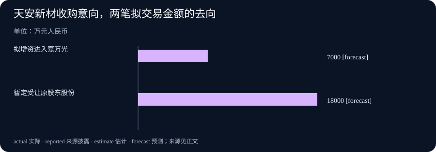

# Daily Intelligence · 2026-11-09

信息边界：新闻研究截止于北京时间 2026 年 11 月 9 日 07:03:11，优先窗口从 11 月 8 日 07:03:11 开始。LiteLLM 与 llama.cpp 的实际 release 时间分别为北京时间 11 月 8 日 10:25:47、23:47:03，两者均为预发布版。天安新材公告及交易所列表标注 11 月 9 日，签约发生于 11 月 6 日；首次公开小时未独立核实。塞浦路斯财政部公告标注 11 月 8 日 10:58，但页面未明示时区，本期按日期采用，不声称四条来源全部严格核实到小时。编写完成时间晚于上述研究截点。本期于 2026-11-09T09:03:19+08:00 更正经典引文辅助出处的链接编码，新闻研究截点与原始来源日期保持不变。

## Today's Thesis

人工智能（AI）服务开始更细致地规定哪些内容留下、相同输入怎样稳定计算。企业投资和经济政策也需要把状态讲清：钱准备付给谁，协议走到哪一步，减税是否已经获准。今天值得追踪的进展，是具体规则和安排的改变；不能让一个新版本或一份公告替最终结果作保证。

## Executive Summary

LiteLLM 的开发预发布版让管理员按团队或调用凭证，关闭费用记录中的输入与回答内容保存；它还修复空回答被反复缓存的问题。前者调整记录范围，后者调整重复请求怎样处理，两项都不是模型知识升级。

llama.cpp 的新预发布版处理“分数相同时选谁”的不稳定问题，重点是特定计算路径的可重复性。昨日的分组归一化修复解决另一种错误，不能把两个版本合并成一项通用能力提升。

天安新材披露拟用约 2.5 亿元取得嘉万光 62.5%股权，其中增资与受让老股的钱流向不同。塞浦路斯财政部则披露，政府仍在等待欧盟委员会对进一步降低取暖油消费税请求的回应，并列出本周一财政会议议程。收购意向与政策请求都需要继续核对后续决定，尚未成为完成交易或已经执行的减税。

## AI Daily

### 1. LiteLLM 将内容保存设置细化到团队，空回答也不应反复复用

LiteLLM 是帮助应用连接不同模型服务、分配请求并记录费用的软件。11 月 8 日发布的 v1.110.0-dev.2 明确标为预发布。它允许管理员按团队或某个调用凭证，关闭费用记录中的提示词与回答保存。提示词是交给模型的输入；调用凭证则用于识别并授权请求。管理员不必为了一个团队的要求，改变所有团队的全局设置。[官方预发布记录](https://github.com/BerriAI/litellm/releases/tag/v1.110.0-dev.2)

开发说明进一步明确：团队或凭证只要有一方禁止保存，请求端就不能重新打开这项内容记录。费用仍可记录，但其中不再带请求与回答正文。这个范围限于所述费用记录，不等于模型提供方、应用自身或其他日志都停止保存内容。相关设计早于本次发布，本期新增事实是这些改动进入 11 月 8 日的预发布版本。[功能原始说明](https://github.com/BerriAI/litellm/pull/50135)

同一版本还修复空回答进入缓存、相同请求随后总是重放空结果的问题。缓存就是保存结果以便再次使用；这次修改会跳过没有输出的回答，并把旧的空记录视为没有可复用结果，让请求重新到达模型服务。它并不保证第二次一定有答案，也没有取消所有正常回答的复用。[修复原始说明](https://github.com/BerriAI/litellm/pull/50057)

普通读者可以把两项变化理解为：系统需要分别决定“什么值得保存”和“什么可以再次当作结果”。采用前仍应检查自己的记录去向与重复请求行为，不把预发布功能写成所有现有部署已经启用。

### 2. llama.cpp 处理并列候选的不稳定选择，目标是让指定计算可重复

llama.cpp 是在本地等环境运行模型的开源软件。11 月 8 日的 b12208 预发布版调整 Top-K 计算，即从一组候选中选择分数最高的若干项。当边界上出现相同分数时，旧的特定实现可能因为计算线程先后顺序不同，改变候选的排列，甚至改变被选中的集合。线程是程序同时处理工作的执行单位。[官方原始预发布说明](https://github.com/ggml-org/llama.cpp/releases/tag/b12208)

发布记录描述了 CUDA 与 Metal 等指定运行路径的改动。CUDA 是调用 NVIDIA 图形处理器计算的软件平台；Metal 是使用 Apple 设备图形处理器计算的技术。对于其中的 Metal 路径，修改用稳定的规则安排并列候选，减少线程调度对结果的影响。新版本还启用对应的可重复性检查。读者不必了解内部排序代码，也能理解验收目标：给定相同输入、相同设置，这一步应按约定选出相同结果。

这一变化与昨日的 b12189 分组归一化修复不同。昨日处理指定批量输入下部分输出未写出，今日处理选择步骤中的并列情况。两者都有明确适用条件；不能因为同一个项目连续发布，就推断每个模型回答都更准。发布说明中的局部性能比较也受设备和输入条件影响，本期不把它扩展成整项应用的通用加速幅度。

## Business Daily

### 1. 天安新材拟取得光通信企业控股权，增资与老股受让分别安排

天安新材在标注 11 月 9 日的公告中披露，已于 11 月 6 日签署收购意向协议，拟通过增资和股权转让取得深圳市嘉万光通信有限公司 62.5%股权。初步以目标公司全部股权约 4 亿元估值计算，本次两部分金额合计约 2.5 亿元。嘉万光从事光通信相关器件及光缆等产品业务；这里是收购另一家公司的股权安排，不是天安新材已获得等额产品订单。[上交所所载公司原始公告，第 1 页](https://static.sse.com.cn/disclosure/listedinfo/announcement/c/new/2026-11-09/603725_20261109_QN94.pdf)

其中，拟现金增资 7,000 万元，取得增资后 17.5%股权；另拟支付暂定 1.8 亿元，受让原股东持有的增资后 45%股权。增资款进入目标公司，受让老股的对价付给出售股份的原股东。两笔钱的用途不同，不能把全部 2.5 亿元写成目标公司拿到的新资金。公告还明确，这两部分互为条件。

原件列有未来年度的业绩承诺及补偿安排。承诺用于约束交易各方，不能当成已经赚到的利润。本期图表只画两部分拟交易金额，不把未来承诺与实际经营混在一起。当前确认的是意向协议与已披露结构，后续仍须核对最终条款、履行情况和公司正式公告，不能据此宣布控股收购已经完成。

### 2. 塞浦路斯仍在争取取暖油减税，欧洲财政会议尚待作决定

塞浦路斯财政部 11 月 8 日公告称，政府正等待欧盟委员会主管部门对进一步降低取暖油消费税请求的回应。消费税是对特定商品征收的税，降低它可能改变税负，但是否获准、怎样执行，以及最终销售价格怎样变化，仍是不同问题。财政部长同时公布赴布鲁塞尔参加 11 月 9 日会议的安排。[财政部原始公告](https://www.gov.cy/en/european-affairs/the-minister-of-finance-of-the-republic-of-cyprus-travels-to-brussels-for-the-eurogroup-and-ecofin-meetings-of-9-november-2026/)

公告列出的欧元集团议题包括欧元区经济和通胀前景，以及各国编制 2027 年预算的情况。欧元集团是欧元区财政部长的协调会议。当天还安排欧盟经济与财政事务理事会会议，涉及烟草税规则调整、法规给企业和公共部门带来的经济影响等议题。这里报道的是已公布的讨论安排，不是会议已通过的新税率或预算。

这条消息补充了上一周利率和能源价格资料之外的政策环节：政府希望怎样减轻家庭与企业负担，还要经过相应程序。财政部长认为接触情况积极，是一方对进展的描述，不能替代正式批准。本期不预判会议结果，也不从议程推算欧洲所有国家都会同时减税。

## Macro Observation

企业收购与税收协调都可能影响资源分配，但资金经过的渠道不同。增资让资金进入目标企业；受让老股改变股份归属；减税若获准，则改变对应商品的税负。把它们都称为“新增投入”会丢掉关键区别，也难以判断谁真正得到可使用的资金。

昨日讨论的是已披露的储备和季度利润，本期补充尚在推进的投资结构与政策请求。研究时先固定它们的状态，后续才知道什么证据足以更新判断。两笔公司交易安排不能用来推断整个光通信行业需求，欧洲一国的请求也不能证明整个地区的税收方向已经改变。

## Signal Dashboard

| 主线 | 本次新增事实 | 尚需核对的条件 |
| --- | --- | --- |
| 内容记录 | LiteLLM 预发布细化团队与凭证的正文保存设置 | 实际部署、记录去向及限制是否生效 |
| 计算可重复性 | llama.cpp 预发布调整并列候选选择 | 指定后端、相同输入及重复运行结果 |
| 企业投资 | 天安新材披露增资与老股受让的意向结构 | 最终条款、资金去向与交易履行 |
| 欧洲财政协调 | 塞浦路斯披露减税请求状态及周一会议安排 | 委员会回应、正式决定与执行条件 |

## Deep Insight

### 留下什么记录，决定下一次能确认什么

今天的软件更新提示一个常被忽视的问题：记录多，并不总是更好；记录少，也不自动意味着过程更安全。关键在于记录是否对应要回答的问题。费用管理需要知道用了多少服务，未必总要保存完整输入与回答。复用结果需要先确认它确实包含有效输出，不能只因为有一条记录，就把它当作可用答案。这些区别让管理规则更接近实际用途。

假设一个团队用模型整理内部材料，希望保留费用分摊，却不希望正文出现在费用管理页面。团队需要检查这条记录是否真的去掉正文，同时另行确认应用和模型服务各自的保存规则。这个假设解释本次设置可以解决哪一层问题，不是在描述某家企业已经采用，也不构成对所有数据去向的保证。若只看一个“关闭保存”的开关，就推断所有地方都不再存储，便跨过了系统之间的边界。

空回答缓存则说明，成功接到一个响应，与获得可复用结果并非同一件事。一次请求结束后，如果没有可用输出，保存并重放它可能让后续尝试一直停在原处。跳过空结果可以恢复再次请求的机会，但不能保证外部模型会给出正确回答。验收时应分别观察有没有重新请求、有没有输出，以及输出是否满足任务要求。这三种结果各自需要证据。

计算中的可重复性还有不同含义。对于分数相同的候选，系统需要一个稳定的选择规则；否则，后来出现差别时，团队难以区分是模型、输入、设置还是执行顺序改变了。让一个步骤可重复，有助于定位问题，却不等于它选择的候选在现实任务里一定最好。正确性、重复性与任务质量相互有关，仍应分开验证。本期两个项目的改动给出具体检查方向，没有替所有模型完成这三项验证。

经营公告中的记录也需要沿状态阅读。收购意向中写出两笔对价，使读者知道未来的钱准备流向哪里；它还没有回答最终何时支付、条件是否满足。即使一份协议列出业绩承诺，未来利润仍须等实际经营与财报确认。若读者只把约定金额记在一张“新增资金”表里，会把进入公司的增资与付给原股东的购股款合并，失去交易结构最重要的一部分信息。

财政政策同理。政府提出请求、主管部门回应、会议讨论、正式决定和实施，分别留下不同记录。消息说部长将争取一项安排，只能说明当前政策方向与程序状态；家庭或企业究竟何时受益，要看之后的正式条件和实际价格。把这几步分别保留，下一次出现新公告时，就能说明进展发生在哪一段，而不会重复计算同一个请求。

因此，一份实用的跟踪表可以只有四栏：对象、当前状态、已经确认的记录、下一项可改变判断的证据。对软件，它可能是费用记录或重复运行结果；对交易，它可能是最终协议与资金履行；对政策，它可能是正式批准及生效安排。这样的记录帮助我们判断下一步应查什么，也为后来纠正原有判断留下位置。

## Tomorrow Watch

软件方面，观察两项预发布是否进入后续稳定版本，以及指定场景的测试能否复现。对内容保存设置，分别核对费用记录和其他保存渠道，不用一个开关概括所有系统。

经营与政策方面，关注天安新材的后续正式披露，以及欧洲会议和塞浦路斯减税请求的新记录。本期截点之前尚未发生的会议结论、资金支付或税率调整，都不提前写成结果。

## One Chart

### 天安新材拟交易金额，两笔钱的流向不同

两根柱子为拟增资 7,000 万元和暂定老股受让款 18,000 万元，单位为万元人民币，合计 25,000 万元，即 2.5 亿元。图中 forecast 表示“目标或计划”，不是已经支付的现金。前者拟进入嘉万光，后者拟支付给出售股份的原股东；对应增资后股权比例分别为 17.5%与 45%。两部分互为条件，不能把合计金额都写成目标公司新取得的资金。[原始公告第 1 页](https://static.sse.com.cn/disclosure/listedinfo/announcement/c/new/2026-11-09/603725_20261109_QN94.pdf)

## Quote of the Day

原文：Be a philosopher; but, amidst all your philosophy, be still a man.

中文译文：做一位哲学家吧，但在所有哲学思考之中，仍要做一个人。

人物：David Hume（大卫·休谟）

出处：《人类理解研究》第一节，作品最初于 1748 年以《人类理解哲学论文集》之名出版。本期文字参照依据 1777 年遗著版整理的转录，保留其拼写与标点。休谟在这里讨论理性研究、社会交往与日常活动之间的平衡，借“大自然”的口吻劝人不要让一种追求排挤其他生活。[原著第一节](https://www.gutenberg.org/files/9662/9662-h/9662-h.htm) · [1748 年初版该段影像与转录](https://en.wikisource.org/wiki/Page:An_Enquiry_Concerning_Human_Understanding_-_Hume_%281748%29.djvu/19)

编辑解读：思考可以帮助生活，也需要给人与人的相处留下空间。这是对经典文字的阅读，不冒充作者对当代技术或经营的评论。

## Action Items

1. **费用记录需要留下正文吗？** 区分费用分摊、内容复查与各系统保存规则，再确认团队设置的实际范围。

2. **重复请求真的再次尝试了吗？** 分别检查空结果、是否重新到达模型服务，以及后来输出是否满足要求。

3. **相同输入为什么得到不同选择？** 固定版本、后端和设置，复测并列候选的情况，不把一个步骤的稳定性当成整体质量保证。

4. **收购款最终付给谁？** 把增资和老股受让分别记录，继续核对条件、最终协议与履行进度。

5. **政策请求已经变成决定了吗？** 为关注的税收安排记录提出、回应、批准和实施的日期，以正式新材料更新判断。
