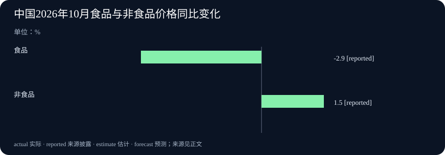

# Daily Intelligence · 2026-11-10

信息边界：新闻研究截止于北京时间 2026 年 11 月 10 日 07:04:47，优先窗口从 11 月 9 日 07:04:47 开始。国家统计局原页标注 9 日 09:30，按中国官方发布当地时间列示。Anthropic、Meta 和 monday.com 原页均标注 11 月 9 日，小时与原页时区未披露，不能声称已逐条证实处于严格 24 小时窗口。物价数据属于 10 月，企业财报属于截至 9 月 30 日的第三季度；发布日期与统计期间不同。

## Today's Thesis

人工智能（AI）的新竞争同时发生在两端：更复杂的任务，以及大量重复的小任务。模型报价可以下降，但实际省下多少钱，要看任务是否完成、失败后是否重做，以及后续人工检查。企业收入和居民物价也需要读清各自的口径，才能知道一个醒目的数字到底改变了什么。

## Executive Summary

Anthropic 发布 Claude Fable 5.2 与 Mythos 5.2，面向复杂技术工作。两者使用同一底层模型，安全限制和准入安排不同。标准价格为每百万输入、输出计费单元分别 8、40 美元；可选快速模式收费更高，不能把更快直接理解为更便宜。

Meta 发布 Muse Ember，负责调用工具、提取资料等反复执行的任务。输入不超过 20 万计费单元时，每百万输入、输出分别为 0.10、0.50 美元；更长输入适用更高费率。不同模型分工的产品设计更明确了，实际任务效果仍需测试。

中国 10 月居民消费价格同比上涨 0.7%，食品与非食品价格方向不同。monday.com 第三季收入同比增长 19%，披露 AI 相关订阅的年化指标为 3,600 万美元。年化订阅金额、当季收入、利润与现金流需要分别看。

## AI Daily

### 1. Anthropic 升级复杂任务模型，准入与速度各有条件

Anthropic 11 月 9 日发布 Fable 5.2 和 Mythos 5.2，用于较难、开放程度较高的技术工作。两者并非两套独立模型：公司明确表示底层相同。Fable 设置网络安全和生物领域的防滥用限制，面向较广用户；希望用于相关研究的组织，可以通过验证项目申请 Mythos。Fable 已在 Claude 平台及主要合作云平台提供，具体使用量还取决于套餐和账户条件。[官方发布与准入说明](https://www.anthropic.com/claude-fable-and-mythos-5-2)

标准模式每百万输入 token 收费 8 美元，每百万输出 token 为 40 美元。token 是模型处理和计费时使用的文字等内容单元，不等于一个汉字或一个单词。输入是交给模型的内容，输出是模型生成的内容。可选快速模式分别收费 16、80 美元；公司称生成 token 的速度最高可达标准模式的 2.5 倍。这是输出阶段的速度上限，不能当成整个项目都快 2.5 倍。

公司还披露代码等测试的改善，但测试设置、工具与任务选择会影响结果。普通用户更需要回答：自己的困难任务能否稳定完成，是否少了人工返工。官方也建议，多数日常编程和知识任务先从 Opus 5.5 开始，再按难度调整。开发者记录还要求保留数据 30 天用于安全监测，零数据保留须获得明确授权，接入前应核对这些条件。相对于前两期的模型运行软件修复，本次新增事实是模型版本、服务报价和准入安排，不是把旧版软件更新改写成能力突破。[同日开发者更新记录](https://platform.claude.com/docs/en/release-notes/overview)

### 2. Meta 用 Muse Ember 承接小任务，低单价仍有长度条件

Meta 同日发布 Muse Ember，定位是反复执行的小步骤，例如读取文件、调用工具、从文档提取资料，以及完成局部代码修改。这里的 AI 代理，是能分步使用工具完成任务的程序。较大模型可以负责计划，Ember 处理其中较明确、数量较多的步骤。它已在 Muse Code 和 Meta Model API 提供；后者是开发者接入模型的服务接口。[Meta 原始研究公告](https://research.meta.ai/blog/muse-ember)

标准报价针对输入不超过 20 万 token 的请求：每百万输入 0.10 美元、输出 0.50 美元。若输入超过这一门槛，对应费率为 0.30、1.50 美元。模型能接收很长的材料，不代表所有长度都按最低价格收费。一次可处理内容的上限，通常称为上下文窗口；本次窗口约为百万 token。团队应同时核对容量、实际输入长度和适用价格。[开发者应用说明](https://dev.meta.ai/resources/blog/build-with-muse-ember)

Meta 用指定测试展示每项任务的成本和得分。厂商表格并非每项都领先：在评价代码修改是否可被接受的 FrontierCode 2.0-AA 中，Ember 为 27.2%，Haiku 5.5 为 34.9%。这组结果仍依赖测试条件，也不能代表所有真实代码任务。它说明选型应看具体工作，低价模型适合哪些步骤，要与错误后的重试、检查成本一起测量。

## Business Daily

### 1. 中国 10 月物价小幅上涨，食品下降与非食品上涨并存

国家统计局 11 月 9 日公布，10 月居民消费价格指数（CPI）同比上涨 0.7%，即比去年同月高 0.7%；与 9 月相比则持平。该指数综合记录居民购买商品和服务的价格变化，不是居民收入或消费总金额。[国家统计局原始数据](https://www.stats.gov.cn/sj/zxfb/202611/t20261109_1965795.html)

其中食品价格同比下降 2.9%，非食品上涨 1.5%；扣除食品和能源后的价格同比上涨 0.8%。这些拆分帮助解释为什么总指标上涨，部分日常购买的东西仍可能变便宜。各类别在指数中的权重不同，不能把两个涨跌幅简单相加或平均，就当成整体涨幅。

对普通家庭，实际感受还取决于购买什么、买多少和所在地的价格。对企业，销售单价、采购成本和销量也可能分别变化。这次新增的是 10 月价格记录，不能仅凭一个月的总指标，就认定所有行业需求一起走强，或居民购买力已经改善。

### 2. monday.com 收入增长，AI 订阅指标与实际收入须分开

提供团队工作管理软件的 monday.com 11 月 9 日披露，第三季收入为 3.775 亿美元，同比增长 19%。按美国通用会计准则计算的营业利润为 3,120 万美元，去年同期为亏损 240 万美元。公司另报调整后营业利润 8,940 万美元，剔除了股份薪酬等指定费用，不能与会计利润混用。[公司正式财报与指标定义](https://ir.monday.com/news-and-events/news-releases/news-details/2026/monday-com-Announces-Third-Quarter-2026-Results-new/default.aspx)

公司披露，AI 相关年度经常性收入（AI ARR）达到 3,600 万美元。这个名称容易被误读：它将测量时点的相关订阅按一年折算，并假设到期合同按原条件续约，不是本季度已经确认 3,600 万美元 AI 收入。其范围还包括订阅套餐中分配给 AI 使用额度的部分，不限于单独出售的 AI 产品。因此，不能直接用它除以季度收入来推算 AI 收入占比。

盈利改善也没有与当季现金流同向变化：经营活动现金净流入为 2,040 万美元，低于去年同期的 9,510 万美元。公司对第四季收入的预期为 3.80 亿至 3.82 亿美元，约同比增长 14%，属于预测而非完成值。后续应追踪订阅续约、收入确认和现金流，不能把一次年化指标披露当成整套 AI 投资已获得回报。

## Macro Observation

模型价格与全国物价衡量的是不同对象，今天的公告没有证明两者存在直接因果关系。前者是指定服务、输入长度和运行模式下的收费，后者是许多商品与服务价格的综合变化。它们提供的共同提醒是：总数背后有构成，不能跳过构成直接解释生活或经营结果。

食品下降而非食品上涨，意味着价格变化并不整齐。软件公司的收入、营业利润和现金流也可能方向不同。读这些资料时，先问清楚是在观察价格、销售、利润，还是实际资金进出，再决定需要什么补充证据，会比从一个总数推导全局更可靠。

## Signal Dashboard

| 主线 | 本次新增事实 | 尚不能据此得出的结论 |
| --- | --- | --- |
| 复杂任务模型 | Fable、Mythos 5.2 发布，准入安排不同 | 任意用户都可无限使用，或整项工作同幅提速 |
| 重复任务模型 | Ember 上线，长输入有更高费率 | 最低标价适用所有输入，或每类任务都更便宜 |
| 中国物价 | 10 月 CPI 同比上涨 0.7%，食品下降 | 每个家庭、每种商品支出都同幅变化 |
| 工作管理软件 | monday.com 季度收入增 19%，披露 AI 年化订阅指标 | 该年化金额等于当季 AI 收入或已收现金 |

## Deep Insight

### AI 账单下降，需要任务完成这一环

今天两家模型公司的产品安排，提供了两种选择：把困难工作交给能力更强的模型，把数量多、边界较清楚的小步骤交给较轻的模型。这种分工有经济上的理由，但并不会因为产品已经发布，就自动在每个团队成立。关键在于，一个步骤做完以后，是否真正满足了整项工作的要求。

先看单价。模型通常分别计算输入和输出费用，一次任务可能包含多轮调用。假设某个低价模型需要反复读取材料、修改答案，另一个模型一次完成，最后的费用差距就不等于价目表上的倍数。这个假设不描述今天任何公司的实际用户表现，只解释为什么应保留调用次数、输入输出长度和成功标准。快速模式也有类似问题：多付费用换取输出速度，只有在等待确实影响工作时才有相应价值。

再看分工。一个较大模型把工作交给较小模型，需要先说明任务、传递材料，再检查返回结果。如果边界明确，例如按已知格式提取文档中的字段，检查办法较容易设计。如果问题仍不清楚，各步骤之间又互相影响，拆分可能增加沟通与检查工作。选择多少模型、在哪个环节使用，不宜只按“越大越好”或“越便宜越好”决定，而要根据任务的具体结构安排。

这也解释了测试中反例的重要性。综合得分较好，并不保证每个子项都领先。一个团队若关心代码修改，应该先看与自己代码和验收方式相近的记录，再保留少数困难样例测试。若关心长文档，应把长度超过价格门槛的情形单独列出来。把失败和额外人工检查一起计入，才更接近“完成一件可用工作的成本”。只报告便宜且成功的样例，会漏掉真正决定日常开支的部分。

企业财报还隔着另一层。用户购买 AI 功能，可以形成订阅指标，但订阅按年折算、收入按会计规则确认、现金按实际收付记录，发生在不同的测量框架中。monday.com 的披露让读者看见了 AI 相关业务的规模线索，却没有单独给出该业务完整的收入、成本和利润。要判断这项业务的回报，后续需要更多持续资料，不能把年化订阅额直接减去推测的模型费用，就计算出利润。

全国物价则提醒我们另一个边界：一种投入便宜，不代表所有支出都便宜。家庭购买不同类别的商品，企业也支付人工、场地、服务等不同费用。10 月食品与非食品价格方向不同，正说明平均变化不能替代每个主体的账单。这里没有用全国 CPI 推算模型价格，也没有用模型报价解释 CPI，而是在保留各自对象之后，提醒读者关注组成。

因此，后续判断可以分三步更新。先确认新模型在目标任务中的正确率与完成条件，再记录完整调用和检查成本，最后观察客户是否续用、企业如何确认收入与收款。如果结果与最初预期不同，便能找到需要修正的环节。产品发布给出了新的可能，可靠判断需要把这条从任务到经营结果的链条逐段接上。

## Tomorrow Watch

模型方面，关注可重复的实际任务测试，尤其是困难任务的完成情况、长输入收费，以及失败后的重试与人工检查。厂商演示和合作方体验可以提供线索，但不能替代相同条件下的比较。Fable 与 Mythos 的准入差异也应继续保留。

经营方面，等待 monday.com 后续披露对 AI 指标、收入和现金流的进一步解释。宏观方面，将物价与今后公布的消费、收入等独立资料结合观察，不能提前把尚未公布的结果写成事实。本期相对 11 月 8、9 日的新增重点，是模型新品与价格条件、10 月物价和新季度经营资料。

## One Chart

### 中国 2026 年 10 月食品与非食品价格同比变化

食品为 -2.9%，非食品为 1.5%，均相对 2025 年 10 月。reported 表示“来源披露的数字”。图中是类别价格涨跌幅，单位为百分比，不是对 CPI 的贡献百分点，也不是家庭支出变化。两类权重不同，不能简单相加或平均；全国 CPI 同比上涨 0.7%，也不意味着每个家庭都面对同样变化。[国家统计局主要数据表](https://www.stats.gov.cn/sj/zxfb/202611/t20261109_1965795.html)

## Quote of the Day

原文：Reading furnishes the mind only with materials of knowledge, it is thinking makes what we read ours.

中文译文：阅读只是给心智提供知识的材料，思考才使读到的东西成为我们自己的。

人物：John Locke（约翰·洛克）

出自《论理解力的运用》（Of the Conduct of the Understanding）第 20 节“阅读”。作品于 1706 年身后出版；本期原句依照 1901 年注释版的原文转录。该节讨论的是读者如何检查论据与思想之间的联系，指出能记住、复述别人的观点，并不等于已经理解。[原著第 20 节](https://en.wikisource.org/wiki/Of_the_Conduct_of_the_Understanding/Of_the_Conduct_of_the_Understanding) · [斯坦福哲学百科的出版说明](https://plato.stanford.edu/entries/locke/)

编辑解读：读新闻时，记住数字只是开始。把对象、条件和推理接起来，才有机会形成可以被新证据修正的判断。这是本期的阅读联系，不是洛克在谈今天的 AI。

## Action Items

1. **需要更强模型的究竟是哪一步？** 选一个真实困难任务，先明确完成标准，再比较不同模型和使用模式。

2. **账单包含了所有重试吗？** 把输入长度、输出量、失败重做与人工检查一起记录，单列长输入的收费条件。

3. **年化金额等于当季收入吗？** 阅读 AI 订阅指标定义，区分按年折算的规模、已经确认的收入和实际收款。

4. **平均物价反映了自己的购买吗？** 对照食品与非食品等类别，保留购买结构差异，不把涨跌幅当成贡献百分点。

5. **什么新证据会改变判断？** 为模型选择、企业表现各列一个可核验条件，在后续测试或正式披露后再更新结论。
