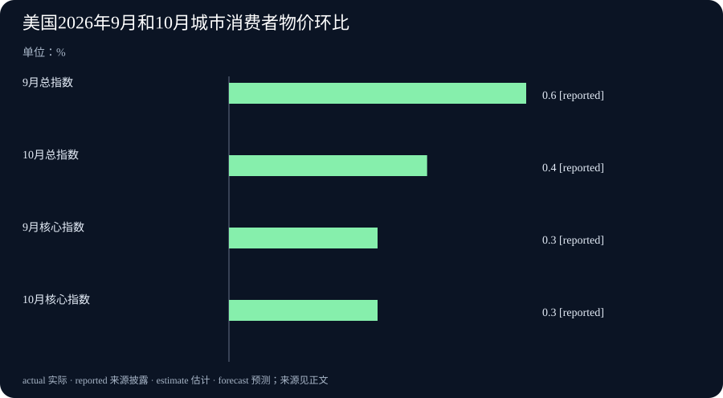

# Daily Intelligence · 2026-11-11

信息边界　研究截止于北京时间 2026 年 11 月 11 日 07:04:54，优先窗口从 11 月 10 日 07:04:54 起。禾赛季报的公司原稿在新闻发布平台标注美东 11 月 10 日 03:30，即北京时间 16:30。美国物价报告标注美东同日 08:30 解除发布限制，即北京时间 21:30。谷歌和 OpenAI 原文均标注 11 月 10 日，小时未披露，原页时区未知，按来源日期采用。禾赛数据属于截至 9 月 30 日的季度，美国物价数据属于 10 月。

## Today's Thesis

谷歌扩大了复杂任务模型的使用范围，OpenAI 则让符合条件的商家在聊天中用自己的资料回答顾客。前者需要核对谁能接入、按什么价格使用，后者让读者有必要辨认回答来自谁。禾赛的出货与利润，以及美国的物价数据，也各自给出了判断所需的具体范围。

## Executive Summary

谷歌让付费开发者与企业可接入 Gemini 4 Carbon，并开始向指定订阅用户推出。此次变化是从先前有限开放扩大到更多用户。公开接入版本的优惠价持续至 11 月 30 日，预算应同时考虑优惠结束后的单价。

OpenAI 推出 ChatGPT 商家功能。通过验证的商家可以更新资料，符合条件的美国电商与在线服务企业还可启用商家助手。顾客会看到独立标记的对话，商家可以查看达到门槛的汇总互动数据。

禾赛第三季激光雷达出货约 73 万台，净营收同比增 34.3%，营业利润同比下降。美国 10 月城市消费者物价经季节调整后环比上涨 0.4%，低于 9 月的 0.6%。去年 10 月的基准缺失，本次总指数同比留空。

## AI Daily

### 谷歌把 Gemini 4 Carbon 开放给更多付费用户

谷歌 11 月 10 日宣布，付费开发者可通过 Gemini 的应用程序接口（API）接入 Carbon，企业可通过相应的商用产品使用。接口让已有软件把任务交给模型，再收取结果。谷歌也开始向 Google AI Ultra 订阅用户推出，包括 Gemini 应用和搜索的人工智能模式。不同产品的实际开通状态以相应账户为准。 [谷歌发布原文](https://blog.google/innovation-and-ai/models-and-research/gemini-models/gemini-4-carbon-now-available/)

Carbon 在大约两周前已向部分网络防御人员开放。这次新增的是付费接口和更多使用渠道。谷歌把它用于多步编程、调试和科学推理等复杂工作，并在开发工具 Antigravity 中预览让多个助手分工的功能。一个助手可以负责拟订计划，另一个检查修改。团队能否采用这种方式，取决于任务能否拆分，以及能否检查每一部分的结果。 [谷歌开发者更新](https://aistudio.google.com/docs/changelog#11-10-2026)

公开接入版本的优惠价为每百万输入计费单元 2 美元、每百万输出计费单元 10 美元，优惠期到 11 月 30 日。之后公布的费率为 4 美元和 20 美元。计费单元（token）是模型切分和处理内容时使用的单位，字数与计费单元数并不一一对应。谷歌还指出，Carbon 在复杂探索与核验中会使用比 Argon 更多的计费单元。对开发团队而言，适合先拿已知答案或验收标准明确的任务试用，再按实际用量核算优惠到期后的成本。

### ChatGPT 增加商家资料和单独的问答入口

OpenAI 在 11 月 10 日发布商家管理中心（Business Hub）。符合条件的企业可以认领在 ChatGPT 中的商家资料。通过验证后，企业可更新关键信息，也可提交商品清单，其中包括价格和供货情况。顾客点开出现在回答中的商家资料后，如果该企业有商家助手（Business Agent），可以主动开启一段对话，询问商品差异或服务内容。 [OpenAI 产品公告](https://openai.com/index/introducing-businesses-chatgpt/)

商家助手目前面向符合条件的美国电商和在线服务企业。平台会审查企业类别和使用目的。OpenAI 将这段对话单独标记，并把商家赞助的位置与 ChatGPT 回答分开显示。认领商家资料的资格范围更广，取决于企业是否符合条件及所在地是否可以使用 ChatGPT。对顾客而言，页面标记有实际用途。它帮助辨认此刻看到的是通用回答，还是由商家资料支持的介绍。 [商家助手规则](https://openai.com/policies/business-agents-policy/)

企业可查看被提及次数和网站点击数等汇总信息。达到一定互动门槛才会显示，原公告说明不会向商家分享顾客的原始对话。企业还可查看网站被引用的对话中常见的主题，用来改进商品说明。若商家希望判断一次介绍是否带来购买，还需要用自己可以核实的订单记录。随着功能扩展，值得关注的是价格或库存变动后，顾客何时能看到新信息。

## Business Daily

### 禾赛第三季出货增加，公司营业利润下滑

禾赛在 11 月 10 日发布未审计的第三季财报。激光雷达通过发出激光并测量反射信号来判断距离，可帮助车辆和机器人感知周围物体。公司当季出货 729,673 台，较去年同季的 441,398 台增长 65.3%。其中，用于辅助驾驶的产品出货 638,055 台，用于机器人等应用的产品出货 91,618 台。单辆车或单台设备可能配备多台雷达，整机销量需要另查。 [禾赛财报与出货表](https://investor.hesaitech.com/zh-hans/news-releases/news-release-details/hesai-group-reports-third-quarter-2026-unaudited-financial)

公司净营收为 10.683 亿元人民币，同比增加 34.3%。销售收入扣除直接成本后，剩下的比例称为毛利率，当季为 41.0%，去年同期为 42.1%。公司把下降主要归因于毛利率较低的产品贡献更多收入。合并营业利润由 7,740 万元降至 6,260 万元，激光雷达业务的营业利润则由 7,740 万元增至约 1.455 亿元。公司披露研发支出同比增加，并提到对新业务的投入。读者可以从业务分项与合并报表分别观察产品经营和新增投入。 [公司原稿与发布时间](https://www.globenewswire.com/news-release/2026/11/10/3399191/0/en/hesai-group-reports-third-quarter-2026-unaudited-financial-results.html)

机器人运动部件用于让机器人的关节等部位执行动作。公司当季披露出货 23,405 件，对照的是第二季的 11,890 件。这个增幅是季与季之间的变化，与上面的激光雷达同比属于不同期间。零件出货证明供货有进展，终端装机及长期使用还需客户资料支持。

### 美国 10 月物价环比涨幅缩小，总指数同比缺少基准

美国劳工统计局发布的 10 月城市消费者物价指数（CPI-U），经季节调整后比上月上涨 0.4%，9 月上涨 0.6%。季节调整用于减弱一年中反复出现的季节波动，方便比较相邻月份。10 月食品上涨 0.5%，能源上涨 0.7%，能源的 9 月涨幅为 5.2%。住房项在 10 月上涨 0.3%，按统计局估算占当月总涨幅的三成以上。 [美国劳工统计局原始报告](https://www.bls.gov/news.release/archives/cpi_11102026.htm)

去掉食品和能源后，核心指数环比仍涨 0.3%，与 9 月相同。因此，总体涨幅缩小的同时，核心环比涨幅保持原有速度。居民会继续面对不同商品和服务的价格变化，具体支出取决于购买内容和数量。

由于 2025 年 10 月拨款中断，统计局当月没有采集调查数据。总指数及多个分项缺少可用的去年同月基准，2026 年 10 月的相应同比因此留空。原表中部分有可用基准的系列仍有同比数值。读表时保留空缺，便能看到目前可确认的是哪些月份、哪些类别的变化。 [统计局缺失数据说明](https://www.bls.gov/cpi/factsheets/approximating-missing-data.htm)

## Macro Observation

上一期的中国物价数据提供了总指数同比和环比。本期美国数据的新情况是相邻月份可比较，总指数的去年同月基准缺失。若需要在两个经济体之间比较，应先对齐统计对象、月份和季节调整方法。把一个同比和一个环比直接并排，容易误读两地的价格走势。

企业数据也有相同的阅读要求。禾赛的激光雷达出货按去年同季比较，机器人运动部件按上季比较。按公司披露，低毛利产品的收入占比变化已经体现在合并毛利率里。未来若要解释单件售价或成本怎样改变，需要继续核对产品组合与分项数据。

## Signal Dashboard

| 主线 | 11 月 10 日披露的进展 | 后续可核验的证据 |
| --- | --- | --- |
| Gemini 4 Carbon | 付费接口开放，指定订阅产品开始推出 | 实际账户可用性、用量与优惠期后账单 |
| ChatGPT 商家功能 | 认领资料，符合条件的美国商家可启用助手 | 顾客能否辨认回答归属，价格和库存更新是否及时 |
| 禾赛第三季 | 雷达出货同比增长 65.3%，合并营业利润下降 | 产品组合、分业务利润及后续终端装机 |
| 美国物价 | 总指数环比涨幅缩小，核心环比仍涨 0.3% | 以后月份的同口径数据，去年同月基准覆盖 |

## Deep Insight

### 从产品可用到结果可信，中间有哪些记录

复杂模型扩大开放之后，团队首先获得的是试用和接入的机会。以 Carbon 为例，一个负责人可以让模型尝试较难的故障排查。假设团队给它一组旧故障记录和明确的修复标准，验收时应看问题是否重现、改动是否修正问题、原本正常的部分是否受到影响。单次回答写得有条理，只能说明它组织了材料。故障是否解决，要靠运行记录和检查结果。把这两种证据保留下来，才知道额外的推理和等待换来了什么。

同一项验证也帮助预算。如果每次修复都要读取大批日志，多轮尝试会让实际用量发生变化。将输入与输出用量分别按费率计算，再相加得到模型费用。再把人工检查与等待所需的时间记进去，才能估计这项工作有没有变省。初期优惠适合用来取得一组可对照的结果。制定持续采购计划时，可以用同一组真实用量估算新价格下的账单，再决定哪些任务值得继续交给它。

商家功能增加了一项检查。顾客看到的资料由谁更新，决定出现错误时该联系谁。假设一家商户的退货期限从三十天改为十四天，它需要改动商家资料或商品信息，并验证助手能否在回答里正确使用新规则。顾客则可通过页面上的身份标记判断信息出处，再核对结算页面所列条款。对于商家，发现有人询问退货有助于改进说明。至于顾客有没有购买、后来是否退货，需要观察对应的业务记录。几个不同的数字各自回答一个问题。

禾赛披露的出货与合并利润说明，衡量业务进度还要找到正确的对象。供货增加可能发生在不同型号和应用上，新的研发投入也可能同时增加。要解释经营结果，可以先看业务分项对收入与营业利润的贡献，再看合并报表中新增费用。即使同一季度内出货、收入都在上升，利润仍可能因产品构成和支出而改变。财报给出了这些变化的方向，具体每台设备的盈利仍需要相应披露。

物价同比留空提供了一个更直接的例子。当前价格与上月可比，并不能补齐去年同月没采集的数值。对需要参考物价调整合同金额的各方，首先要看约定的具体指数和月份。统计局给出一种合同各方同意时可采用的近似计算方法，并将结果标为非官方估算。可用来做某项工作的估算，与可以代表官方调查的数字，适用条件不同。

记录还要带上时间。模型试用保留当时的版本与费率，商家核对保留商品资料的更新时间。下月对照财报与物价时，先记录表中所用期间和缺失项目。这样才能判断后来出现的差别来自产品或业务变化，还是因为比较条件变了。

## Tomorrow Watch

跟踪 Carbon 在同一类复杂任务中的完成率、使用量和优惠到期后的费用。观察 ChatGPT 商家助手上线后，顾客能否从页面标记认出信息由谁提供，以及商家更新价格和库存后，答案何时变化。

关注禾赛后续披露的分业务收入、研发投入和出货情况。美国价格部分继续跟踪官方总指数、核心与能源分项，注意各期同比基准的覆盖。11 月 10 日美国物价与禾赛三季度财报均为本期新增材料，与前两期报道的中国 CPI、monday.com 季报及拟收购公告属于不同披露。

## One Chart

### 美国 2026 年 9 月与 10 月城市消费者物价环比

图中为经季节调整的环比涨幅，单位为百分比。总指数从 9 月的 0.6%降至 10 月的 0.4%，核心指数两个月均为 0.3%。核心指扣除食品和能源后的指数。reported 表示来源披露的数字。各柱展示同一口径下相对前月的变化，0.4%仍表示价格水平比上月上升。 [美国劳工统计局表 A](https://www.bls.gov/news.release/archives/cpi_11102026.htm)

## Quote of the Day

原文　Till this moment, I never knew myself.

中文译文　直到这一刻，我才真正认识自己。

人物　Jane Austen（简·奥斯汀）

出自 1813 年出版的《傲慢与偏见》第二卷第十三章。这是小说人物伊丽莎白·班纳特的话。她重读达西的信，将其中的细节与原先听到的说法对照，也开始反省自己为何更容易相信某一方。 [小说原文](https://www.gutenberg.org/files/42671/42671-h/42671-h.htm) · [大英图书馆初版说明](https://www.bl.uk/stories/blogs/posts/jane-austen-names-and-notability)

编辑解读　复看证据有时会改变对事情的理解，也会让人发现自己当初作出判断的原因。

## Action Items

1. **模型试用怎样验收？** 选一件难度明确的工作，提前写下完成条件，并记录检查与返工所用时间。

2. **优惠结束后会花多少？** 用实际输入和输出量按新价格计算一次，再决定哪些工作适合继续使用。

3. **这段商品说明由谁提供？** 看页面的对话和赞助标记，涉及价格、库存或退货时核对交易页面。

4. **出货增长落在哪类产品？** 从季报表头确认比较期间，再把业务分项和合并利润对照起来。

5. **同比的基准月份有数据吗？** 遇到空缺先看表注，保留原统计的范围，引用估算时说明其来源和用途。
