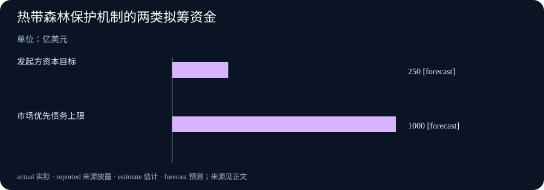

# Daily Intelligence · 2026-11-16

信息边界　研究截止于北京时间 2026 年 11 月 16 日 06:59:54，优先窗口从 11 月 15 日同一时刻起。印度政府发布于新德里当地时间 15 日 09:55，即北京时间 12:25。加拿大公告标注 15 日，首发小时未披露。两个软件的正式发布页均标注 15 日，页面分别显示 18:26 和 07:52，网页读取结果未给出时区。后三项按来源日期采用。基金结构图引用 2025 年发布的方案，作为理解本次贷款的背景。

## Today's Thesis

人工智能助手接入更多工具之后，权限决定它能看到什么、能做什么。Tucano 收紧了从私人对话整理出来的共享资料，Hermes Agent 的预发布把一款工具权限插件列入目录。加拿大的森林融资承诺和印度赴埃及的商业代表团则各自走到不同阶段。接下来要看的分别是钱何时到账，以及磋商是否带来企业可用的规则。

## Executive Summary

Tucano 更新到 0.2.33。管理员可以分别指定成员能看到哪些团队分组、助手和对话频道。由对话汇总出的知识库也会按来源限制访问，助手回答时必须遵守同一范围。

Nous Research 在 Hermes Agent 的预发布目录增加一款可按工具设置允许、询问或阻止的插件。插件的说明还列出本地审计记录。目录中出现插件，为用户提供了一个可选办法。要判断保护是否生效，仍要确认插件已启用和对应操作经过这套规则。

加拿大宣布四年内向热带森林长期保护机制提供最高 5.6 亿加元的初始贷款，从已有国际气候融资预算安排。印度政府则确认商工部长率百余人规模的商业代表团抵达开罗，并列出贸易委员会和企业交流安排。印度公告确认代表团已抵达，未公布新的关税安排或订单金额。

## AI Daily

### Tucano 让知识库沿用原会话的可见范围

Tucano 是把人工智能助手放在类似团队聊天界面里使用的开源软件。用户可以在不同频道分派任务，也可以让助手把讨论结果写进团队知识库。0.2.33 版让管理员为每位成员选择可见的团队分组、助手和频道。邀请新成员时也可以先选定访问范围。代表某位成员作答的助手沿用这位成员的范围。 [Tucano 0.2.33 发布原文](https://github.com/eduwxyz/tucano/releases/tag/v0.2.33)

发布说明提到，旧的知识库没有完整沿用对话的限制。即使一个人无权打开某次私聊，他仍可能读到由那次私聊汇总出的页面，或让助手替他看到它。新版会对受限成员隐藏引用了越权会话的整页，同时把该页移出其搜索、索引和助手可读资料。如果来源已丢失，或者旧资料未记录来源，系统对受限成员也按不可见处理。拥有完整访问权限的人员仍能查看相应资料。

假设团队讨论了尚未公开的供应商报价，后来把摘要放进知识库。如果采购频道只向指定成员开放，测试时就应该分别用采购成员和普通账户查找该页，以及询问助手相同的问题。这样能发现限制是否只保护了原对话，还是也覆盖了摘要。官方说明没有测量实际部署里受影响的页面数，也没有给出第三方接入工具的全面测试结果。

### Hermes 的预发布让用户试用按工具分级的权限插件

Nous Research 在 Hermes Agent 0.23.1 的一版早期测试版本中，将权限分级插件加入可选插件目录。插件是给原软件增加能力的独立组件。该插件让运行助手的程序按工具名称设定三种处理方式。设为允许时可以执行，设为询问时先请求许可，设为阻止时拦下调用。插件还会用本地数据库保留工具运行后的审计记录，供使用者检查规则和已有记录。 [Hermes Agent 11 月 15 日预发布](https://github.com/NousResearch/hermes-agent/releases/tag/v0.23.1%2Bcanary.20261115T064406Z) [目录登记及插件说明](https://github.com/NousResearch/hermes-agent/commit/c2779be89a3293075a3e892b7f8f2817c1797e02)

举例来说，整理项目资料通常要读文件，寄出带附件的邮件则会改变外部系统。团队可以按风险为工具设置不同处理方式。但按工具名称分级的规则，需要和底层系统的文件、账户及网络权限一起核对。新版公告的增量是目录接入和可试用的选项。已经使用稳定版的用户，需要确认自己的版本、插件来源及实际启用状态。

11 月 15 日的日报讨论了 Droid 如何显示工具调用。本期这两项分别涉及另一处决策。Tucano 确定某位成员及其助手读得到哪些资料。Hermes 目录里的插件在工具运行前判定是否允许它执行。把两个环节混在一起，可能看漏了助手经由另一套资料库读取内容，或者经由工具改变记录的机会。

## Business Daily

### 加拿大为热带森林保护安排四年贷款

11 月 15 日，加拿大总理卡尼在马尼拉与巴西总统卢拉会面时宣布，将在四年内向热带森林长期保护机制（Tropical Forest Forever Facility，TFFF）提供最高 5.6 亿加元的初始资金。加拿大外交部门的配套说明明确，资金以贷款形式出资，来自既有国际气候融资预算，拟用于帮助该机制启动及建立初期资本。公告给出加拿大的融资承诺和上限。具体拨款日及实际到账金额仍待披露。 [加拿大总理办公室公告](https://www.pm.gc.ca/en/news/news-releases/2026/11/15/prime-minister-carney-announces-canadas-landmark-contribution-protect) [加拿大外交部门配套说明](https://www.international.gc.ca/news-nouvelles/2026/2026-11-14-tfff-fcft.aspx?lang=eng)

巴西和挪威共同牵头该机制。按其公开方案，资金先进入投资安排，投资净收益再用于向符合条件的热带森林国家支付保护费用。支付取决于经核实的保护结果。加拿大公告称，至少 20% 的保护付款将流向原住民和当地社区。这个比例对应机制将来发出的保护付款。加拿大这笔贷款又是融资来源之一，两者处于不同环节。

这个安排值得追踪，因为它试图把持续保护森林与长期收入联系起来。后续需要核对有哪些项目符合条件、如何核实森林面积和退化程度，以及款项怎样到达社区。在看到这些记录以前，可以确认的是融资承诺、资金来源与设计中的核验条件。

### 印度商业代表团抵达开罗，联合贸易委员会列入行程

印度新闻信息局 11 月 15 日发布商工部通报，确认商务和工业部长皮尤什·戈亚尔于 14 日抵达开罗，随团包括初创企业在内的一百三十多位商界人士和企业代表。官方把扩大贸易、投资和产业合作列为此行重点。通报列出第七次印埃联合贸易委员会会议，由两国主管部长共同主持，另安排联合商业委员会和企业论坛。 [印度商工部原始通报](https://www.pib.gov.in/PressReleseDetailm.aspx?PRID=2336423&lang=1&reg=3)

联合贸易委员会为政府处理贸易问题提供一个沟通渠道，企业论坛让公司与潜在客户、供应商或合作方见面。代表团抵达是相对上次行程预告已经发生的一步。参团规模说明参与度，成交量要等双方或企业披露。本期采用的通报在当天上午发布，它提到会议计划，未公布税费变化或合同结果。 [11 月 14 日行程预告](https://www.pib.gov.in/PressReleasePage.aspx?PRID=2336126&lang=1&reg=3)

## Macro Observation

财政承诺和贸易磋商影响经济的途径不同。贷款承诺确定一笔钱可以按什么方向安排，之后仍要看合同条件、拨付和用途。商贸代表团则先建立联系，企业能否因此降低成本，还要看关税、通关或投资条件有没有明确变化。

加拿大的贷款安排也提醒读者区分一国预算和国际机制的筹资计划。加元列示的国家贷款、美元列示的全球投资方案，以及最后向原住民和社区支付的数额，应各自记录。对印度和埃及的消息，同样可把参团人数、谈判议题和最终合同分开。这样阅读既能看到已公布的资金安排和代表团到场，也能保留估计经济影响所需的后续条件。

## Signal Dashboard

- **对话和整理后的页面共用访问边界。** Tucano 新版隐藏受限成员无权核对来源的知识库页面，搜索和助手回答也要遵循相同范围。
- **工具的执行权限可分级试用。** Hermes 预发布将可选插件列入目录，操作者需要检查实际启用、匹配规则和审计记录。
- **森林资金明确为贷款承诺。** 加拿大提出四年最高 5.6 亿加元，后续可查拨付、共同融资和保护付款的方法。
- **印埃商业代表团已到访。** 印度商工部确认抵达和人员规模。要判断贸易条件是否改变，还要看会议成果与正式政策文件。

## Deep Insight

### 从一条记录到下一步行动，中间要保留哪些条件

软件往往会把一件事换一种形式。会议记录可以变成知识库条目，工具试探可以变成真正发出的邮件。访问范围容易在转换时失去。举例来说，一份项目总结有三段，其中只有一段来自限定频道。仅凭摘要的文字，后来接手的人很难追溯那一段来自哪里。Tucano 采取的办法是以来源决定整页是否对该成员可见，即使只有一处引用越过权限也会隐藏页面。这样能保护私下对话，也可能让原本可以分享的部分一起消失。是否需要另作一份公开摘要，要由知道来源与使用目的的人决定。

工具分级处理的是接下来能做的动作。管理员可以让某些操作经过许可，也可以直接阻止其他操作。但一项工具有时既能读资料，又能通过不同参数修改它。只给工具名称打等级，仍需要压测它能接受的指令和参数。最简单的验收是准备一条允许的操作和一条应拦下的操作。再核对执行结果、失败信息以及事后的记录是否能相互对应。这也能帮助团队发现，最终的权限决定究竟由应用、外部服务还是插件执行。

资金安排同样需要跨环节保持记录。加拿大的声明给出了贷款上限和时间，没有给出全部取款或拨付的证明。机制的设计把募集来的资金投入管理，再用净收益承担保护付款。若一笔钱从贷款承诺转成已拨资金，之后还应查它是否进入预定用途，受益人按何种结果获得支付。不同出资方和项目的账目需要先对齐期间及币种。这样可以把某个承诺的分量说清楚，也能在收益低于设计预期时判断哪一段受到影响。

对于商业代表团，接下来的证据更接近企业日常。假设供应商希望在埃及销售一种设备，首先要核实当地买家、合规证明、运费和交易条件。如果联合委员会后来公布一项具体进口规则，企业才能把它写入成本计算。即使有人在论坛表达采购意向，仍需要订单、交货和收款记录，才能逐步确认商业结果。代表团、会议和交易各有自己的计量方法。

四条消息提出两类可做的小检查。对软件，从受限成员的账号走一遍搜索，再试一条需要审批的工具操作。对经营和政策，记录已发生的动作及其对象，并写下一份能改变判断的文件。这样既能在错误发生时找到责任所在，也能在承诺开始兑现时说明究竟是哪一步有了新进展。

## Tomorrow Watch

- 留意 Tucano 受限成员能否经知识库搜索或助手回答看到本应隐藏的内容，特别是更换账号、撤销会话权限和旧页面来源缺失的情形。
- 留意 Hermes 权限插件在预发布中的实际启用条件及工具调用记录，尤其是谁有权改规则、规则变更是否可查。
- 跟踪森林机制之后披露的出资到位、资金管理和付款规则。分别记录贷款、到位的资本和已支付保护款。
- 关注印埃联合贸易委员会是否发布联合结果，以及两国商贸部门有无随后公布可执行的通关或投资措施。

## One Chart

### 热带森林保护机制的两类拟筹资金

图中单位为亿美元。机制 2025 年的方案设想募集 250 亿美元的发起方资本，再向市场发行至多 1,000 亿美元的优先债务。优先债务是在偿还次序上排在发起方资本之前的借款。forecast 表示方案目标或计划。两根柱都表示拟筹资金，实际到位另看。加拿大本次披露的是最高 5.6 亿加元的单笔国家贷款，口径和币种不同，未放入图中。 [机制发布的 2025 年方案，第 3.0 版](https://tfff.earth/wp-content/uploads/2025/08/TFFF-Concept-Note-3.0-202508-FINAL.pdf)

## Quote of the Day

> There is no Wealth but Life.

> 只有生命才是财富。

John Ruskin（约翰·罗斯金），《给最后来的人》（Unto This Last）第四篇《论价值》。该篇 1860 年初刊于英国《康希尔杂志》。罗斯金在篇末阐明他怎样理解财富，把人的生活及其能给他人带来的帮助放在中心。 [著作原文](https://www.gutenberg.org/files/36541/36541-h/36541-h.htm) [牛津大学阿什莫林博物馆收录及初刊年份](https://ruskin.ashmolean.org/media/_file/doc/unto_this_last.pdf)

编辑解读　看一项资金安排时，记下最后希望改善谁的处境。等到可以对照实际到款与效果时，再判断这笔钱带来了多少改变。

## Action Items

1. **摘要带着原资料的权限吗？** 用一个受限测试账户查知识库、搜索和助手回答，记录各处能看到的范围。

2. **哪个操作需要你确认？** 列出会改变文件、账户或外部服务的工具，用允许和拦截两种例子复核设置。

3. **这笔钱走到了哪一步？** 把贷款上限、实际拨付、投资净收益和向社区支付分别登记，更新时保留来源和单位。

4. **会谈之后有什么可办的事项？** 给关注的产品列出进口规则、所需单据和当前税费，再用双方正式文件更新。

5. **哪些旧记录缺少原始出处？** 在下一次整理资料时，检查哪些页面引用的原件已失效，并请有权限的人复核可共享的内容。
