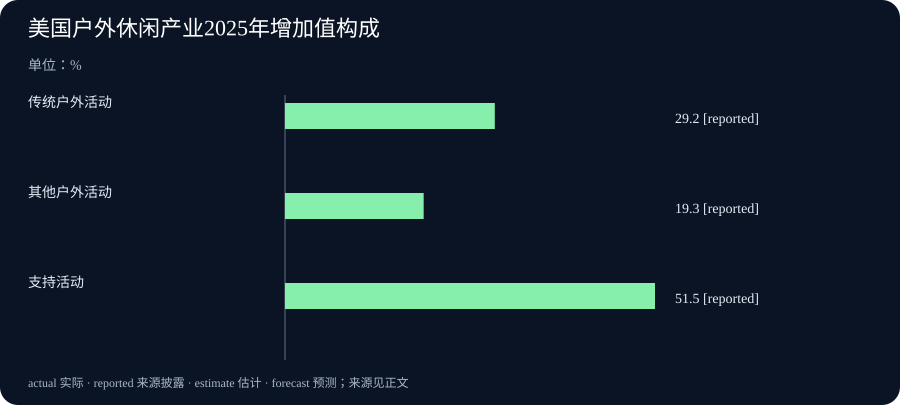

# Daily Intelligence｜2026-11-19

- **新闻研究截止：**2026-11-19 09:04（Asia/Shanghai）；窗口为前24小时，即2026-11-18 09:04至2026-11-19 09:04。Google两篇公告只标日期、未披露小时；美国劳工统计局与经济分析局公告标注美东时间11月18日10:00，换算为上海时间11月18日23:00。
- **本期新增：**Google的新模型与互动世界工具、美国2025年职场伤病及户外休闲产业数据，与最近两期的模型权限、插件、零售和制造业事件不同。比较来源时使用公告原文链接，而不是按标题判断重复。

## Today's Thesis
Google将新一代模型和互动世界生成工具带入部分产品，但开放访问仍不等于实际效果已经得到独立验证。美国官方数据同时给出两种不同的经济观察：雇主报告的非致命职场伤病继续减少，户外休闲产业仍有较大经济体量，但其2025年实际增加值增速低于全美经济。

## Executive Summary
Google公布Gemini 4 Neon，并扩大Project Genie体验。前者面向文本、图像和多步骤任务，后者让用户用提示创建并探索可交互的虚拟世界。两项公告说明产品能力和可访问范围正在扩展；其中的性能评价仍是公司测试结果，不能代替用户自身任务上的比较。

美国劳工统计局报告，雇主在2025年记录的私营行业非致命伤病为240万起，比上一年减少3.0%。这组数字不包括死亡事故，也只统计雇主报告的案件。美国经济分析局估算，户外休闲产业2025年增加值为7042亿美元，占当年现价GDP的2.3%；扣除价格变化后，该产业增速为1.9%，低于美国整体经济的2.3%。

## AI Daily
### Gemini 4 Neon进入Google产品和开发者渠道

Google于11月18日公布Gemini 4 Neon，并通过Gemini应用、开发者平台及部分企业产品逐步开放。具体可用范围取决于产品和订阅条件。Google称该模型可处理最多100万token的上下文。Token是模型处理文字和其他输入时使用的片段单位，因此100万token不等于100万汉字或固定页数。

Google列出的API价格为每百万输入token 3美元、缓存输入token 0.15美元、输出token 15美元。缓存输入指可复用、因而按较低价格计费的输入部分。实际账单取决于输入输出量、产品和缓存条件。公司发布的基准测试和效率比较也受测试题目、模型设置及硬件影响，不能直接当作所有用户任务的结果。

对采购者来说，定价给出了估算使用成本的起点，但还要把提示词长度、重复输入是否命中缓存、输出长度和订阅费用放进同一预算。上下文上限也只是可处理材料的容量，不代表模型能准确理解其中每个细节。相对最近两期，本期新增的是Google正式公布新模型及其接入和定价信息；本稿不把公司基准测试转写为独立能力结论。

来源：[Google官方公告（11月18日；小时未披露）](https://blog.google/innovation-and-ai/models-and-research/gemini-models/introducing-gemini-4-neon/)

### Project Genie开放有限的互动世界体验

Google DeepMind公布Genie 4，并向符合条件的Google AI Ultra订阅用户开放Project Genie体验。用户可用文字提示创建虚拟场景，再在场景中移动和继续修改。这里的“世界模型”是根据提示生成、并对用户动作作出反应的模拟环境，不代表它准确复现现实物理规律。

Google称新版可生成最长约3分钟的体验，旧版上限为1分钟；用户也可从全景图开始，并用文字改变场景。新版还加入原生声音。功能仍处于研究阶段，公告承认画面生成和交互存在延迟，物理规律、声音精度和场景持续性也有限。因此，访问开放是研究体验扩大，不代表它已经能稳定用于游戏制作或现实仿真。

一个简单的使用例子是先给虚拟环境一张全景起始图，再用文字修改其中元素；这说明用户可以引导生成过程，但不说明场景会长期保持一致。若用于训练或娱乐，还要单独评估内容安全、可重复性和生成等待时间。

来源：[Google DeepMind官方公告（11月18日；小时未披露）](https://blog.google/innovation-and-ai/models-and-research/google-deepmind/genie-4-now-available-project-genie/)

## Business Daily
### 雇主报告的私营行业伤病继续下降

美国劳工统计局11月18日10:00（美东时间）发布2025年雇主报告伤病数据。私营行业雇主报告了约240万起非致命职业伤病和疾病，比2024年少3.0%，也是该系列自2003年以来的最低值。这里统计的是雇主报告的非致命案件，不等于所有劳动者实际遭遇的伤害，也不含职业死亡。

其中，伤害约230万起，下降1.5%；职业疾病约109,400起，下降26.1%。因伤病需要请假、转岗或限制工作职责的案件为842,500起。总记录率为每100名全职等值员工2.3起；这是按工作时间折算的发生率，不是2.3%的员工必然受伤。

劳工统计局说明，部分行业序列受到行业分类从NAICS 2017转为NAICS 2022的影响，零售和信息业修订较明显。跨年比较时应查看该局的可比口径说明。统计按员工工作时间换算发生率，因而人数变化和发生率变化并不总是相同。上述数据也不能单独证明某项安全措施造成了下降。它能回答“雇主报了多少案”，却不能说明没有报告的伤害、外包劳动者的情况，或每种行业风险为何变化。

来源：[美国劳工统计局原始报告（11月18日10:00美东）](https://www.bls.gov/news.release/osh.nr0.htm)

## Macro Observation
### 户外休闲产业体量大，实际增速略低于整体经济

美国经济分析局11月18日10:00（美东时间）公布2025年户外休闲经济数据。该产业增加值约7042亿美元，占美国当年现价GDP的2.3%。增加值是生产过程中创造的价值，扣除了中间投入；它不是消费者全部户外支出，也不能与企业销售额直接互换。

扣除价格变化后，户外休闲产业增加值比2024年增长1.9%，低于美国整体经济的2.3%。产业就业增长1.7%，员工报酬增长4.6%；就业人数在43个州和华盛顿特区增加。分项中，传统户外活动占增加值29.2%，其他户外活动占19.3%，支持活动占51.5%。支持活动包括相关建筑、旅行和本地出行等，因此不能把它们全看作直接发生在户外的消费。

数据局同时更新了2021至2024年的历史估计。读者比较历史数字时应使用本次修订后的序列。行业规模可说明经济贡献，但不能单独说明利润、工资分布或环境成本。增加值增速低于整体经济，也不等于每类户外活动都在减速；各分项和州级构成不同。就业与员工报酬增长是另外两种指标，也不能直接推出每名员工的实际收入增加，因为报酬总额还受就业人数和价格变化影响。

来源：[美国经济分析局原始报告（11月18日10:00美东）](https://www.bea.gov/news/2026/outdoor-recreation-economic-statistics-us-and-states-2025)

## Signal Dashboard
| 指标 | 统计期与口径 | 结果 | 读数边界 |
|---|---|---:|---|
| 私营行业雇主报告非致命伤病 | 美国，2025年 | 240万起，较2024年下降3.0% | 不含死亡；以雇主报告为基础 |
| 户外休闲产业增加值 | 美国，2025年现价 | 7042亿美元，占GDP 2.3% | 不是消费支出总额 |
| 户外休闲产业实际增加值增速 | 美国，2025年 | 1.9%；整体经济为2.3% | 已剔除价格变化 |
| 户外休闲产业分项占比 | 美国，2025年增加值 | 传统活动29.2%；其他活动19.3%；支持活动51.5% | 三类合计100% |

## Deep Insight
这组公告提醒我们先看数字“数的是什么”。劳工统计局统计雇主记录的非致命案件；没有记录到的事件和职业死亡不在这组总数里。经济分析局计算产业创造的增加值；它既不是消费者支出，也不是行业利润。两份报告都给出有用的趋势，但不能回答各自口径以外的问题。

AI公告也有类似边界。Google公布了模型入口、定价和产品功能，这能确认用户何时可以接触某些工具；它不能独立证明模型对每类工作都更准确。后续观察应把“正式可用”“用户采用”“任务效果”和“经济结果”分开记录。否则，容易把发布本身误读成结果已经实现。对统计也要使用同样的克制：观察到年度下降或产业占比，只能说明数据在特定定义下如何变化，不能自动说明造成变化的原因。把范围、时间和定义放在数字旁边，读者才知道它能够回答什么问题，也知道还需要哪些证据。

判断一项变化是否具有持续性，需要连续年份、相同统计口径和能够解释机制的额外证据。伤病数字下一年若反弹，可能与报告范围、行业构成或实际风险有关，单年数据无法区分这些原因。户外休闲产业的总额也可能在一部分活动增长、另一部分活动下降时仍然上升，所以总量不能代替分项。对于AI工具，公告能确认产品何时发布及企业声称提供什么功能；要评估生产率，还需比较完成时间、返工率、错误后果和成本，并确认测试条件一致。这样做不会削弱新闻价值，而是避免把不同层次的证据混为一谈。评估者也应记录数据发布日期与统计所属年份，因为较晚发布的统计并不代表描述较晚发生的事。读者据此可以把“新公布”与“新发生”分开，避免将时间顺序读反。这同样适用于公司产品：公告日期、开放日期和用户实际采用的日期可能不同。分别核对这些时间，才能公平评估后续变化。

## Tomorrow Watch
- Google列出的产品入口是否按公告范围开放，地区、订阅和开发者条件是否变化。
- Project Genie的延迟、场景持续性和声音表现是否有独立测试；目前仍以研究预览为主。
- 美国伤病下降能否在后续年度延续；比较时留意行业分类口径调整及雇主报告范围。
- BEA后续修订是否改变2021至2025年户外休闲产业的历史增长路径，以及州级差异。

## One Chart
**美国户外休闲产业2025年增加值构成**（占该产业增加值比例；来源披露的数字）

三项占比合计100%。支持活动是产业核算中的相关行业活动，不等于全部直接户外消费。

## Quote of the Day
> **拉丁文原句：**Non exiguum temporis habemus, sed multum perdimus.
>
> **中文译文：**我们拥有的时间并不少，失去的时间却很多。

——塞涅卡（Seneca），《论生命之短暂》（*De Brevitate Vitae*）第10章第1节，约公元49年；成书时间学界有不同判断。原文可在[塔夫茨大学 Perseus 古典文献库](https://www.perseus.tufts.edu/hopper/text?doc=Perseus%3Atext%3A2007.01.0016)定位；剑桥大学出版社的研究节选将该作时间范围置于公元48至55年间，见[出版商节选](https://assets.cambridge.org/97811071/45474/excerpt/9781107145474_excerpt.pdf)。中文为本刊译文。

**本期联系：**塞涅卡在讨论人如何使用时间，并非谈论现代技术。把这句话放在今天，编辑解读是：面对新工具，值得区分“发布了什么”和“实际节省了多少时间”，后者仍须用真实工作结果检验。

## Action Items
1. **哪些产品条件会影响可用性？** 对照Google公告查看地区、订阅和API入口，再决定是否纳入自己的工具评估。
2. **模型是否适合具体任务？** 用相同材料和验收标准比较结果，并保存错误案例，而不是照搬厂商基准分数。
3. **伤病下降代表什么？** 后续阅读劳工统计局可比口径和行业分类说明，并同时观察职业死亡数据。
4. **户外产业的增长落在哪些活动？** 查看BEA分项及州级数据，区分直接活动与支持活动。
5. **新增工具真的节省时间吗？** 在实际工作中记录完成时间、返工和错误，再判断收益是否超过使用成本。
