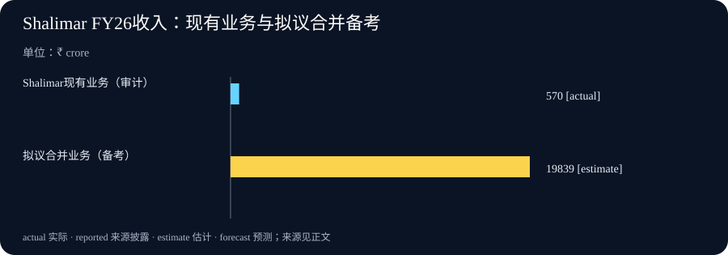

# Daily Intelligence｜2026-11-22

- **新闻研究截止：**2026-11-22 07:03:39（Asia/Shanghai）；固定窗口为2026-11-21 07:03:39至2026-11-22 07:03:39。AWS、印度新闻信息局与Shalimar Paints的来源页只标11月21日，没有披露首次公开的具体小时；不能据此证明它们都严格落在24小时内。印度政府稿明确在印度标准时间11月21日20:33发布，换算为上海时间23:03，处于窗口内。
- **本期新增：**AWS为Bedrock网页检索增加多语种与国家偏好设置，并扩展Quick的浏览器工作区；这两项是企业工具变化，不是新模型成绩。印度与加拿大结束第六轮CEPA谈判，但尚未签署协议；Shalimar Paints披露拟议合并的经营规模和条件，交易仍待批准。对照了11月21日和20日两期，未把已报道的模型评测、模型开放、英国统计或Anthropic上市重复作为新事件。

## Today's Thesis
AWS本期的两项更新都在改善企业使用AI助手的入口和工作流程：一项让网页检索更能处理不同语言与国家语境，另一项把桌面工作区延伸到浏览器，并让代理任务在关掉页面后继续运行。它们改变的是工具可用方式，不证明模型本身更聪明，也不代表每个地区都能使用。印度与加拿大结束一轮贸易谈判，尚未达成协议；印度涂料企业Shalimar Paints披露了与Infra.Market拟议合并后的规模，但监管和债权人批准仍是前提。今天值得关注的是“能力如何进入工作流程”以及“计划距离正式生效还差哪些步骤”。

## Executive Summary
Amazon Bedrock的网页检索工具新增西班牙语、法语、德语、意大利语和日语，并支持非美国英语。企业还可传入国家代码，让搜索更偏向当地来源。AWS称该工具在指定云区域处理查询；这能帮助团队控制资料所在区域，但不会自动保证搜索答案正确或符合当地法律。

AWS Quick把原有桌面工作区的一部分带到浏览器。用户可以从浏览器调用代理、技能和连接器，查看每日简报与待处理事项；网页启动或安排的代理任务会在用户关掉页面后继续运行，Mission Control用于查看完成结果或等待用户输入的任务。当前公布的区域范围有限。AWS的产品说明没有提供生产率提升的独立测量，因此不能把“持续运行”直接写成省时或收入增长。

印度新闻信息局称，印度与加拿大在新德里结束第六轮全面经济伙伴关系协定（CEPA）谈判。双方讨论货物、服务、原产地规则、贸易救济、知识产权和投资促进，并表示谈判取得进展。公告仍把签约描述为目标，没有公布最终条款或签署日期。

Shalimar Paints说明，若其控股方Infra.Market的拟议合并完成，业务将扩展到建筑材料多个环节。公司列出合并后FY26备考收入₹19,839 crore（约1,984亿印度卢比）、息税折旧摊销前利润₹1,709 crore（约171亿印度卢比），以及250多个工厂等规模数据。这些是公司披露的备考口径，不是合并后的实际经营结果；公告列出的交易仍须获得证券交易所、印度证券交易委员会、国家公司法法庭和债权人等批准。

## AI Daily
### Bedrock网页检索新增多语种与国家偏好

AWS在11月21日发布公告，为Amazon Bedrock和Bedrock AgentCore中的Web Search网页检索工具增加五种语言：西班牙语、法语、德语、意大利语和日语，同时增加非美国英语支持。网页检索是代理或应用在回答前寻找当前网页资料的工具；这些新增语言让它可以从对应语言的本地网页取材。

企业现在还可以提供ISO 3166-1 alpha-2两位国家代码，例如JP或DE，让结果偏向某个国家的来源。对用户来说，这对当地法规、价格或公共服务等问题更有用，因为这些问题往往需要本地资料。它只是搜索偏好，不是答案正确性的认证，也不能代替人工核对来源。

AWS说明，AgentCore版本在美国东部（弗吉尼亚北部、俄亥俄）、美国西部（俄勒冈）、亚太（悉尼、东京）和欧洲（爱尔兰、法兰克福）区域提供；Bedrock本身的Web Search仍仅在美国区域提供。查询在调用者选择的云区域处理。AWS称客户可自动获得新语言能力且价格不因语言变化，但不同产品的区域范围不能混为一谈。

这条更新相对11月21日报的模型基准和权重开放带来另一种变化：它改善模型获得新网页证据的入口，而不是改变模型参数或推理能力。实际效果仍取决于网页覆盖、语言理解、来源筛选和用户给出的国家设置。页面没有披露各语言的检索质量对比，也没有说明所有国家都拥有同等来源覆盖。

来源：[AWS：Bedrock网页检索扩展语言支持与国家偏好（11月21日；小时未披露）](https://aws.amazon.com/about-aws/whats-new/2026/11/web-search-amazon-bedrock/)

### AWS Quick把代理工作区延伸到浏览器

AWS于11月21日宣布更新Quick网页体验。Quick是面向工作的AI工作区，允许团队把代理、技能和连接器放在一起使用。此次网页端可以复用桌面端的代理和技能，展示每日简报以及按优先级排列的邮件和消息；网页、桌面与手机之间同步对话、代理和文件。

一个值得区分的变化是任务可以跨越浏览器关闭继续运行。用户在网页启动或安排代理后，即使关掉页面，任务仍可继续；Mission Control会显示哪些任务完成、哪些任务在等待输入。浏览器扩展和Microsoft 365的Word、Excel、PowerPoint、Outlook插件也同步更新。它改变了任务的运行地点和查看方式，但不意味着代理可以绕过用户权限或不需要复核。

Quick网页体验公布的区域包括美国东部（弗吉尼亚北部）、美国西部（俄勒冈）、欧洲（法兰克福、爱尔兰、伦敦）和亚太（悉尼、东京）。公告没有列出中国大陆区域。AWS的另一个11月20日博客还介绍了流程编排、多代理协作和连接器；那是相关背景，不作为本期第二个新事件，也不把同一更新拆成多条来源。

对企业而言，浏览器可让员工在不打开桌面应用的情况下查看任务进度；长期运行也可能减少等待用户保持页面开启的限制。但计划任务能否稳定完成，仍取决于账户权限、连接器数据质量、组织安全设置和任务本身。AWS公布的是功能和区域可用性，没有给出第三方生产率测量或准确率结果。

来源：[AWS：Quick推出新的网页体验并更新浏览器扩展与Microsoft 365插件（11月21日；小时未披露）](https://aws.amazon.com/about-aws/whats-new/2026/11/aws-quick-launches-new-web-experience-updated-browser-extension-microsoft-365-add-ins/)

## Business Daily
### 印度与加拿大结束第六轮CEPA谈判，协议仍未签署

印度新闻信息局于印度标准时间11月21日20:33发布公告，称印度与加拿大在新德里结束第六轮全面经济伙伴关系协定（CEPA）谈判。这一时间换算为上海时间11月21日23:03，处于本期固定的24小时窗口内。谈判本身在11月11日至20日举行。

双方讨论了货物贸易、服务贸易、原产地规则、贸易救济、知识产权和投资促进。原产地规则决定商品在满足哪些生产条件后能享受协定优惠；贸易救济则涉及反倾销、反补贴等应对措施。印度方面称，各谈判轨道取得进展，并重申目标是达成有实际商业意义、平衡且互利的协议。

“结束第六轮谈判”不等于“CEPA已经达成”。公告没有给出关税减让清单、服务准入承诺、最终文本或正式签署日期。对企业而言，只有条款敲定、双方签署并完成各自批准后，市场准入安排才可能改变。因此，接下来应观察是否公布谈判结果文本、下一轮安排以及签署和批准步骤。

相较11月20日报中的英国统计数据与Anthropic融资，本次增量是印度与加拿大谈判进程出现正式阶段性更新，而非已实现的贸易流量或新增投资。双方的新闻稿反映政府谈判进度，不能据此预判具体行业的出口收益。

来源：[印度新闻信息局：印度—加拿大CEPA第六轮谈判结束（11月21日20:33 IST）](https://www.pib.gov.in/PressReleseDetailm.aspx?PRID=2339731&lang=1&reg=3)

## Macro Observation
### Shalimar拟与Infra.Market合并，披露规模但交易尚待批准

Shalimar Paints于11月21日在提交给印度证券交易所的新闻稿中介绍，若其控股方Infra.Market拟议的合并完成，Shalimar将成为覆盖建筑材料多个环节的平台。Shalimar目前主要经营涂料，公司称其FY26收入约为570亿印度卢比（₹570 crore）。合并业务的FY26备考收入为19,839亿卢比，备考息税折旧摊销前利润为1,709亿卢比，利润率为8.6%。

备考数字是把两家业务按假设的合并范围放在一起计算，帮助读者了解如果交易完成后规模可能如何变化；它不是合并后实际已经取得的收入。新闻稿称FY26数据经过审计，H1 FY27数据仅经过有限审阅，过去12个月截至2026年9月的数字则由这些期间数据推算。因此，不同指标的核验程度并不相同。

公司还披露拟议组合拥有250多个工厂，分布在22个邦；其中150多个为自有，其余来自独家合作安排。备考收入中约69%来自自有品牌，渠道触点超过20,000个，企业客户超过1,500家。这里的“触点”是公司覆盖的零售网点，不等于已完成销售的消费者人数；工厂总数也不代表所有产能都已投产或满负荷运转。

交易仍需证券交易所、印度证券委员会（SEBI）、国家公司法法庭（NCLT）和债权人等批准。公司披露的战略目标是从涂料延伸到混凝土、钢材、板材、瓷砖、电气和模块化厨房等材料。若交易获批，这可能改变公司产品组合和经销网络；但公告没有证明合并已生效，也没有披露合并后的现金流、债务安排或整合成本。

这件事与CEPA谈判处于不同阶段：贸易协议仍在协商，Shalimar交易仍在审批之前。两者都提醒读者把“提出目标”“谈判有进展”与“结果已经实现”分开。对建筑材料行业，后续需看批准文件、最终交易结构和审计后的实际经营数据，而不是只看公司给出的备考规模。

来源：[Shalimar Paints提交印度交易所的合并说明（11月21日；小时未披露）](https://nsearchives.nseindia.in/corporate/SHALPAINTS_21112026003415_BSENSENov21PressRelease.pdf)

## Signal Dashboard
- **AI检索覆盖：**Bedrock网页检索新增5种明确列出的语言，并支持非美国英语；国家代码可影响来源偏好，但不是质量保证。
- **企业工作流：**Quick网页端代理可在浏览器关闭后继续运行；区域可用范围仍有限，实际完成情况取决于权限和复核。
- **贸易谈判：**印度—加拿大完成第六轮CEPA谈判，涉及6个谈判领域；协议文本、关税安排和签署均未公布。
- **拟议合并规模：**Shalimar新闻稿列出FY26合并备考收入₹19,839 crore、EBITDA ₹1,709 crore；交易仍等待多方批准。

## Deep Insight
### AI工作流的边界，正从“能否回答”转向“谁来接手、何时复核”

Bedrock与Quick的更新都没有宣布新的基础模型。它们改变的是AI工具进入工作环境的方式：Bedrock网页检索让系统更容易从多语言网页寻找资料；Quick则让代理任务不必一直依附打开的浏览器页面。两项改动看起来都在扩大“可做的事”，但实际改变分别属于信息输入和任务运行环境，不能据此推断模型判断力整体提升。

多语言检索的价值在于减少只看英语或美国来源的偏差。比如，用户询问日本某项地方规定，调用方可以指定日语并提供JP国家代码，让系统更有机会找到当地网页。这里的“更有机会”是工具设计意图，不是结果保证。检索工具还需要判断页面是否为官方来源、资料是否仍有效，以及不同国家的同名机构是否被混淆。网页检索的回答即使附有引用，也要由用户打开原文确认日期、适用范围和例外条件。

Quick网页任务持续运行则把风险从“页面关掉会不会中断”转向“任务在用户离开时如何受控”。如果代理读取邮件、查询文件或连接业务软件，任务是否能继续应服从现有账户权限。写操作、对外发送或更改预算等行动仍需要合适的授权和确认。AWS此次公告描述了浏览器端任务运行及Mission Control状态查看，却没有提供权限审计细节或外部安全评估，因而不能把“持续运行”理解为“自主完成且无需监督”。

两项工具更新共同提出一个组织问题：员工如何知道系统用了哪些资料、任务走到哪一步、哪些决定仍需本人批准？企业如果只把流程交给代理，却没有清楚的资料范围、责任人和异常处理，就可能让错误在更长的流程中传播。反过来，若每一步都要重复人工确认，自动化的价值也会下降。适合的边界要结合任务风险：读取公开资料可以较少干预，付款、合同或对外承诺则应设置明确的人工确认点。

今天的产品公告没有公布独立效果数据。要判断它们是否真的改善工作，应观察真实使用中的来源命中质量、错误纠正耗时、任务完成率和人工介入频率，并与原流程比较。单看功能列表，无法知道员工是否更快，也无法知道跨语言结果是否更准确。后续若厂商披露实际企业使用数据，还需要看样本数量、测量方法和失败案例。

这个判断也与商业新闻呼应。CEPA谈判“取得进展”不代表企业已经获得新的市场准入；Shalimar的备考收入也不代表合并已经完成。工具发布、政府谈判和公司交易都存在从承诺到结果的中间环节。读者应追问：谁已作出决定，哪些条件尚未满足，数据是实际发生还是按假设计算？这种区分能避免把未来可能性写成当下事实。

## Tomorrow Watch
1. **检索结果是否更本地？**关注Bedrock公开的多语言检索样例、区域覆盖和引用质量；语言支持本身不能证明结果可靠。
2. **代理任务如何受控？**观察AWS Quick对权限、写操作确认和运行记录的说明，尤其是关掉浏览器后的任务如何中断或交接。
3. **CEPA谈判是否进入文本阶段？**留意印度与加拿大是否公布最终条款、下一轮安排或签署计划；当前仍无协议文本。
4. **Shalimar交易能否获批？**关注交易所、SEBI、NCLT及债权人文件，以及之后披露的合并财务与债务结构；目前备考数字不能替代完成后的业绩。

## One Chart
图表对照Shalimar Paints现有业务FY26收入与公司披露的拟议合并后FY26备考收入。两者都以₹ crore计，但后者假设合并完成，不能视为已实现收入。

来源：[Shalimar Paints提交印度交易所的合并说明（11月21日；小时未披露）](https://nsearchives.nseindia.in/corporate/SHALPAINTS_21112026003415_BSENSENov21PressRelease.pdf)

## Quote of the Day
> “the life which is unexamined is not worth living.”
>
> **中文译文：**“未经审视的人生不值得过。”
>
> **人物与出处：**苏格拉底（柏拉图《申辩篇》所记），审判陈词，38a；审判发生于公元前399年。这里引用的是Benjamin Jowett的英译，原文段落见[柏拉图《申辩篇》](https://classics.mit.edu/Plato/apology.html)。

**编辑解读：**这句话并非在谈现代技术。它提醒我们，面对AI工具、贸易谈判或拟议交易时，先检查证据、边界和条件，再判断一个结果是否成立。

## Action Items
1. **来源可靠吗？**使用Bedrock网页检索回答法规或价格问题时，打开当地政府或监管机构原文，核对发布日期和适用范围。
2. **代理做了什么？**试用持续运行的工作任务前，确认它能访问哪些资料、是否会写入或发送内容，并设置人工确认点。
3. **协议到了哪一步？**跟踪印度—加拿大CEPA后续公告，只有正式文本、签署和批准材料出现后，才判断市场准入是否改变。
4. **合并何时生效？**关注Shalimar交易相关批准及最终财务披露，在此之前把收入和利润数字称为公司备考口径。
