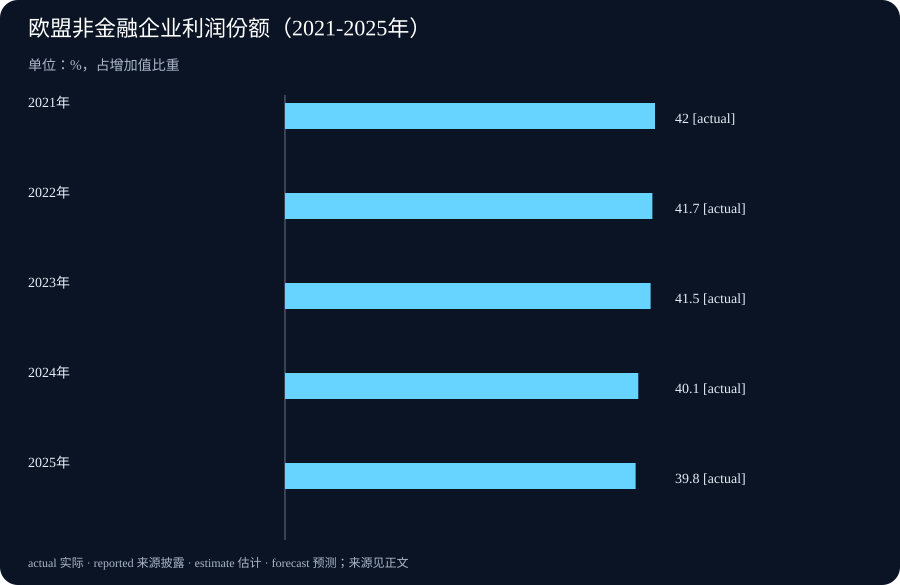

# Daily Intelligence｜2026-11-25

- **新闻研究截止：**2026-11-25 07:01:00（Asia/Shanghai）；固定窗口为2026-11-24 07:01:00至2026-11-25 07:01:00。Google页面的发布时间是协调世界时11月24日19:30，换算为上海时间11月25日03:30，在窗口内。Eurostat页面的元数据给出协调世界时11月24日10:00，换算为上海时间18:00；中国国家统计局页面标注11月24日09:30（北京时间），换算为协调世界时01:30。OpenAI页面只标11月24日，德国联邦统计局新闻稿只标11月24日，两处都没有在页面上给出具体小时，不能据此证明发布时刻严格落在窗口内。
- **本期新增：**OpenAI公布GPT-6系列在蛋白质设计与预测上的实验室结果和计算结果，并在同一页面写明哪些部分仍不如专用模型；Google DeepMind上线"人类第一次考试"（HFE）基准，把测量重点从能不能一次做对改成是否每次都能做对；Eurostat公布2025年欧盟非金融企业利润份额连续第四年下降；德国联邦统计局公布2026年企业AI使用率为37%以及未采用的理由；中国国家统计局公布2026年11月中旬50种生产资料价格中38种比上旬下降。对照了11月24日与23日两期全文、论断与来源链接，未把Shirudo运行中防护、搜索读取钱包资料、困惑度倡议、台湾人工智能年会闭幕、印度拨款与影视征集、Bedrock多语种检索、AWS Quick网页体验重复包装成新事件。本期没有跨实验室验证的模型排名。

## Today's Thesis
今天两条AI消息回答的是同一个问题：模型到底有多强，凭什么这么说。OpenAI给出实验室结合率——测试的322个小蛋白里有35个（10.9%）与预定目标结合；同一个页面也写明原始RFdiffusion研究报告过更高的命中率、从序列预测完整结构仍是明显短板、这一轮设计流程仍要靠专用模型筛选候选，因此作者自己说结果"还不能证明"模型能零样本从头做出可用设计。Google DeepMind换的是测量口径：不看模型能不能一次做对，看它对同一任务和轻微变体是否每次都做对，题库是544道日常文字与图像问题、覆盖20项基础能力；页面上没有任何模型分数。

另外三条来自官方统计，量的分别是分配、采用和价格。欧盟2025年非金融企业利润份额是增加值的39.8%，比2024年低0.2个百分点，为连续第四年下降，成员国从法国的32.2%一直到爱尔兰的74.9%。德国至少10名员工的企业中37%在2026年使用了AI，一年内上升11个百分点，未使用者给出的最多理由是缺乏知识（65%）、隐私与数据保护顾虑（61%）和法律后果不清楚（60%）。中国11月中旬50种流通领域生产资料价格中38种较上旬下降，但这是不加权的种数，不是价格指数。五件事共用一条判断方法：先问是谁测的、测的是什么、分母是什么，再决定这句话能走多远。

## Executive Summary
OpenAI在11月24日发布研究页面，说明GPT-6系列模型在蛋白质任务上表现出的能力，并配套一篇预印本。可核对的结果包括：与Onava合作在实验室合成并测试的322个小蛋白结合子中，35个（10.9%）与目标结合；在已知结构上重新设计序列的初筛中，MDM2为75/88（85%）、VEGF-A为26/42（62%）、PD-1为8/59（14%）；改造治疗性抗体的结合环后，272个片段中179个（66%）仍结合原目标。页面同时列出限制：候选筛选依赖Boltz-2、OpenDDE、ESMFold2、ProteinMPNN等专用模型，从序列预测完整结构的表现仍大幅落后专用模型，结合只是通往工具或药物的第一步。

Google DeepMind在协调世界时11月24日19:30上线"人类第一次考试"基准，放在Kaggle上，用来测量大模型回答简单日常问题的可靠性。页面的区分很直接：多数基准测的是复杂数学、编程和科学上的能力上限，HFE测的是模型能否稳定解出任务及其轻微变形。数据集为544道基础文字与图像问题，覆盖20项基础能力；页面提供实时排行榜和技术报告链接，并发起一项到12月15日为止的三周Kaggle征集，请社区提交当前模型仍会答错的日常问题。页面上没有公布任何具体模型的成绩。

Eurostat在11月24日公布欧盟非金融企业的利润份额：2025年为增加值的39.8%，比2024年下降0.2个百分点；序列上2021年42.0%、2022年41.7%、2023年41.5%、2024年40.1%、2025年39.8%，即连续四年回落。成员国差别大：爱尔兰74.9%、马耳他55.2%、罗马尼亚51.8%居前，法国32.2%、斯洛文尼亚33.2%、葡萄牙34.2%居后。该指标定义为营业盈余除以总增加值，是劳动报酬等份额的补数；页面提醒，份额低不一定代表利润少，也可能说明经济更依赖劳动。

德国联邦统计局11月24日发布企业新闻稿：2026年至少10名员工的德国企业中37%使用了AI技术，比2025年的26%高出11个百分点。分规模看，250人以上大企业73%、50至249人中型企业49%、10至49人小企业33%，同比分别上升16、13、10个百分点。使用者最常采用的技术是图像、视频、声音与音频生成（59%）、书面语言分析（54%）与语音识别（45%）；主要用途是营销或销售（35%）、行政管理流程或经营（31%）、记账、控制与财务管理（28%）。在非使用者中，18%曾考虑采用；不用的理由依次为缺乏知识65%、数据保护与隐私顾虑61%、法律后果不明60%、与现有设备软件系统不兼容47%、数据可得性或质量问题41%、成本过高36%、伦理考虑27%。

中国国家统计局11月24日09:30发布2026年11月中旬流通领域重要生产资料市场价格：与11月上旬相比，50种产品中11种上涨、38种下降、1种持平（多晶硅持平）。跌幅较大的有液化石油气−10.1%、纯苯−9.8%、冰醋酸−8.3%、汽油（95#）−6.9%、聚丙烯−6.8%；上涨的包括无烟煤+4.4%、天然橡胶+2.6%、生猪+3.4%。监测由中国统计信息服务中心与卓创资讯共同进行，覆盖31个省（区、市）300多个交易市场的近2000家经营企业，口径为批发与销售价格，包含出厂价格之外的流通费用、利润与税费。

## AI Daily
### 蛋白质设计：结合率与自认的短板写在同一页

OpenAI在11月24日发布研究页面，主题是GPT-6系列模型在蛋白质设计与结构预测上的表现，并链接一篇题为"GPT-6 as a Universal Foundation Model for Protein Biology: Beyond Specialized Models"的预印本。页面说的是"内在能力"（intrinsic capabilities）：模型不依赖专门的生物学模型，也能给出蛋白质三维结构和氨基酸序列的候选设计。实验室合成与测试由研究合作方Onava完成。

实验室结果分三组。第一组是从结构出发设计小蛋白结合子：测试322个，35个（10.9%）与预定目标结合，按目标分别为PD-L1 5个、IL-7Rα 3个、TrkA 1个、VEGF-A 8个、IL-17A 18个。页面直接给出对照：原始RFdiffusion研究报告过更高的命中率，但命中率很大程度取决于进实验室前怎样筛选设计。第二组是在已知结构上重新设计序列：MDM2为75/88（85%），VEGF-A为26/42（62%），PD-1为8/59（14%），序列与原设计的中间差异分别是43%、50%、15%；另外对三个未发表结构新设计的序列，107个蛋白中有14个（13.1%）显示结合。第三组是抗体改造：为结合IL-4Rα的6个小抗体重新设计3条结合环，测试182个设计中128个（70%）仍结合；在5种治疗性抗体上改写结合环约一半氨基酸，272个片段中179个（66%）仍结合原目标。

计算结果用于比较不同代次的模型。运动基元支架设计（motif scaffolding）用MotifBench的30道题，最新内部模型评估设计中43.7%同时满足保住基元与整体结构相符两个条件，RFdiffusion为27.8%；这项被页面称为主初步分析，判定过程使用了ProteinMPNN与ESMFold预测。按CATH折叠分类码做整体设计，200道题中18.9%通过，专用模型Proteina为17.1%。小分子对接：PoseBusters数据集上GPT-6.2为93%、内部模型为96%、专用模型DiffDock-L为50%；在179个Scarpino结构上内部模型为97%、DiffDock为60%。抗体复合物姿态预测的平均DockQ从GPT-5.6的约0.05升到GPT-6的0.28、GPT-6.2的0.57、内部模型的0.81，页面注明这些结构是公开的，模型可能在训练中见过相同或相似配对。突变效应排序在4个数据集、稳定性研究265个集合上的秩相关从0.41升至0.52、0.57、0.66，四个数据集的平均排序都优于专用模型ESM2-650M。

限制写得很具体。第一，从氨基酸序列预测完整三维结构仍是"明显短板"：TM-score平均从GPT-5.6的0.16、GPT-6.2的0.26到内部模型的0.38，而专用模型ESMFold2平均为0.93；页面说明0.5以上通常才算抓住整体折叠。第二，这一轮设计流程依靠Boltz-2、OpenDDE、ESMFold2、ProteinMPNN、SolubleMPNN等专用模型来预测与过滤候选，作者据此写道，结果"还不能证明"模型能在没有专用模型帮助下端到端零样本生成新的结合子。第三，结合只通往工具或药物的一步，特异性、稳定性、生物活性以及治疗应用的安全与有效性仍待确立。第四，作者用"未发表的结构加序列差异明显"作为能力超出记忆（memorization）的证据，这是一个论证，不是外部检验。页面另提到，按Preparedness Framework评估与降低生物安全风险。

对读者的意思是：这条消息同时提供了分子和分母，也提供了作者自认做不好的任务。判断它是否等于"AI已能设计药物"，要看后续是否出现非合作方实验室的复现、公开的设计与筛选流程、以及训练数据重叠的披露。

来源：[OpenAI：GPT-6模型展现内在蛋白质设计能力（11月24日；小时未披露）](https://openai.com/index/gpt-6-models-demonstrate-intrinsic-protein-design-capabilities)

### HFE把问题换成"每次都做对吗"，但没有公布分数

Google DeepMind的研究员Oran Kelly在协调世界时11月24日19:30发帖，宣布"人类第一次考试"（Humanity's First Exam，简称HFE）基准上线Kaggle，用来测量大语言模型回答简单日常问题有多可靠。页面的区分点是测量目标：当前前沿模型在复杂数学、编程和科学上表现突出，多数基准测的是这些领域的"能力上限"；HFE不问模型能否一次解出任务，而问它能否把任务及其轻微变体每次都做对。

可核对的信息是：数据集包含544道基础的文字与图像问题，覆盖20项基础能力。页面给出实时排行榜和技术报告的链接，并举例一道题：给出一块霓虹灯招牌，要求按顺序列出每个单词第三个字母的颜色（答案为绿；黄；白；蓝；蓝）。为了让题库保持更新，Google发起一项为期三周、到12月15日为止的Kaggle征集，邀请社区提交今天模型仍会答错的日常问题。页面写道，过去6个月前沿模型在HFE上有明显进展。

页面没有给出的同样重要：没有任何具体模型的名字或分数，没有20项能力分项的结果，也没有在这页说明题目如何验证、怎样去重、如何判断是否进入过训练语料、"每次都做对"怎样计分——这些需要读技术报告。出题、托管排行榜、征集新题都由同一家机构组织，这是这类基准的常见结构，也是它需要外部复核的原因。

两条AI消息放在一起看，方向相反但互补。OpenAI测的是模型能否完成需要专业知识的困难任务，Google测的是模型能否稳定完成人人都会的简单任务。前者的分数不能推定后者，后者的稳定也不等于前者能做药。所谓"评测重心转移"，目前只能说是多了一把尺，而不是一条已经量出结果的新刻度。

来源：[Google DeepMind：人类第一次考试，测试大模型可靠性（协调世界时11月24日19:30）](https://blog.google/innovation-and-ai/models-and-research/google-deepmind/humanitys-first-exam/)

## Business Daily
### 利润份额连续四年回落，量的是分配不是利润额

Eurostat在11月24日公布欧盟非金融企业的利润份额统计：2025年该份额为增加值的39.8%，比2024年低0.2个百分点。按页面给出的序列，2021年为42.0%，此后逐年降至2022年41.7%、2023年41.5%、2024年40.1%、2025年39.8%，即连续四年回落。更长时间看，2005年为40.7%，2007年42.1%是20年来的高点，2012年39.5%是记录中的低点；2025年比记录低点高0.3个百分点，比2005年低0.9个百分点。

成员国之间差别很大。2025年最高的是爱尔兰74.9%，页面把这一异常值归因于设在爱尔兰的大型外资跨国公司资本密集度高；其后为马耳他55.2%、罗马尼亚51.8%。最低的是法国32.2%，其后为斯洛文尼亚33.2%、葡萄牙34.2%。

口径要逐项说清。利润份额的定义是营业盈余除以总增加值，它同时是劳动报酬份额与生产相关其他税净额（其他税减其他补贴）在增加值中占比的补数。这意味着它衡量的是增加值在资本与劳动之间怎样分配，不是利润金额、不是利润率、也不是企业收入。Eurostat在页面中提醒：份额低不必然表示利润少，也可能是经济更依赖劳动；份额高也可能是生产更资本密集。因此"利润份额下降"不能直接读成"企业盈利能力恶化"。

还有一处时间差：这是年度部门账户口径，统计年份为2025年，发布于2026年11月24日，相隔约一年；引用时应说明数字属于哪一年，也不要拿成员国的平均份额去代替某一国的企业利润状况。数据来源数据集为nasa_10_ki。

来源：[Eurostat：欧盟企业利润份额连续四年下降（协调世界时11月24日10:00）](https://ec.europa.eu/eurostat/web/products-eurostat-news/w/ddn-20261124-3)

### 德国企业AI使用率升至37%，非使用者的理由集中在知识、隐私与法律

德国联邦统计局（Destatis）在11月24日发布第408号新闻稿：2026年，至少10名员工的德国企业中37%使用了AI技术，比2025年的26%上升11个百分点，即"每三家就有一家用了AI"。按企业规模分：250人以上大企业73%，50至249人中型企业49%，10至49人小企业33%；与上年相比分别上升16、13、10个百分点，三个规模档次都有增长，但差距没有缩小。

采用什么、用在哪里，页面给了排序。最常使用的技术是图像、视频、声音与音频的生成（59%）、书面语言分析（54%）与语音识别（45%）。主要用途是营销或销售（35%）、组织企业管理流程或经营管理（31%）、记账、控制与财务管理（28%）。

未采用AI的企业提供了另一组同样重要的数字。其中18%已经考虑过使用。给出不用AI的理由依次为：缺乏知识65%、对数据保护与隐私的顾虑61%、法律后果不清楚60%、与现有设备、软件和系统不兼容47%、数据可得性或质量方面的困难41%、成本过高36%、伦理考虑27%；另有18%认为在自己企业里使用AI没有意义。这组理由说明限制采用的是知识、合规与系统集成，而不只是模型能力或价格。

方法与口径：结果来自每年一次的企业信息与通信技术（IKT）使用情况调查，由欧盟提供资金支持；关于AI使用与非使用原因的问题允许多重回答，因此各项比例相加会超过100%。详细结果在德国GENESIS-Online数据库表52911。需要区分的是，"使用AI"是企业自报是否用到相关技术，不等于投入强度、支金额度或生产率效果，也不能据此推断就业或收入分配的变化。本段中文表述是对德文原文的翻译。

来源：[德国联邦统计局：超过三分之一企业在2026年使用人工智能（第408号新闻稿，11月24日；小时未标注）](https://www.destatis.de/DE/Presse/Pressemitteilungen/2026/11/PD26_408_52911.html)

## Macro Observation
### 11月中旬中国生产资料价格：38种下降，但这是种数不是指数

中国国家统计局11月24日09:30（北京时间）发布"2026年11月中旬流通领域重要生产资料市场价格变动情况"。监测覆盖9大类50种产品，与2026年11月上旬相比，11种价格上涨、38种下降、1种持平。持平的是多晶硅（致密料），为每千克41.0元。

下降的一端集中在化工与成品油。按页面数字（单位：元/吨，括号内为较上旬涨跌幅）：液化石油气7,073.5（−10.1%）、纯苯7,858.6（−9.8%）、冰醋酸3,750.0（−8.3%）、汽油95号10,305.0（−6.9%）、聚丙烯10,503.6（−6.8%）、聚乙烯9,525.5（−7.7%）、液化天然气7,260.5（−4.5%）、柴油0号9,253.8（−4.9%）、甲醇3,446.2（−4.0%）、焦煤2,150.0（−4.6%）。有色金属同步回落：电解铜107,780.7（−1.8%）、铝锭22,800.0（−2.6%）、锌锭25,034.3（−1.8%）；钢材普遍小跌，螺纹钢3,141.6（−0.3%）、普通中板3,330.6（−1.7%）。上涨的主要是无烟煤1,584.5（+4.4%）、天然橡胶19,023.8（+2.6%）、生猪每千克9.0元（+3.4%）、棉花16,491.7（+1.4%）、纸浆4,904.7（+0.3%）。

口径比数字更要紧。页面附注写明，流通领域重要生产资料市场价格指重要生产资料经营企业的批发和销售价格，既包含出厂价格，也包含经营企业的流通费用、利润和税费；两者互相影响、存在时滞，某一时间段内趋势可能不完全一致。监测由中国统计信息服务中心与卓创资讯共同进行，覆盖31个省（区、市）300多个交易市场的近2000家批发商、代理商、经销商等经营企业；采价方式包括信息员现场采价以及电话、即时通讯工具和电子邮件询价。上涨与下降的个数按涨跌幅统计。

因此这条消息不能这样读：38种下降不等于价格总水平下降，50个样本不加权、不含服务业与消费品，也不是消费者价格指数或工业生产者出厂价格指数（PPI）。半月比（中旬对上旬）反映的是两周之间的变化，与同比读数不可互换；把它当作通胀或通缩的证据之前，应先与统计局另行发布的月度PPI、CPI对照。

来源：[中国国家统计局：2026年11月中旬流通领域重要生产资料市场价格变动情况（11月24日09:30北京时间）](https://www.stats.gov.cn/sj/zxfbhjd/202611/t20261123_1965935.html)

## Signal Dashboard
- **能力主张的自证程度：**OpenAI在同一页面给出实验室结合率（322个测试35个命中，10.9%）与落后项（结构预测TM-score 0.38对ESMFold2的0.93），并写明筛选依赖专用模型；仍无外部复现。
- **评测口径变化：**HFE把问题从"能否一次做对"换成"是否每次都做对"，题库544题、20项基础能力，但页面未公布任何模型分数与方法细节。
- **分配指标：**欧盟2025年非金融企业利润份额39.8%，连续第四年下降；它是营业盈余占总增加值之比，不是利润额或利润率，爱尔兰74.9%受跨国公司口径影响。
- **采用瓶颈：**德国企业AI使用率37%（+11个百分点），大企业73%对小企业33%；非使用理由前三为缺乏知识65%、隐私顾虑61%、法律后果不明60%，且允许多重回答。
- **价格读数：**中国11月中旬50种生产资料中38种较上旬下降、1种持平；半月比与不加权个数不能等同于CPI或PPI。

## Deep Insight
### 声称、测量、采用：三段之间各隔着一道验证

把今天五件事排成一条线，会看到一个共同结构：厂商的成效主张、第三方可复核的测量、企业和家庭的实际采用，是三段不同的过程，每段都有自己的判据。新闻通常只把第一段写得最清楚。

先看能力主张。OpenAI这页的价值恰恰在于它把不利数字也放进来：原始RFdiffusion研究有更高命中率，完整结构预测TM-score只有0.38而专用模型是0.93，设计流程需要专用模型过滤候选，所以作者写"还不能证明端到端零样本"。这类自我标注并不减少卖点，它降低的是读者被单向说服的风险。但也应注意它仍不是验证：结合率是厂商自报、由合作方实验室完成，判定成功所用的工具本身也是被比较对象的一部分（ProteinMPNN、ESMFold 用来筛设计），DockQ比较的又是公开结构、作者自己提示可能见过相似配对。真正能推进结论的下一步很具体：非合作实验室按同一序列复现、把筛选规则与失败样本一起公开、说明训练语料与测试集的交叠、并给出除结合之外的特异性和稳定性数据。在此之前，这句话的合理读法是"在这批任务上、这套筛选下、由这两家机构测出的结果"。

再看测量口径。HFE把基准从"能力上限"转向"稳定完成"，方法学上是有意义的变化：一次做对可能靠运气、靠检索、靠特定提示；把同一任务做变形后还每次都做对，才接近日常使用里所谓可靠。它同时也改变了风险归属——越低的题目越容易进训练语料，题目由社区征集更带来污染与难度漂移的问题。要让它成为可外部检验的尺度，需要公开的东西包括：每题多轮采样的计分规则、20项能力的划分依据、题目去重与训练语料比对方式、以及排行榜上实际参赛模型的成绩。页面说"过去6个月有明显进展"却没给数字，这一句现在只能当作厂商的定性说法，而不是结果。这里适用的判据是：一个新指标在被别人复算之前，它改变的是提问方式，不是答案。

第三段是采用。德国的数字提供了今天最可操作的信息：整体37%、大企业73%、小企业33%，而不用AI的三家理由里排前的是"不知道怎么用"（65%）、隐私与数据保护（61%）、法律后果不清楚（60%），成本只排第六（36%）。这组排序的含义是，限制采用的主要不是模型或价格，而是组织能力、合规确定性与系统集成；这三项都靠制度和培训改善，不靠下一版模型。同时要注意方法：这是自报是否使用的年度调查，允许多重回答，所以各比例相加会超过100%，而且它不测投入强度、不测生产率效果，不能用来推算AI对德国产出的贡献。

统计口径的谨慎同样适用于欧盟利润份额。连续四年下降这件事真实，但它是增加值在资本与劳动之间的分配变化，不是企业利润额的变化；Eurostat自己写明，份额低也可能表示经济更劳动密集。把它读成"企业盈利能力恶化"就多走了一步。爱尔兰74.9%被解释为大型外资跨国公司的资本密集度，这是同一均值下的构成问题：跨国企业把增加值记在哪里，会让份额数字失去可比性。至于中国50种生产资料中38种下降，它是半月之间的不加权个数，既不是指数，也不是同比，更不是消费价格；把它当成通缩证据，等于把样本计数误当作总水平测量。

于是，本期的通用追问可以是四条：这句话来自谁的测量，是厂商、合作方还是独立机构？数字的分母是什么——是测试设计数、增加值、企业总数还是不加权样本数？作者是否说明了自己做不好的任务或调查允许多重回答？从"能做出"到"能用上"、从"用了"到"用出效果"，中间还差哪一步？把这四条问完，多数公告会回到恰当位置：它们改变的是可测性与可能性，不等于结果已经发生。

## Tomorrow Watch
1. **蛋白质结果是否被复现？**关注是否有非OpenAI、非Onava的实验室公布按同一序列的复现结果，以及论文是否公开设计与筛选流程、失败样本和训练语料交叠说明；厂商自报的合作方测试不能替代外部复核。
2. **HFE是否公开分数与方法？**留意排行榜上具体模型的成绩、技术报告中"每次都做对"的计分规则、20项能力的划分方式，以及社区征集题目如何做去重与污染筛查；页面上的"明显进展"目前只是定性说法。
3. **企业采用统计是否给出强度？**关注Eurostat与各国统计局后续是否发布AI使用强度（支出、占ICT投入比重、岗位覆盖）口径，以及德国下一年调查中法律后果不清楚这一理由是否随欧盟规则落地而下降；仅有"是否使用"无法衡量效果。
4. **利润份额是否续降、部门账户是否修正？**年度部门账户通常在次年秋季更新，季度账户更早；应同时看季度序列是否确认下行，并注意成员国统计调整与跨国企业利润重估造成的修正。
5. **中国价格能否与PPI、CPI对得上？**下一个半月数据与11月月度价格指数即将分别发布；判断"生产资料价格下降"是否传导到企业成本与消费价格，需要看同比口径与出厂价格，而不是50种商品的涨跌个数。

## One Chart
图表显示欧盟非金融企业利润份额（营业盈余占总增加值之比），覆盖2021年至2025年五个年度：42.0%、41.7%、41.5%、40.1%、39.8%。五个点说明的是同一件事的五个阶段——份额连续四年回落，且2025年的读数已低于2005年的40.7%，但仍略高于2012年记录低点39.5%。

要注意这张图不能读成什么：它是分配份额，不是利润金额或利润率；不含金融企业；统计年份为2025年，发布于2026年11月24日，相隔约一年；成员国差异在图中被平均掉，同期区间从法国的32.2%到受跨国公司影响的高值爱尔兰74.9%。

来源：[Eurostat：欧盟企业利润份额连续四年下降（协调世界时11月24日10:00）](https://ec.europa.eu/eurostat/web/products-eurostat-news/w/ddn-20261124-3)

## Quote of the Day
> "Nothing is clearer than a matter that has been verified by results; nothing is settled but a claim that has proof."
>
> **中文原文：**「事莫明于有效，论莫定于有证。」（王充《论衡·卷二十三·薄葬篇》）
>
> **白话释义：**说明一件事，没有比拿出实际效验更清楚的；断定一个论点，没有比拿出证据更靠得住的。
>
> **人物与出处：**王充（约公元37年—约92年），东汉思想家，《论衡》的作者。这句话出自今本《论衡》卷二十三薄葬篇，原文作"事莫明於有效，論莫定於有證"。在它的前后文里，王充讨论的是儒墨两家关于人死后有无知觉的争论：他说刘向（子政）的奏议未能说明儒家"无知"的验证与墨家"有知"的根据，接着写下这一句，随后是"空言虚语，虽得道心，人犹不信"——空洞的说法即便合于道理，人们仍然不会相信。他在同篇还主张判断是非"不徒耳目，必开心意"，即不能只靠见闻。此处英文是本期自译，不引自任何已刊译本；篇次与卷次依据所引全文页面的标注。原文见[劝学网《论衡》卷二十三·薄葬篇页面](https://www.quanxue.cn/ct_rujia/lunheng/lunheng67.html)。
>
> **编辑解读：**王充这句话讲的是主张与验证的关系：效验让事情清楚，证据让论点确定。本期两条AI消息正处在这句话的两端——OpenAI给出了实验室的结合数，也给出了自己没做好的任务；Google DeepMind提出一把新的尺，但还没有把量出的结果公之于众。三条官方统计则提醒另一件事：数字的清楚程度取决于口径，份额、种数与自报使用情况都各有边界。判断进展，先看有没有可复核的效验与证据，再看它支持到哪一步。

## Action Items
1. **这句话由谁测的？**读AI能力报道时，先分清厂商自测、合作方实验室与独立机构复现三种情形；若判定成功还借助被比较的专用模型，应把"结果"与"方法依赖"同时记下。
2. **分母是什么？**看到比例先看总体：322个测试设计里35个命中，50种商品里38种降价，40%以下的采用率分母是"至少10名员工的德国企业"；欧盟利润份额的分母是增加值而不是利润额。
3. **作者是否说出短板？**能力主张旁边若同时给出落后项（如TM-score 0.38对0.93、不能端到端零样本），应把它当成报道的一部分而不是脚注；反之，只报成绩不报限制时需要主动寻找限制条件。
4. **采用与效果之间还差几步？**企业"用没用AI"不反映投入强度与生产率效果；评估自身或所在组织的采用时，把知识、合规、系统集成三项障碍与成本分开列，并记录可核对的流程变化与质量结果。
5. **统计期与发布日是否一致？**引用2025年度部门账户、2026年年度调查或11月中旬价格监测时，分别标注统计期、发布时区与比较口径（同比、环比、半月比），不要互换使用。
