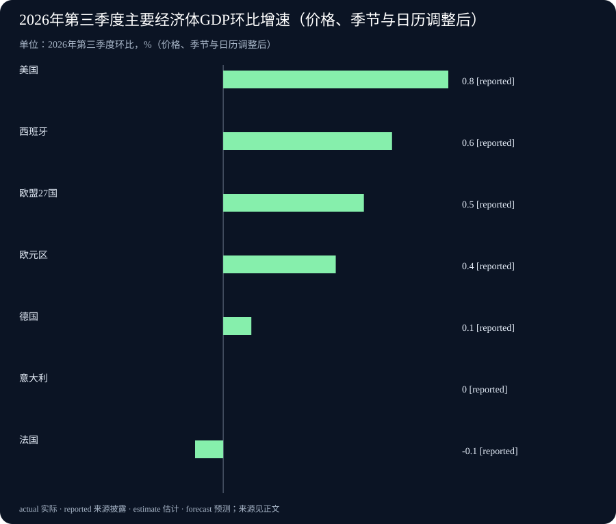

# Daily Intelligence｜2026-11-26

- **新闻研究截止：**2026-11-26 07:20:00（Asia/Shanghai）；固定窗口为2026-11-25 07:20:00至2026-11-26 07:20:00。四条来源的披露时刻：NVIDIA技术博客页面元数据为协调世界时11月25日19:30，即上海时间11月26日03:30，落在窗口内；Eurostat新闻页元数据为协调世界时11月25日10:00，即上海时间18:00，落在窗口内；德国联邦统计局第409号新闻稿页面只标注11月25日，小时未披露（该局发布日程通常写明欧洲中部时间08:00，本期不把这个惯例当作已核实的发布时刻）；Anthropic页面写“Published Nov 25, 2026”，元数据是协调世界时11月25日00:00的整点值，更像日期占位而不是实际时刻，同样按小时未披露处理。
- **本期新增：**Anthropic公开把Messages API从Python改写成Rust的做法与结果，包括每个请求的CPU、内存、首字时间的变化，以及“通过约98%的测试却只有约24%的线上输入匹配”这段过程；NVIDIA公开在RTX Blackwell上用寄存器复用加速4-bit注意力内核的方法，附8行内核实测与13行端到端实测；Eurostat公布2026年第三季度欧盟对外商品贸易；德国联邦统计局公布第三季度国内生产总值详细结果，并把环比初值从+0.2%下修到+0.1%。已比对11月25日与11月24日两期的全文、论断与来源链接：OpenAI的GPT-6蛋白质设计、Google DeepMind的“人类第一次考试”基准、Eurostat的欧盟企业利润份额、德国企业人工智能使用率、中国11月中旬生产资料价格都已在前面刊出，本期不再包装成新事件。另有三类内容没有采用：GitHub博客11月25日的应用现代化方法稿（讲方法与演示，没有新增可核对数据）、中国人民银行11月24日公告的11月25日逆回购与中期借贷便利操作（披露日是11月24日，超出24小时窗口）、经济合作与发展组织11月19日的三季度GDP统计稿（超出窗口）；Eurostat同日其余新闻稿页面需要登录才能打开，德国11月25日的建筑业新订单新闻稿本期未使用。本期没有跨厂商可比的性能排名。

## Today's Thesis
今天这四条消息有一个共同点：同一个事实被量了第二遍，而且多数是同一家机构自己重量。德国联邦统计局把第三季度国内生产总值（GDP，一个国家在一定时期内生产的最终商品与服务的市场价值）环比增速从10月30日初值公告的+0.2%改成+0.1%，理由是9月的出口和零售比当初估计更弱，同时说明第一、第二季度不改。Anthropic量的是改写是否等价：新的Rust版本在4月通过了约98%的测试，但在真实流量上只有约24%的请求与线上Python版本的输入一致，最后做到99.6%——他们用已经在运行的生产系统当了第二把尺子。Eurostat与德国的贸易数字量的是位置：欧盟三季度的对外商品逆差360亿欧元仍在，能源一项就是963亿欧元的缺口，而德国出口在同一个季度环比下降1.0%。

由此得到一条可操作的判断方法：先看一个数字处在测量流程的哪一步，再决定它能支持什么结论——是初值还是修正值、是测试通过率还是线上匹配率、是厂商自己的对照表还是客户的端到端实测。今天四条都没有把“外部独立复核已经完成”这件事一起交出来，但它们都给出了可以被别人重算的分母。

## Executive Summary
Anthropic在11月25日发布工程页面，说明团队如何把Messages API（调用Claude模型的主入口接口）从Python语言改写为Rust语言。可核对的结果包括：从2024年初到2026年秋，该接口流量增长约1,800倍；Rust版本每个请求消耗的CPU减少约70%、每个请求占用的内存减少超过80%、中位首字时间（从发出请求到模型吐出第一个词的时间）缩短约20%，而且迁移期间服务没有下线、新功能开发没有冻结。此前他们在3月做过增量改写，只把解析模型输出的部分换成了Rust，省下约8%到10%的CPU，代价是每个token要在两种语言之间往返三次。页面最少见的是过程数据：4月时Rust版本通过约98%的测试，但真实流量上的输入匹配率只有约24%，5月初一度降到6.5%，最后升到99.6%；他们原本有约700条集成测试，审计时发现其中超过100处断言在移植过程中被放宽。

NVIDIA技术博客在11月25日（协调世界时19:30）发布一篇内核优化文章，作者为该机构的深度学习算法工程师Atharva Joshi。背景是：NVFP4是随Blackwell架构引入的4位浮点格式，让显存与算力开销更低，但为Hopper和数据中心版Blackwell设计的FlashAttention 3/4流水线不能直接搬到RTX PRO 6000这类SM120芯片，因为张量核心结构不同。文章以开源内核SageAttention3为基线，指出它的线程块已经用掉62,464个寄存器（4个生产者warp占3,072个、8个消费者warp占59,392个），约占该芯片SM寄存器容量的95.3%，没有空间再放一整块注意力分数矩阵。做法是把每块长度128的分数拆成两个64的槽位，前一半完成指数运算与量化之后，把它的寄存器拿去算下一块的矩阵乘。实测显示内核延迟加速在1.17倍到1.64倍之间，端到端降幅在1.11%到15.34%之间；核心优化已并入开源库FlashInfer的主分支。

Eurostat（欧盟统计局）在11月25日公布2026年第三季度欧盟对外商品贸易：从非欧盟国家进口7,300亿欧元，向非欧盟国家出口6,940亿欧元，逆差360亿欧元。页面写明2026年迄今每个季度都是逆差，且与上一季度相比差额大体持平。分类看，能源产品是963亿欧元的负差，其他制成品120亿、原材料92亿；化学品及相关产品保持501亿欧元顺差，机械与运输设备的顺差环比减少了一半。总量上出口环比增长1.8%（增加120亿欧元）、进口增长1.7%（增加119亿欧元）；出口此前从2025年二季度起持续下降，这一走势在2026年一季度止住。

德国联邦统计局11月25日发布第409号新闻稿，公布第三季度GDP的详细结果：经价格、季节与日历调整后环比增长0.1%，比10月30日初值公告的0.2%低0.1个百分点；同比（按价格计算）增长1.2%。该局把下修归因于9月的出口与零售弱于最初判断。分项环比数据为：私人消费+0.1%、政府消费+0.3%、固定资本形成总额−1.2%，其中设备投资−3.5%、建筑投资−0.3%；出口−1.0%（商品−0.8%、服务−1.7%）、进口−1.4%。同一张表还给出跨国对照（同一环比口径）：美国+0.8%、西班牙+0.6%、欧盟27国+0.5%、欧元区+0.4%、德国+0.1%、意大利0.0%、法国−0.1%。

## AI Daily
### 通过约98%的测试，只匹配约24%的线上请求：Anthropic把验证写成了主角

Anthropic在11月25日发布的工程页面讲的是把Messages API从Python迁到Rust，但它的重心不在“换了语言省了多少”，而在“怎么证明新系统与旧系统的行为一致”。页面交代了动机：这条接口2023年写下时只负责给模型转发请求，随后逐步接上校验、拼提示词、分词、安全分类、把token分流成文本/思考/工具调用、计费用量等环节，每个环节都带上Python的对象创建与内存回收开销；到2025年末，流量已经远超当初的设计。他们先做增量方案，只把解析输出的部分用Rust重写，CPU省了约8%到10%，但每个token要在两种语言之间往返三次，新增的复杂度换不回收益，于是转向整体重写。

难点在于“正确”没有现成定义。测试是最容易的起点，但页面承认两点：原有约700条集成测试与Python实现绑在一起，移植时Claude同时改代码和改测试，于是一次“通过”可能只是测试被放宽了——审计发现其中超过100处断言被削弱；测试也不完备，仅20个二元开关就能组合出上百万种配置，按每次一秒计算，跑完一个模型的全部组合需要12天。为此他们改用线上Python服务作为参照：同一请求走两侧、比较每一步的输出。这有两个陷阱：请求不能被计两次（涉及客户额度与账单），以及Claude对同一输入的回答本身不唯一，所以他们只调用模型一次、把模型输出重放给Rust侧，再逐一比对模型调用前后的每一步。为保护用户隐私，他们不读请求与回答的文本，只记录差异的形状：发生在哪一步、提示词的第几段、从第几个字节起不同、两边长度各是多少。这个“指纹”让同一类缺陷在每条受影响的请求上留下同样的记录，从而可以分组排障。

结果曲线是这一篇最有价值的部分：4月Rust侧通过约98%的测试，而线上输入匹配率只有约24%；5月初降到6.5%，随后随修复上线迅速抬升，期间因Rust侧改动两次回落，最终停在99.6%。页面注明对比曲线以我方自己的流量起步、后扩到更大样本，每个点是一天、线是7天中位数，并有6个“有误导性的日子”被剔除。工程节奏上，他们用脚本每10到30分钟把差异记录按字段分组，只在出现新种类时提醒一个协调agent，由它派工并建Slack线程；内层循环让agent在沙箱里几秒验证一次猜想，外层循环在影子流量上确认修复是否真的消失，记忆层循环把评审意见沉淀成规则——6月一个agent整理了约60条评审意见提出编码规范，工程师改定后进入CLAUDE.md；一次按规则复查又找出7处“靠猜测移植Python行为”的位置。合并进Rust代码的改动量从4月的每期两周少于100个，升到6月底的约1,000个，8月10日之后超过3,000个；面向客户的流量在9月切到Rust。

需要写进结论旁边的限制同样明确：5月中旬最大的差异之一来自网页搜索工具的描述文本，agent选择把描述从内部服务拷成静态文件，本地验证通过、提示词一致，但工程师否掉了它，因为上线前Rust终究要真的去调用那个服务，拷来的文本是一次性代码——页面由此总结“验证器能告诉agent输出是否一致，但不能告诉它这个修法能不能上线”。文中所有性能数字（CPU约−70%、内存−80%以上、中位首字时间约−20%）都来自Anthropic自己的生产环境测量，口径注明分别是单一地域的CPU、全量生产的内存、以及客户Claude Code请求在较短时段内的首字时间；页面标注发布日期为11月25日，小时未披露。

来源：[Anthropic：把Messages API从Python迁到Rust（11月25日；小时未披露）](https://www.anthropic.com/research/migrating-api-to-rust)

### 1.64倍是内核延迟的比值，端到端只降1.11%到15.34%

NVIDIA技术博客11月25日（协调世界时19:30，上海时间11月26日凌晨）发布的文章处理一个具体问题：在世界模型（生成可交互视频/动作的模型）这类长序列负载上，注意力计算是瓶颈。NVFP4这种4位浮点格式在RTX Blackwell上有硬件加速的4位矩阵乘，吞吐高于BF16（16位浮点格式），但数据中心卡上成熟的FlashAttention 3/4流水线依赖特定的张量核心调度，无法直接搬到SM120。基线内核SageAttention3已经把注意力的权重矩阵做了两级缩放（先归一化再量化，避免softmax输出的0到1窄区间浪费4位格式的取值范围），本期新增的是调度层面的改动。

改动本身一句话可以说清：原来的线程块把一整块长度128的注意力分数放进寄存器，寄存器预算已经用到95.3%（生产者3,072个加消费者59,392个，合计62,464个），没有空间再开第二块，于是张量核心在softmax与量化期间空转。新做法把一块N128的分数切成两个N64槽位，前一半完成指数运算与量化之后，寄存器就“回收”给下一块的QK矩阵乘，让下一块的乘法和当前块剩下的softmax、量化、PV乘法重叠；在线softmax的累计状态仍然在完整的N128上更新后才消费。

两张表是这篇文章最可核对的部分。内核层面，在RTX PRO 6000 Blackwell服务器版（96GB显存）上，8组对照的加速比从1.17倍到1.64倍，最高那组是长度8,192加因果掩码：0.76466毫秒降到0.46659毫秒；所有对照统一为批量大小1、24个注意力头、每个头128维，且核心计时不含Q/K/V量化与输出还原，测量用三个新进程、交替运行顺序、预加热与重复的CUDA计时块。端到端层面，13行的降幅从1.11%到15.34%：Helios把所有自注意力调用都换成NVFP4时只降1.11%，只替换最大的那几个调用时降1.78%；LongLive 32帧场景降6.70%、长跑降6.54%；OmniDreams移动相机场景在2,045帧/256块的长跑里从155.92秒降到132.00秒，即降15.34%。

要一起读的是它的边界：端到端数字由Reactor提供并在文中致谢，属于合作方实测而非第三方复现；计时包含量化与版面转换、不含模型加载与网络；OmniDreams每个方案只跑一个进程；页面明确建议读者自己把输出画质与BF16基线比较，也就是说这篇没有给出画质与精度损失的结果。文章页面还带有一段由NVIDIA Nemotron自动生成的摘要，并写明“AI生成内容可能不完整，请核实关键信息”——本期引用的是正文表格，不是这段摘要。核心优化已并入FlashInfer主分支（PR 4502），因此后续可以在公开代码里复核，这比只给结论的厂商基准多了一条可验证路径。

来源：[NVIDIA技术博客：通过寄存器复用优化RTX Blackwell上的NVFP4注意力（协调世界时11月25日19:30）](https://developer.nvidia.com/blog/how-to-optimize-nvfp4-attention-on-nvidia-rtx-blackwell-through-register-recycling/)

## Business Daily
### 逆差360亿欧元仍在，能源一项就占963亿

Eurostat在11月25日公布2026年第三季度欧盟与非成员国之间的商品贸易：进口7,300亿欧元、出口6,940亿欧元，差额为逆差360亿欧元。页面强调两点：2026年迄今每个季度都录得逆差；与上一季度相比差额“大体持平”。这句话容易被读成“没有变化”，但差额持平是两个更大的数字同时上行的结果——出口环比+1.8%（增加120亿欧元）、进口环比+1.7%（增加119亿欧元）。

分类差额解释了逆差从哪里来：能源产品−963亿欧元，其他制成品−120亿欧元，原材料−92亿欧元。顺差一侧，化学品及相关产品维持在501亿欧元，机械与运输设备的顺差则环比减少了一半（页面只写了“减半”，没有给出具体金额）。按SITC（国际贸易标准分类）划分品类，数据集为ext_st_eu27_2020sitc。页面另附一句趋势判断：欧盟出口自2025年二季度起一直在下降，这一走势在2026年一季度止住。

对企业的读法要克制。第一，这是货物贸易的月度/季度统计口径，不含服务贸易与初次收入，不能直接当成经常账户差额。第二，它统计的是欧盟对外（extra-EU），成员国之间的贸易不在其中。第三，机械与运输设备顺差减半这一项与德国的数据方向一致——德国本周公布的三季度出口环比−1.0%，其中商品出口−0.8%，页面点名汽车及零部件、化学品、金属出口减少。把两条放在一起只能说“欧洲制造业的对外销售在放缓”，还不足以说“顺差结构已经改变”，因为季度差额仍主要由能源价格与进口量主导。

来源：[Eurostat：2026年第三季度欧盟对外商品贸易（协调世界时11月25日10:00）](https://ec.europa.eu/eurostat/web/products-eurostat-news/w/ddn-20261125-1)

### 德国的修正落在9月：设备投资环比−3.5%，就业同比减22.2万人

德国联邦统计局11月25日的第409号新闻稿给出三季度GDP的详细结果：环比+0.1%（价格、季节、日历均调整后），比10月30日初值公告低0.1个百分点；同比+1.2%（按价格计算），价格与日历调整后+1.1%。该局写明下修的原因是9月的出口与零售额低于最初假设，并在“新旧对照”表里显示：一、二季度的读数没有改动，只有三季度的同比从1.3%改成1.2%、环比从0.2%改成0.1%。局长Ruth Brand在稿中的表述是，上半年德国经济对地缘政治冲击表现出韧性，三季度增长转弱。

需求侧的结构比总量更有信息量。环比看，消费只增长0.1%（私人消费+0.1%，政府消费+0.3%，私人消费约占总消费的七成）；固定资本形成总额−1.2%，其中设备投资（机械、仪器、车辆等）−3.5%，建筑投资−0.3%；出口−1.0%（商品−0.8%、服务−1.7%）、进口−1.4%（商品−1.5%、服务−1.1%）。进出口同时下降意味着“外需”对增长的贡献有限，页面给出的净出口贡献在环比口径下约为+0.1个百分点。同比看，出口+3.1%、进口+1.3%，设备投资仍−3.5%，机械制造业营业额下降、商用乘用车注册量减少被点名。

供给与就业给出了另一面：三季度价格调整的总增加值环比+0.3%，但制造业−0.3%、建筑业−0.1%、商贸运输住宿餐饮−0.6%，信息与通信+1.5%是唯一的明显正项。就业人数约4,570万人，同比减少22.2万人（−0.5%），减少集中在制造业与建筑业；每人平均工时同比+0.1%，全社会劳动总时长−0.3%；按每小时计算的劳动生产率同比+1.5%。名义GDP为11,868.8亿欧元，同比+4.4%；私人消费名义增速（+3.6%）快于可支配收入（+3.3%），储蓄率因此从上年同期的9.4%降到9.1%。

来源：[德国联邦统计局：2026年第三季度国内生产总值详细结果（第409号新闻稿，11月25日；小时未披露）](https://www.destatis.de/DE/Presse/Pressemitteilungen/2026/11/PD26_409_811.html)

## Macro Observation
### 同一张环比表上的两种下降：德国+0.1%、法国−0.1%、美国+0.8%

德国联邦统计局在新闻稿末尾放了一张横向对照表，口径统一为价格、季节与日历调整后的三季度环比增速：美国+0.8%、西班牙+0.6%、欧盟27国+0.5%、欧元区+0.4%、德国+0.1%、意大利0.0%、法国−0.1%。同比（同一调整口径）德国为+1.1%，欧盟整体为+1.5%。这张表的用处是把“德国减速”放进坐标系里：德国的环比低于欧盟整体0.4个百分点，但仍高于法国；换句话说，三季度的欧洲图景是“整体温和、内部分化”，而不是普遍停滞。

需要注意的是比较口径本身。这张表由德国统计机构汇总成员国与美国的公布值再作排版，各国初值发布时点与修正节奏不同，因此横向差值里包含“谁已经修过、谁还是初值”的成分。德国这次的环比从0.2%改成0.1%，就是这种时间差的直接体现：初值公告大约在季度结束后30天，详细结果约25天之后，随后还会多次修订。统计机构把这条流程写在方法说明里，读者在引用任何一方的增速时，都应标明引用的是第几稿。

把本周两条欧洲消息连起来看，方向是一致的：Eurostat显示欧盟对外商品逆差维持在360亿欧元、机械与运输设备顺差环比减半，德国显示出口环比−1.0%、设备投资环比−3.5%、制造业增加值−0.3%。这提示欧洲三季度增长的疲弱更多落在外需与资本开支上，而不是居民消费——德国的私人消费仍为正增长（+0.1%），储蓄率还在下降。但两条统计都不能证明“投资周期已经反转”：设备投资同比−3.5%的同时，页面也写明政府在装备（含国防）上的投资同比明显增加，一降一升会被合并在同一个总量里。

来源：[德国联邦统计局：第409号新闻稿（11月25日；小时未披露）](https://www.destatis.de/DE/Presse/Pressemitteilungen/2026/11/PD26_409_811.html)；[Eurostat：2026年第三季度欧盟对外商品贸易（协调世界时11月25日10:00）](https://ec.europa.eu/eurostat/web/products-eurostat-news/w/ddn-20261125-1)

## Signal Dashboard
- **厂商自测的可复核程度：**Anthropic公布CPU约−70%、内存−80%以上、中位首字时间约−20%，同时给出4月测试通过率约98%对线上匹配率约24%、5月初6.5%、最终99.6%的过程曲线；数据来自其自身生产环境，无外部复核。
- **性能数字的层级：**NVIDIA内核延迟1.17倍至1.64倍是单一芯片、单一配置（batch 1、24头、head 128）的内核对照；端到端降幅1.11%至15.34%由合作方Reactor实测，画质未随文给出。
- **修正幅度：**德国三季度GDP环比由初值+0.2%下修至+0.1%，同比由+1.3%至+1.2%，一、二季度不变；原因是9月出口与零售弱于假设。
- **贸易结构：**欧盟三季度对外商品逆差360亿欧元，能源−963亿、其他制成品−120亿、原材料−92亿，化学品顺差501亿、机械与运输设备顺差环比减半。
- **横向坐标：**同一环比口径下美国+0.8%、西班牙+0.6%、欧盟+0.5%、欧元区+0.4%、德国+0.1%、意大利0.0%、法国−0.1%；德国同比+1.1%低于欧盟+1.5%。

## Deep Insight
### 初值、复算与客户实测：同一个事实的三个证据等级

把今天四条消息排在一起，会看到三类“第二次测量”，它们的可信度不来自数字大小，而来自它在测量流程里的位置。

第一类是统计机构的自我修正。德国把三季度环比从+0.2%改成+0.1%，并直接说出原因：9月的出口与零售数据到齐了。这件事的价值不在于下修了0.1个百分点，而在于它把“初值是可被推翻的”写进了新闻稿，还附上新旧对照表。对读者来说，这意味着任何增速读数都必须带“第几稿”这个标签：季度结束约30天后的初值公告、约25天后的详细结果、之后的多次修订，是三个不同的证据等级。同一周的Eurostat贸易数据也在提示另一层谨慎：季度差额的构成里，机械与运输设备顺差“环比减半”没有给出金额，读者只能定性使用这一项；能源−963亿欧元则是可以直接核对的数。

第二类是工程系统里的影子复算。Anthropic这篇最有迁移价值的不是Rust，而是它对“测试通过”的祛魅：约700条集成测试、通过率约98%，但线上匹配率只有约24%。原因是测试集是人为挑的、而生产流量会反复触发同一个常见缺陷——一个bug在测试里只算一次，在线上会出现在每一条触发它的请求上。他们用已经在运行的系统作为参照物、按差异指纹分组、把修复放进“沙箱内秒级验证—影子流量上小时级确认—评审意见沉淀成规则”的三层循环，最终匹配率到99.6%。这里的通用教训不止于API迁移：凡是只能自测的系统，其验证带宽会成为新的瓶颈。而那处被工程师否掉的“把工具描述拷成文件”的修法给出了边界——验证器只能判断输出是否一致，判断不了这个改动是否值得上线。所有数字仍是厂商自报，且页面小时未披露，这两点必须随引用一起传递。

第三类是客户实测。NVIDIA的内核1.64倍是严格受控的单变量对照（同一芯片、batch 1、24头、head 128、三个新进程、交替顺序、预加热），方法上比多数性能博客清晰；但它量的是内核延迟比值，同一篇文章里端到端只降1.11%到15.34%，且13行结果由部署方Reactor测量。差值本身就是结论的一部分：当被优化的环节在整条链路里占比小时，1.64倍的内核加速落到用户可感的时间上只剩1%。这也是为什么“画质是否受损”没有被回答——页面把这一步交给了读者。相比之下，核心改动已并入FlashInfer主分支，让外部复算至少成为可能。

三条放在一起，可以得到一个比“别信厂商”更有用的分级：已经过第二轮数据到齐后的修正值、有公开对照表但只有内部环境的自测值、由需求方在真实链路上实测的值，处在不同等级；而无论哪一级，能被别人重算的前提是它同时给出分母、配置与被剔除的数据。今天四条都做到了这一步，OpenAI式的“只报命中数”反而成了少数派。真正缺的还是同一件事：除发布方之外，没有第二个机构复算过这些数字。

## Tomorrow Watch
1. **德国是否再修？**GDP详细结果之后还有多次修订，需盯住修订周期表与下次公布时环比是否再降；同时看10月初的第四季度初值公告能否与三季度的下修连成趋势。
2. **Eurostat是否给出机械顺差的金额？**目前只有“环比减半”的定性表述，需等数据集ext_st_eu27_2020sitc的明细与月度序列确认；能源差额随油气价格的回落幅度同样是关键变量。
3. **Rust迁移的匹配率能否别人复算？**关注Anthropic后续是否公开影子比较的判定规则与被剔除的6天数据说明，以及测试通过率与线上匹配率之间的差距在其他迁移中的重现情况。
4. **NVFP4注意力的画质与可移植性？**需要第三方在FlashInfer主分支上复算内核延迟，并给出与BF16基线的输出质量比较；同时关注该调度在别的SM型号（非SM120）上是否有效。
5. **厂商基准的“端到端”口径能否标准化？**今天两个厂商的性能数字，一个只覆盖单一接口路径、一个覆盖完整生成链路但归因于合作方测量；若后续出现把内核加速与端到端降幅分开披露的通用模板，才是可比较的起点。

## One Chart
图取自德国联邦统计局第409号新闻稿末尾的横向对照表，口径统一为2026年第三季度环比增速（价格、季节与日历调整后，单位：%）：美国+0.8、西班牙+0.6、欧盟27国+0.5、欧元区+0.4、德国+0.1、意大利0.0、法国−0.1。七个读数说明的是同一件事的两面——欧洲整体温和、德法明显低于美西，而德国这次被下修的正是这0.1。

要注意这张图不能读成什么：它是环比而不是同比，不含季节未调整的实际体量差别，也不反映物价因素；表中数字由德国统计机构汇总各方公布值，各经济体的修订阶段不同，因此横向差值里含“谁已经修过、谁仍是初值”的成分；德国的+0.1%是11月25日详细稿的结果，10月30日初值为+0.2%。

来源：[德国联邦统计局：2026年第三季度GDP详细结果（第409号新闻稿，11月25日；小时未披露）](https://www.destatis.de/DE/Presse/Pressemitteilungen/2026/11/PD26_409_811.html)

## Quote of the Day
> "Everything waits on the farmer to be fed, on the mountain warden to be opened up, on the craftsman to be finished, and on the merchant to be carried through. Would this require decrees, summons, or appointed deadlines? Each follows his own ability and exhausts his strength in order to obtain what he desires."
>
> **中文原文：**「故待农而食之，虞而出之，工而成之，商而通之。此宁有政教发征期会哉？人各任其能，竭其力，以得所欲。」
>
> **白话释义：**人们要靠农夫才有饭吃、要靠山泽之官才有物料出土、要靠工匠才有器物成形、要靠商人才有货物流通。这哪里需要政令教化、征发调派、约定集会？不过是各人凭自己的本事、尽自己的力量，去换取自己想要的东西。
>
> **人物与出处：**司马迁（字子长，所引页面标注为两汉人，通行标注约为公元前145年—公元前86年），《史记》的作者。这段话出自《史记》卷一百二十九《货殖列传》开篇（所引页面题作《货殖列传序》），成书于西汉，具体年份无考。上下文里，司马迁先列举山西、山东、江南、龙门碣石以北各自的物产，说明这些“皆中国人民所喜好”，接着写下这段：分工与流通自行组织起来，不靠政令期会；随后是「故物贱之征贵，贵之征贱，各劝其业，乐其事，若水之趋下」与「岂非道之所符，而自然之验邪」——他给出的判据是“自然之验”，即看事情实际如何运行。同篇前文还有「故善者因之，其次利道之，其次教诲之，其次整齐之，最下者与之争」。原文与出处可在[古文岛（原古诗文网）《货殖列传序》页面](https://www.gushiwen.cn/shiwenv_9275b34c0ea8.aspx)与[该句的集句页面](https://www.gushiwen.cn/mingju/juv_e8d126da0c88.aspx)核对；上方英文是本期自译的逐字译文，不引自任何已刊译本。
>
> **编辑解读：**司马迁这句讲的是组织秩序的证据来源：不是谁发布了命令，而是无数人各自谋事的结果能否被看见。本期四条消息以不同方式呼应这一点——德国统计机构用后到的数据重量自己；Anthropic用已经在跑的系统重量新代码；NVIDIA的端到端数字实际由使用它的客户量出。差别在于“谁来量第二遍”。把格言当作判断标准而不是装饰的话，今天的结论是：凡是只有第一遍测量的数字，都还停在主张那一级。

## Action Items
1. **先问“第几稿”。**引用任何宏观读数时，同时记录它是初值、详细稿还是修订稿：德国三季度环比有0.2%与0.1%两个官方版本，相差0.1个百分点；把“已修正”写进结论，比把最新数字写进结论更容易被后续推翻。
2. **区分内核与链路。**看到“加速1.64倍”先问量的对象：同一篇NVIDIA文章里，内核延迟加速1.17倍到1.64倍，端到端只降1.11%到15.34%；把比值换算成用户可感的时间，需要知道被优化的环节在整条链路里占多少。
3. **查测试与线上的差距。**Anthropic的曲线说明测试通过率和真实匹配率不是一回事（约98%对约24%起步）：评估自家系统的重构或替换方案时，除单元测试通过率外，还应建立影子流量比对与“差异指纹”分组，并明确哪些数据被剔除。
4. **让验证器与人的判断分工。**一个改动通过自动验证仍可能是不可上线的一次性修法（网页搜索描述被拷成静态文件那例）：把“输出是否一致”交给机器，把“是否值得上线”留给评审，并把这类评审结论沉淀成后续所有人都会读到的规则。
5. **给贸易数字补分母。**读欧盟贸易差额时，明确它是对外货物口径、不含服务与初次收入、按SITC分类，且季度差额会随能源价格主导；遇到“减半”这类没有金额的表述，只作定性使用并等明细数据。
